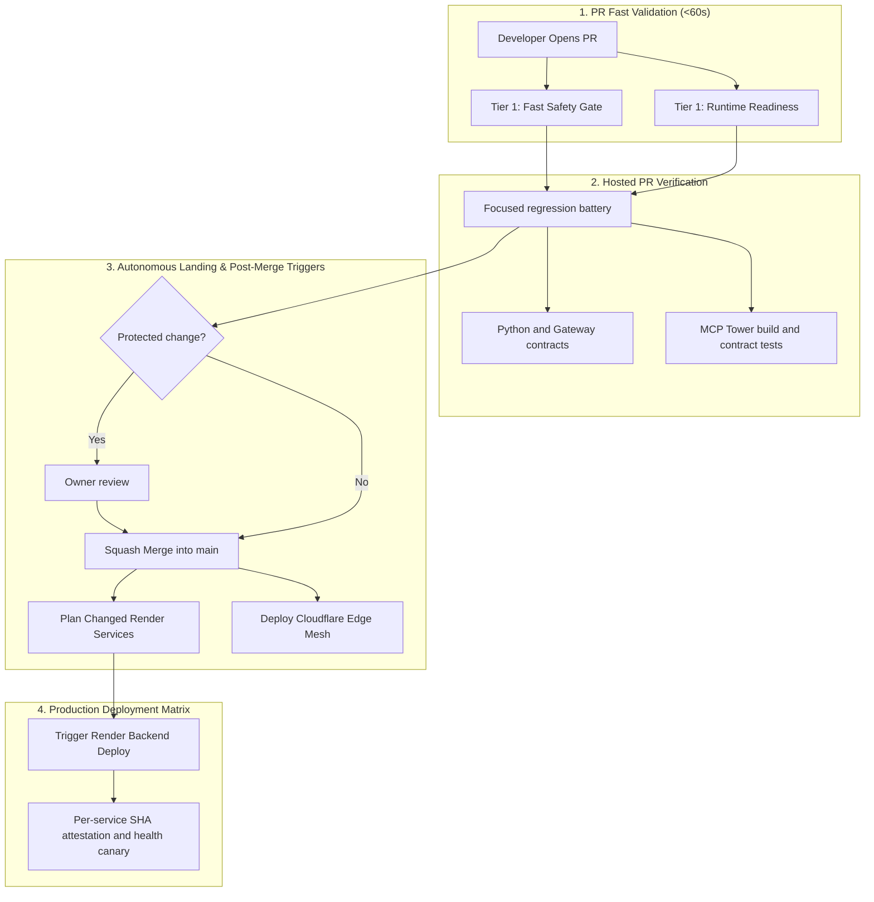
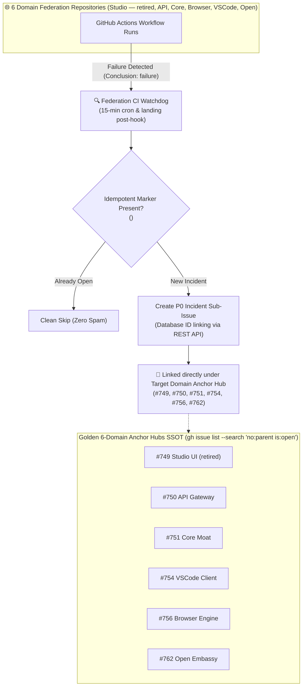

# SupremeAI — Single Door Monorepo SSOT

> **Our Motto:** *"We don't want to create a textbook-perfect model — we want to build a textbook example of how intelligently any problem and any free-tier or resource limitation can be overcome."*  
> **আমাদের মূলমন্ত্র:** *"আমরা শুধু বইয়ের পাতার নিখুঁত কোনো মডেল বানাতে চাই না — আমরা এমন কিছু তৈরি করতে চাই, যা হবে যেকোনো সমস্যা এবং ফ্রি-টিয়ার বা রিসোর্সের বিশাল সীমাবদ্ধতাকেও কতটা বুদ্ধিমত্তার সাথে জয় করা সম্ভব তার একটি পাঠ্যবইয়ের মতো উদাহরণ।"*

> **The Single Door Monorepo SSOT for the SupremeAI Federation.**  
> <!-- Fix (wiring audit 2026-11-11): docs/README.bn.md does not exist — dead link removed. -->

This repository (`Supremeai-bd/supremeai`) is the **Single Door Monorepo SSOT** for Core, Gateway, Browser relay, and the MCP Control Plane. The former `studio/` frontend is retired; `vscode/` is reference material, not a monorepo release target.

> [!IMPORTANT]
> ### 🤖 AI Agent & MCP Contributor Quickstart (Where & How to Work)
> If you are an external AI (Claude, Cursor, Antigravity, etc.) connecting via MCP Tower or GitHub:
> 1. **Single Door for Work:** All tasks, bug reports, and PRs live exclusively in **`Supremeai-bd/supremeai`**. Satellite repositories maintain a strict 0 Issues / 0 PRs policy. <!-- Fix (wiring audit 2026-11-11): docs/FEDERATION_CHARTER.md does not exist — dead link removed. -->
> 2. **Where to Write Code:** Edit the corresponding domain folders inside this repository (`core/`, `gateway/`, `browser/`, `infrastructure/`, or `scripts/`). See the ownership map below before adding a build or a deploy target.
> 3. **Autonomous Auto-Landing & Zero Cloud Waste:** Routine PRs can auto-merge after verification. Changes to protected release, authorization, or data boundaries require owner review ([`docs/PR_TO_PRODUCTION_LIFECYCLE.md`](./docs/PR_TO_PRODUCTION_LIFECYCLE.md)).
> 4. **Universal Runner Hierarchy:** PR code runs on hosted runners. The personal runner is reserved for trusted-main CI; Render CI is inactive without verified quota and runner evidence.
>
> **MCP Tower call conventions (avoid argument/format errors):**
> - Tool names are **wave-split** (2026-10-29/30 rename waves, #2493): the core github + bridge queue/order tools are **dotted** (`github.read_file`, `github.list_prs`, `github.workflow_runs`, `bridge.work_queue`, `bridge.work_order`) — their old snake_case forms are dead (-32602). The external-repo explorer family (`github_repo_tree`, `github_search_repos`, ...) and the claim/feedback family (`work_claim`, `bridge_read_feedback`, `bridge_work_renew`, `bridge_work_release`) stay **snake_case**. Never guess: probe `tools/list` first.
> - Repo references must be **`owner/repo`** (e.g. `Supremeai-bd/supremeai`); a bare repo name returns "Invalid repo reference". On repo-resolving list tools pass `repo` explicitly — the omit-repo default resolves through the account registry and has silently drifted before (R66/#2447); every response echoes the resolved target as `targetRepo`/`targetUrl`, so verify it.
> - Use the correct tool name + `owner/repo` form or the call fails.
> - Bridge tools: `bridge_submit_patch` requires `taskId` (`bridge-YYYYMMDD-<slug>`), `summary`, `scopePaths` (1-30), `testsEvidence`, and `files` (each with `path`); pass `originalIssueNumber` so the root issue auto-closes on merge, and `closesOriginalIssue: true` only when a docs-only payload **IS** the resolution of that issue (receipt-closure convention #2485, `contract.receiptClosureConvention` in `bridge_guide`; default keeps the WO open via `Refs #N`). `work_claim` requires `issueNumber` (integer). `bridge.work_order`/`bridge_read_feedback` require `number` (issue number).

## 📐 Architecture & Single Monorepo SSOT Topology

<!-- ARCHITECTURE_GAP_MAP:START -->
### 🗺️ Architecture Reality & Gap Map (generated from the import graph)

> **Modules:** `2191` | **Reachable from live entrypoints:** `1676` (76.5%) | **Unreachable:** `521`  
> **Service entrypoints:** `browser.main, core.main, core.services.brain.main, core.services.worker.main, gateway.service.app, scripts.runtime.infisical_bootstrap` | **Dispatcher entrypoints:** `6` (CI workflows + Makefile)  
> **Edges:** `5023` (dispatch: 194, dynamic: 4, import: 4137, string: 688)  
> _Generated by `scripts/ci/architecture_gap_guardian.py`. Recounted from every `import`, router-mount string and `importlib` call — no hand-maintained module list. Full data: `docs/generated/architecture_gap_map.json`._

```mermaid
flowchart TD
    %% SupremeAI Architecture Reality — derived from the import graph
    %% Auto-generated by scripts/ci/architecture_gap_guardian.py
    %% Deterministic: identical repo state produces identical bytes.
    classDef live fill:#1b4332,stroke:#40916c,stroke-width:2px,color:#d8f3dc;
    classDef floating fill:#7f4f24,stroke:#a68a64,stroke-width:2px,color:#ede0d4;
    classDef dead fill:#5c0002,stroke:#ba181b,stroke-width:2px,color:#ffccd5,stroke-dasharray: 5 5;

    subgraph LiveEntry [Live Entrypoints]
        @__github/workflows/codeql__yml["@.github/workflows/codeql.yml"]
        @__github/workflows/daily-key-health__yml["@.github/workflows/daily-key-health.yml"]
        @__github/workflows/deploy-rollback__yml["@.github/workflows/deploy-rollback.yml"]
        @__github/workflows/ops-maintenance__yml["@.github/workflows/ops-maintenance.yml"]
        @__github/workflows/unified-pipeline__yml["@.github/workflows/unified-pipeline.yml"]
        @Makefile["@Makefile"]
        browser__main["browser.main"]
        core__main["core.main"]
        core__services__brain__main["core.services.brain.main"]
        core__services__worker__main["core.services.worker.main"]
        gateway__service__app["gateway.service.app"]
        scripts__runtime__infisical_bootstrap["scripts.runtime.infisical_bootstrap"]
    end

    subgraph Subsystems [Reachable Subsystems (module counts)]
        @__github/workflows/codeql["@.github/workflows/codeql · 1 modules"]
        @__github/workflows/daily-key-health["@.github/workflows/daily-key-health · 1 modules"]
        @__github/workflows/deploy-rollback["@.github/workflows/deploy-rollback · 1 modules"]
        @__github/workflows/ops-maintenance["@.github/workflows/ops-maintenance · 1 modules"]
        @__github/workflows/unified-pipeline["@.github/workflows/unified-pipeline · 1 modules"]
        @Makefile["@Makefile · 1 modules"]
        browser__action_cascade["browser.action_cascade · 1 modules"]
        browser__autonomous_browser["browser.autonomous_browser · 1 modules"]
        browser__browser_agent["browser.browser_agent · 1 modules"]
        browser__browser_session["browser.browser_session · 1 modules"]
        browser__browsing_memory["browser.browsing_memory · 1 modules"]
        browser__ghost_tower["browser.ghost_tower · 1 modules"]
        browser__main["browser.main · 1 modules"]
        browser__request_models["browser.request_models · 1 modules"]
        browser__runtime["browser.runtime · 1 modules"]
        browser__security["browser.security · 1 modules"]
        browser__semantic_dom["browser.semantic_dom · 1 modules"]
        browser__server["browser.server · 1 modules"]
        browser__session_manager["browser.session_manager · 1 modules"]
        browser__surface_controls["browser.surface_controls · 1 modules"]
        browser__swarm_browser["browser.swarm_browser · 1 modules"]
        browser__url_policy["browser.url_policy · 1 modules"]
        browser__vision_grounding["browser.vision_grounding · 1 modules"]
        browser__web_scraper["browser.web_scraper · 1 modules"]
        core["core · 1 modules"]
        core___monitoring_legacy["core._monitoring_legacy · 1 modules"]
        core__accessibility["core.accessibility · 1 modules"]
        core__action_policy["core.action_policy · 1 modules"]
        core__adaptive_engine["core.adaptive_engine · 20 modules"]
        core__adaptive_optimizer["core.adaptive_optimizer · 1 modules"]
        core__admin["core.admin · 1 modules"]
        core__admin_god["core.admin_god · 1 modules"]
        core__advanced_reasoning["core.advanced_reasoning · 1 modules"]
        core__agent_chat_loop["core.agent_chat_loop · 1 modules"]
        core__agent_factory["core.agent_factory · 1 modules"]
        core__agent_heartbeat["core.agent_heartbeat · 1 modules"]
        core__agent_mailbox["core.agent_mailbox · 1 modules"]
        core__agent_registry["core.agent_registry · 1 modules"]
        core__agent_review_workflow["core.agent_review_workflow · 1 modules"]
        core__agent_supervisor["core.agent_supervisor · 1 modules"]
        core__agent_tool_policy["core.agent_tool_policy · 1 modules"]
        core__agent_tool_specs["core.agent_tool_specs · 1 modules"]
        core__agents["core.agents · 61 modules"]
        core__ai_memory["core.ai_memory · 4 modules"]
        core__alembic_migrations["core.alembic_migrations · 40 modules"]
        core__analyze_coverage["core.analyze_coverage · 1 modules"]
        core__api["core.api · 219 modules"]
        core__app["core.app · 1 modules"]
        core__app_builder["core.app_builder · 1 modules"]
        core__ast_security_scanner["core.ast_security_scanner · 1 modules"]
        core__automation["core.automation · 7 modules"]
        core__autonoguard_engine["core.autonoguard_engine · 1 modules"]
        core__base["core.base · 1 modules"]
        core__brain["core.brain · 19 modules"]
        core__browser_compat_store["core.browser_compat_store · 1 modules"]
        core__browser_session_catalog["core.browser_session_catalog · 1 modules"]
        core__browser_session_manager["core.browser_session_manager · 1 modules"]
        core__browser_session_vault["core.browser_session_vault · 1 modules"]
        core__byoc["core.byoc · 3 modules"]
        core__cache["core.cache · 8 modules"]
        core__capability_activation["core.capability_activation · 1 modules"]
        core__capability_discovery["core.capability_discovery · 1 modules"]
        core__capability_gateway["core.capability_gateway · 1 modules"]
        core__circles["core.circles · 23 modules"]
        core__client["core.client · 2 modules"]
        core__clients["core.clients · 2 modules"]
        core__code_indexer["core.code_indexer · 1 modules"]
        core__code_validator["core.code_validator · 1 modules"]
        core__competitive_kit["core.competitive_kit · 1 modules"]
        core__config["core.config · 1 modules"]
        core__config_cache["core.config_cache · 1 modules"]
        core__config_classification["core.config_classification · 1 modules"]
        core__config_control_plane["core.config_control_plane · 1 modules"]
        core__config_fields["core.config_fields · 1 modules"]
        core__config_parsers["core.config_parsers · 1 modules"]
        core__config_proxy["core.config_proxy · 1 modules"]
        core__config_registry["core.config_registry · 1 modules"]
        core__config_validation["core.config_validation · 1 modules"]
        core__config_validator["core.config_validator · 1 modules"]
        core__connection_registry["core.connection_registry · 1 modules"]
        core__constants["core.constants · 1 modules"]
        core__container_auditor["core.container_auditor · 1 modules"]
        core__context_engine["core.context_engine · 3 modules"]
        core__context_synthesizer["core.context_synthesizer · 1 modules"]
        core__contracts["core.contracts · 13 modules"]
        core__cost_guard["core.cost_guard · 1 modules"]
        core__dag_planner["core.dag_planner · 1 modules"]
        core__database["core.database · 9 modules"]
        core__db["core.db · 1 modules"]
        core__db_schema_gate["core.db_schema_gate · 1 modules"]
        core__db_ssl["core.db_ssl · 1 modules"]
        core__decision_engine["core.decision_engine · 1 modules"]
        core__degraded_mode["core.degraded_mode · 1 modules"]
        core__deployment["core.deployment · 1 modules"]
        core__deployment_fallback_defaults["core.deployment_fallback_defaults · 1 modules"]
        core__docs["core.docs · 1 modules"]
        core__ecosystem["core.ecosystem · 8 modules"]
        core__ecosystem_scout["core.ecosystem_scout · 4 modules"]
        core__effective_policy["core.effective_policy · 1 modules"]
        core__embeddings["core.embeddings · 1 modules"]
        core__engine["core.engine · 13 modules"]
        core__enum_guard["core.enum_guard · 1 modules"]
        core__errors["core.errors · 5 modules"]
        core__evaluation["core.evaluation · 14 modules"]
        core__evolution["core.evolution · 14 modules"]
        core__evolution_module["core.evolution_module · 1 modules"]
        core__examples["core.examples · 1 modules"]
        core__exceptions["core.exceptions · 1 modules"]
        core__execution_adapters["core.execution_adapters · 1 modules"]
        core__execution_policy["core.execution_policy · 1 modules"]
        core__external_agents["core.external_agents · 16 modules"]
        core__factory["core.factory · 1 modules"]
        core__factual_verifier["core.factual_verifier · 1 modules"]
        core__failure_fingerprint["core.failure_fingerprint · 1 modules"]
        core__feature_flags["core.feature_flags · 1 modules"]
        core__feedback_loop["core.feedback_loop · 1 modules"]
        core__firebase_auth["core.firebase_auth · 1 modules"]
        core__generation_monitor["core.generation_monitor · 1 modules"]
        core__github["core.github · 12 modules"]
        core__governance["core.governance · 5 modules"]
        core__health["core.health · 7 modules"]
        core__health_check["core.health_check · 1 modules"]
        core__health_policy["core.health_policy · 1 modules"]
        core__health_routes["core.health_routes · 1 modules"]
        core__http_client["core.http_client · 1 modules"]
        core__human_behavior["core.human_behavior · 1 modules"]
        core__i18n["core.i18n · 3 modules"]
        core__immune_system["core.immune_system · 1 modules"]
        core__in_process_dispatcher["core.in_process_dispatcher · 1 modules"]
        core__integration_layer["core.integration_layer · 1 modules"]
        core__integrations["core.integrations · 12 modules"]
        core__intelligence["core.intelligence · 10 modules"]
        core__intelligent_cache["core.intelligent_cache · 1 modules"]
        core__intelligent_cache_bridge["core.intelligent_cache_bridge · 1 modules"]
        core__intelligent_silent_catcher["core.intelligent_silent_catcher · 1 modules"]
        core__intent["core.intent · 1 modules"]
        core__intent_router["core.intent_router · 1 modules"]
        core__intent_router_v2["core.intent_router_v2 · 1 modules"]
        core__ip_blocklist_manager["core.ip_blocklist_manager · 1 modules"]
        core__kaggle_orchestrator["core.kaggle_orchestrator · 1 modules"]
        core__kernel["core.kernel · 5 modules"]
        core__knowledge_base["core.knowledge_base · 1 modules"]
        core__knowledge_contract["core.knowledge_contract · 1 modules"]
        core__knowledge_facade["core.knowledge_facade · 1 modules"]
        core__language_router["core.language_router · 1 modules"]
        core__ld_client["core.ld_client · 1 modules"]
        core__learning["core.learning · 18 modules"]
        core__lifespan["core.lifespan · 1 modules"]
        core__llm["core.llm · 27 modules"]
        core__localization["core.localization · 3 modules"]
        core__logging_config["core.logging_config · 1 modules"]
        core__main["core.main · 1 modules"]
        core__maintenance_pipeline["core.maintenance_pipeline · 1 modules"]
        core__markdown_indexer["core.markdown_indexer · 1 modules"]
        core__marketplace_registry_sync["core.marketplace_registry_sync · 1 modules"]
        core__mcp_adapters["core.mcp_adapters · 3 modules"]
        core__mcp_allowlist["core.mcp_allowlist · 1 modules"]
        core__mcp_audit["core.mcp_audit · 1 modules"]
        core__mcp_client["core.mcp_client · 1 modules"]
        core__mcp_policy["core.mcp_policy · 1 modules"]
        core__mcp_policy_schema_generated["core.mcp_policy_schema_generated · 1 modules"]
        core__memory["core.memory · 12 modules"]
        core__memory_manager["core.memory_manager · 1 modules"]
        core__messaging["core.messaging · 11 modules"]
        core__microvm_sandbox["core.microvm_sandbox · 1 modules"]
        core__middleware["core.middleware · 12 modules"]
        core__missions["core.missions · 5 modules"]
        core__models["core.models · 44 modules"]
        core__monitoring["core.monitoring · 7 modules"]
        core__multi_platform_orchestrator["core.multi_platform_orchestrator · 1 modules"]
        core__natural_file_presenter["core.natural_file_presenter · 1 modules"]
        core__neon_repository["core.neon_repository · 1 modules"]
        core__observability["core.observability · 12 modules"]
        core__optimization["core.optimization · 4 modules"]
        core__orchestration["core.orchestration · 13 modules"]
        core__otp_router["core.otp_router · 1 modules"]
        core__output_validator["core.output_validator · 1 modules"]
        core__p2p["core.p2p · 2 modules"]
        core__performance_enhancer["core.performance_enhancer · 1 modules"]
        core__persistence["core.persistence · 3 modules"]
        core__pipelines["core.pipelines · 2 modules"]
        core__playwright_manager["core.playwright_manager · 1 modules"]
        core__plugins["core.plugins · 23 modules"]
        core__presence_registry["core.presence_registry · 1 modules"]
        core__prompt_enhancement_engine["core.prompt_enhancement_engine · 1 modules"]
        core__prompt_handler["core.prompt_handler · 1 modules"]
        core__provider_rate_limiter["core.provider_rate_limiter · 1 modules"]
        core__providers["core.providers · 4 modules"]
        core__pyerrorfix["core.pyerrorfix · 35 modules"]
        core__rag["core.rag · 3 modules"]
        core__rate_limit["core.rate_limit · 1 modules"]
        core__rate_limit_quota["core.rate_limit_quota · 1 modules"]
        core__reliability_controller["core.reliability_controller · 1 modules"]
        core__repo_manager["core.repo_manager · 1 modules"]
        core__request_context["core.request_context · 1 modules"]
        core__resilience["core.resilience · 8 modules"]
        core__retry_budget["core.retry_budget · 1 modules"]
        core__retry_handler["core.retry_handler · 1 modules"]
        core__routing["core.routing · 1 modules"]
        core__rules_mutator["core.rules_mutator · 1 modules"]
        core__runner["core.runner · 1 modules"]
        core__runs["core.runs · 12 modules"]
        core__runtime["core.runtime · 7 modules"]
        core__sandbox["core.sandbox · 7 modules"]
        core__scaling["core.scaling · 1 modules"]
        core__scheduled_task_sweep["core.scheduled_task_sweep · 1 modules"]
        core__schema_exporter["core.schema_exporter · 1 modules"]
        core__schema_validator["core.schema_validator · 1 modules"]
        core__schemas["core.schemas · 2 modules"]
        core__scout["core.scout · 11 modules"]
        core__scripts["core.scripts · 16 modules"]
        core__search["core.search · 1 modules"]
        core__secret_policy["core.secret_policy · 1 modules"]
        core__secret_utils["core.secret_utils · 1 modules"]
        core__security["core.security · 34 modules"]
        core__self_benchmark["core.self_benchmark · 1 modules"]
        core__self_evolution["core.self_evolution · 19 modules"]
        core__selfcheck["core.selfcheck · 1 modules"]
        core__sentinel_agent["core.sentinel_agent · 1 modules"]
        core__service_container["core.service_container · 1 modules"]
        core__service_registry["core.service_registry · 1 modules"]
        core__services["core.services · 48 modules"]
        core__shutdown["core.shutdown · 1 modules"]
        core__skill_manager["core.skill_manager · 1 modules"]
        core__skills["core.skills · 21 modules"]
        core__social_growth["core.social_growth · 1 modules"]
        core__startup["core.startup · 5 modules"]
        core__startup_validator["core.startup_validator · 1 modules"]
        core__state_machine["core.state_machine · 1 modules"]
        core__state_store["core.state_store · 1 modules"]
        core__storage["core.storage · 6 modules"]
        core__swarm_pubsub["core.swarm_pubsub · 1 modules"]
        core__target_registry["core.target_registry · 1 modules"]
        core__task_contract["core.task_contract · 1 modules"]
        core__task_policy["core.task_policy · 1 modules"]
        core__task_queue["core.task_queue · 3 modules"]
        core__task_router["core.task_router · 1 modules"]
        core__telemetry["core.telemetry · 2 modules"]
        core__testing["core.testing · 1 modules"]
        core__tier8["core.tier8 · 6 modules"]
        core__tool_loop["core.tool_loop · 1 modules"]
        core__tools["core.tools · 200 modules"]
        core__type_sync_bus["core.type_sync_bus · 1 modules"]
        core__unified_memory["core.unified_memory · 1 modules"]
        core__universal_rules["core.universal_rules · 1 modules"]
        core__upload_validator["core.upload_validator · 1 modules"]
        core__url_policy["core.url_policy · 1 modules"]
        core__user_profiler["core.user_profiler · 1 modules"]
        core__utils["core.utils · 16 modules"]
        core__verification["core.verification · 1 modules"]
        core__version["core.version · 1 modules"]
        core__web_ai_session_bridge["core.web_ai_session_bridge · 1 modules"]
        core__worker["core.worker · 1 modules"]
        core__worker_service["core.worker_service · 1 modules"]
        core__workers["core.workers · 4 modules"]
        core__ws["core.ws · 1 modules"]
        core__zero_cost_architecture["core.zero_cost_architecture · 3 modules"]
        gateway["gateway · 1 modules"]
        gateway__admin_auth["gateway.admin_auth · 1 modules"]
        gateway__circuit_breaker["gateway.circuit_breaker · 1 modules"]
        gateway__config["gateway.config · 1 modules"]
        gateway__dual_pool_priority_router["gateway.dual_pool_priority_router · 1 modules"]
        gateway__frontend_compat["gateway.frontend_compat · 1 modules"]
        gateway__main["gateway.main · 1 modules"]
        gateway__memory["gateway.memory · 1 modules"]
        gateway__memory_gate["gateway.memory_gate · 1 modules"]
        gateway__metrics_exporter["gateway.metrics_exporter · 1 modules"]
        gateway__middleware["gateway.middleware · 4 modules"]
        gateway__model_horizon["gateway.model_horizon · 1 modules"]
        gateway__prompt_injection["gateway.prompt_injection · 1 modules"]
        gateway__provider_chain["gateway.provider_chain · 1 modules"]
        gateway__rate_limit["gateway.rate_limit · 1 modules"]
        gateway__routes["gateway.routes · 1 modules"]
        gateway__sanitization["gateway.sanitization · 1 modules"]
        gateway__service["gateway.service · 31 modules"]
        gateway__stealth_webhook["gateway.stealth_webhook · 1 modules"]
        gateway__tool_pruner["gateway.tool_pruner · 1 modules"]
        scripts__advanced_analysis["scripts.advanced_analysis · 8 modules"]
        scripts__agents["scripts.agents · 13 modules"]
        scripts__ci["scripts.ci · 147 modules"]
        scripts__db["scripts.db · 1 modules"]
        scripts__devops["scripts.devops · 1 modules"]
        scripts__lib["scripts.lib · 2 modules"]
        scripts__maintenance["scripts.maintenance · 1 modules"]
        scripts__ops["scripts.ops · 8 modules"]
        scripts__orchestrator["scripts.orchestrator · 1 modules"]
        scripts__quality["scripts.quality · 1 modules"]
        scripts__runtime["scripts.runtime · 1 modules"]
        scripts__security["scripts.security · 2 modules"]
        scripts__testing["scripts.testing · 2 modules"]
        scripts__validate_schemas["scripts.validate_schemas · 1 modules"]
        skills["skills · 1 modules"]
        skills__dynamic["skills.dynamic · 3 modules"]
        skills__installer["skills.installer · 1 modules"]
        skills__marketplace["skills.marketplace · 1 modules"]
        skills__registry["skills.registry · 4 modules"]
        skills__sandbox["skills.sandbox · 1 modules"]
        skills__schema["skills.schema · 1 modules"]
    end

    @__github/workflows/codeql__yml --> @__github/workflows/codeql
    @__github/workflows/daily-key-health__yml --> @__github/workflows/daily-key-health
    @__github/workflows/deploy-rollback__yml --> @__github/workflows/deploy-rollback
    @__github/workflows/ops-maintenance__yml --> @__github/workflows/ops-maintenance
    @__github/workflows/unified-pipeline__yml --> @__github/workflows/unified-pipeline
    @Makefile --> @Makefile
    browser__main --> browser__main
    core__main --> core__main
    core__services__brain__main --> core__services
    core__services__worker__main --> core__services
    gateway__service__app --> gateway__service
    scripts__runtime__infisical_bootstrap --> scripts__runtime

    subgraph Unreachable [Unreachable from LIVE entrypoints]
        browser__browser_session_manager["browser.browser_session_manager"]
        browser__gateway["browser.gateway"]
        browser__gateway__prompt_injection["browser.gateway.prompt_injection"]
        browser__ghost_tower["browser.ghost_tower"]
        browser__ghost_tower__auto_login["browser.ghost_tower.auto_login"]
        browser__ghost_tower__browser_auth["browser.ghost_tower.browser_auth"]
        browser__ghost_tower__check_cookies_status["browser.ghost_tower.check_cookies_status"]
        browser__ghost_tower__check_status["browser.ghost_tower.check_status"]
        browser__ghost_tower__cookie_sync_scheduler["browser.ghost_tower.cookie_sync_scheduler"]
        browser__ghost_tower__gemini_web_engine["browser.ghost_tower.gemini_web_engine"]
        browser__ghost_tower__ghost_bridge_server["browser.ghost_tower.ghost_bridge_server"]
        browser__ghost_tower__launch_manual_login["browser.ghost_tower.launch_manual_login"]
        browser__ghost_tower__login_helper["browser.ghost_tower.login_helper"]
        browser__ghost_tower__multi_ai_sso_runner["browser.ghost_tower.multi_ai_sso_runner"]
        browser__ghost_tower__stealth_browser_engine["browser.ghost_tower.stealth_browser_engine"]
        browser__ghost_tower__stealth_browser_engine__config["browser.ghost_tower.stealth_browser_engine.config"]
        browser__ghost_tower__stealth_browser_engine__content_pruner["browser.ghost_tower.stealth_browser_engine.content_pruner"]
        browser__ghost_tower__stealth_browser_engine__cookie_bridge["browser.ghost_tower.stealth_browser_engine.cookie_bridge"]
        browser__ghost_tower__stealth_browser_engine__infinite_scanner["browser.ghost_tower.stealth_browser_engine.infinite_scanner"]
        browser__ghost_tower__stealth_browser_engine__semantic_extractor["browser.ghost_tower.stealth_browser_engine.semantic_extractor"]
        browser__ghost_tower__stealth_browser_engine__session_manager["browser.ghost_tower.stealth_browser_engine.session_manager"]
        browser__ghost_tower__stealth_browser_engine__stealth_profile["browser.ghost_tower.stealth_browser_engine.stealth_profile"]
        browser__ghost_tower__sync_cookies_to_infisical["browser.ghost_tower.sync_cookies_to_infisical"]
        browser__playwright_manager["browser.playwright_manager"]
        browser__routes["browser.routes"]
        browser__routes___cognitive["browser.routes._cognitive"]
        browser__routes___crown_jewel["browser.routes._crown_jewel"]
        browser__routes___health["browser.routes._health"]
        browser__routes___render_proxy["browser.routes._render_proxy"]
        browser__routes___scraping["browser.routes._scraping"]
        browser__routes___session_store["browser.routes._session_store"]
        browser__runtime["browser.runtime"]
        browser__runtime__config["browser.runtime.config"]
        browser__runtime__content_pruner["browser.runtime.content_pruner"]
        browser__runtime__cookie_bridge["browser.runtime.cookie_bridge"]
        browser__runtime__infinite_scanner["browser.runtime.infinite_scanner"]
        browser__runtime__injection_canaries["browser.runtime.injection_canaries"]
        browser__runtime__semantic_extractor["browser.runtime.semantic_extractor"]
        browser__runtime__session_manager["browser.runtime.session_manager"]
        browser__runtime__stealth_profile["browser.runtime.stealth_profile"]
        _more["… 481 more (see JSON)"]
    end

    class @__github/workflows/codeql__yml live;
    class @__github/workflows/daily-key-health__yml live;
    class @__github/workflows/deploy-rollback__yml live;
    class @__github/workflows/ops-maintenance__yml live;
    class @__github/workflows/unified-pipeline__yml live;
    class @Makefile live;
    class browser__main live;
    class core__main live;
    class core__services__brain__main live;
    class core__services__worker__main live;
    class gateway__service__app live;
    class scripts__runtime__infisical_bootstrap live;
    class @__github/workflows/codeql live;
    class @__github/workflows/daily-key-health live;
    class @__github/workflows/deploy-rollback live;
    class @__github/workflows/ops-maintenance live;
    class @__github/workflows/unified-pipeline live;
    class @Makefile live;
    class browser__action_cascade live;
    class browser__autonomous_browser live;
    class browser__browser_agent live;
    class browser__browser_session live;
    class browser__browsing_memory live;
    class browser__ghost_tower live;
    class browser__main live;
    class browser__request_models live;
    class browser__runtime live;
    class browser__security live;
    class browser__semantic_dom live;
    class browser__server live;
    class browser__session_manager live;
    class browser__surface_controls live;
    class browser__swarm_browser live;
    class browser__url_policy live;
    class browser__vision_grounding live;
    class browser__web_scraper live;
    class core live;
    class core___monitoring_legacy live;
    class core__accessibility live;
    class core__action_policy live;
    class core__adaptive_engine live;
    class core__adaptive_optimizer live;
    class core__admin live;
    class core__admin_god live;
    class core__advanced_reasoning live;
    class core__agent_chat_loop live;
    class core__agent_factory live;
    class core__agent_heartbeat live;
    class core__agent_mailbox live;
    class core__agent_registry live;
    class core__agent_review_workflow live;
    class core__agent_supervisor live;
    class core__agent_tool_policy live;
    class core__agent_tool_specs live;
    class core__agents live;
    class core__ai_memory live;
    class core__alembic_migrations live;
    class core__analyze_coverage live;
    class core__api live;
    class core__app live;
    class core__app_builder live;
    class core__ast_security_scanner live;
    class core__automation live;
    class core__autonoguard_engine live;
    class core__base live;
    class core__brain live;
    class core__browser_compat_store live;
    class core__browser_session_catalog live;
    class core__browser_session_manager live;
    class core__browser_session_vault live;
    class core__byoc live;
    class core__cache live;
    class core__capability_activation live;
    class core__capability_discovery live;
    class core__capability_gateway live;
    class core__circles live;
    class core__client live;
    class core__clients live;
    class core__code_indexer live;
    class core__code_validator live;
    class core__competitive_kit live;
    class core__config live;
    class core__config_cache live;
    class core__config_classification live;
    class core__config_control_plane live;
    class core__config_fields live;
    class core__config_parsers live;
    class core__config_proxy live;
    class core__config_registry live;
    class core__config_validation live;
    class core__config_validator live;
    class core__connection_registry live;
    class core__constants live;
    class core__container_auditor live;
    class core__context_engine live;
    class core__context_synthesizer live;
    class core__contracts live;
    class core__cost_guard live;
    class core__dag_planner live;
    class core__database live;
    class core__db live;
    class core__db_schema_gate live;
    class core__db_ssl live;
    class core__decision_engine live;
    class core__degraded_mode live;
    class core__deployment live;
    class core__deployment_fallback_defaults live;
    class core__docs live;
    class core__ecosystem live;
    class core__ecosystem_scout live;
    class core__effective_policy live;
    class core__embeddings live;
    class core__engine live;
    class core__enum_guard live;
    class core__errors live;
    class core__evaluation live;
    class core__evolution live;
    class core__evolution_module live;
    class core__examples live;
    class core__exceptions live;
    class core__execution_adapters live;
    class core__execution_policy live;
    class core__external_agents live;
    class core__factory live;
    class core__factual_verifier live;
    class core__failure_fingerprint live;
    class core__feature_flags live;
    class core__feedback_loop live;
    class core__firebase_auth live;
    class core__generation_monitor live;
    class core__github live;
    class core__governance live;
    class core__health live;
    class core__health_check live;
    class core__health_policy live;
    class core__health_routes live;
    class core__http_client live;
    class core__human_behavior live;
    class core__i18n live;
    class core__immune_system live;
    class core__in_process_dispatcher live;
    class core__integration_layer live;
    class core__integrations live;
    class core__intelligence live;
    class core__intelligent_cache live;
    class core__intelligent_cache_bridge live;
    class core__intelligent_silent_catcher live;
    class core__intent live;
    class core__intent_router live;
    class core__intent_router_v2 live;
    class core__ip_blocklist_manager live;
    class core__kaggle_orchestrator live;
    class core__kernel live;
    class core__knowledge_base live;
    class core__knowledge_contract live;
    class core__knowledge_facade live;
    class core__language_router live;
    class core__ld_client live;
    class core__learning live;
    class core__lifespan live;
    class core__llm live;
    class core__localization live;
    class core__logging_config live;
    class core__main live;
    class core__maintenance_pipeline live;
    class core__markdown_indexer live;
    class core__marketplace_registry_sync live;
    class core__mcp_adapters live;
    class core__mcp_allowlist live;
    class core__mcp_audit live;
    class core__mcp_client live;
    class core__mcp_policy live;
    class core__mcp_policy_schema_generated live;
    class core__memory live;
    class core__memory_manager live;
    class core__messaging live;
    class core__microvm_sandbox live;
    class core__middleware live;
    class core__missions live;
    class core__models live;
    class core__monitoring live;
    class core__multi_platform_orchestrator live;
    class core__natural_file_presenter live;
    class core__neon_repository live;
    class core__observability live;
    class core__optimization live;
    class core__orchestration live;
    class core__otp_router live;
    class core__output_validator live;
    class core__p2p live;
    class core__performance_enhancer live;
    class core__persistence live;
    class core__pipelines live;
    class core__playwright_manager live;
    class core__plugins live;
    class core__presence_registry live;
    class core__prompt_enhancement_engine live;
    class core__prompt_handler live;
    class core__provider_rate_limiter live;
    class core__providers live;
    class core__pyerrorfix live;
    class core__rag live;
    class core__rate_limit live;
    class core__rate_limit_quota live;
    class core__reliability_controller live;
    class core__repo_manager live;
    class core__request_context live;
    class core__resilience live;
    class core__retry_budget live;
    class core__retry_handler live;
    class core__routing live;
    class core__rules_mutator live;
    class core__runner live;
    class core__runs live;
    class core__runtime live;
    class core__sandbox live;
    class core__scaling live;
    class core__scheduled_task_sweep live;
    class core__schema_exporter live;
    class core__schema_validator live;
    class core__schemas live;
    class core__scout live;
    class core__scripts live;
    class core__search live;
    class core__secret_policy live;
    class core__secret_utils live;
    class core__security live;
    class core__self_benchmark live;
    class core__self_evolution live;
    class core__selfcheck live;
    class core__sentinel_agent live;
    class core__service_container live;
    class core__service_registry live;
    class core__services live;
    class core__shutdown live;
    class core__skill_manager live;
    class core__skills live;
    class core__social_growth live;
    class core__startup live;
    class core__startup_validator live;
    class core__state_machine live;
    class core__state_store live;
    class core__storage live;
    class core__swarm_pubsub live;
    class core__target_registry live;
    class core__task_contract live;
    class core__task_policy live;
    class core__task_queue live;
    class core__task_router live;
    class core__telemetry live;
    class core__testing live;
    class core__tier8 live;
    class core__tool_loop live;
    class core__tools live;
    class core__type_sync_bus live;
    class core__unified_memory live;
    class core__universal_rules live;
    class core__upload_validator live;
    class core__url_policy live;
    class core__user_profiler live;
    class core__utils live;
    class core__verification live;
    class core__version live;
    class core__web_ai_session_bridge live;
    class core__worker live;
    class core__worker_service live;
    class core__workers live;
    class core__ws live;
    class core__zero_cost_architecture live;
    class gateway live;
    class gateway__admin_auth live;
    class gateway__circuit_breaker live;
    class gateway__config live;
    class gateway__dual_pool_priority_router live;
    class gateway__frontend_compat live;
    class gateway__main live;
    class gateway__memory live;
    class gateway__memory_gate live;
    class gateway__metrics_exporter live;
    class gateway__middleware live;
    class gateway__model_horizon live;
    class gateway__prompt_injection live;
    class gateway__provider_chain live;
    class gateway__rate_limit live;
    class gateway__routes live;
    class gateway__sanitization live;
    class gateway__service live;
    class gateway__stealth_webhook live;
    class gateway__tool_pruner live;
    class scripts__advanced_analysis live;
    class scripts__agents live;
    class scripts__ci live;
    class scripts__db live;
    class scripts__devops live;
    class scripts__lib live;
    class scripts__maintenance live;
    class scripts__ops live;
    class scripts__orchestrator live;
    class scripts__quality live;
    class scripts__runtime live;
    class scripts__security live;
    class scripts__testing live;
    class scripts__validate_schemas live;
    class skills live;
    class skills__dynamic live;
    class skills__installer live;
    class skills__marketplace live;
    class skills__registry live;
    class skills__sandbox live;
    class skills__schema live;
    class browser__browser_session_manager dead;
    class browser__gateway dead;
    class browser__gateway__prompt_injection dead;
    class browser__ghost_tower dead;
    class browser__ghost_tower__auto_login dead;
    class browser__ghost_tower__browser_auth dead;
    class browser__ghost_tower__check_cookies_status dead;
    class browser__ghost_tower__check_status dead;
    class browser__ghost_tower__cookie_sync_scheduler dead;
    class browser__ghost_tower__gemini_web_engine dead;
    class browser__ghost_tower__ghost_bridge_server dead;
    class browser__ghost_tower__launch_manual_login dead;
    class browser__ghost_tower__login_helper dead;
    class browser__ghost_tower__multi_ai_sso_runner dead;
    class browser__ghost_tower__stealth_browser_engine dead;
    class browser__ghost_tower__stealth_browser_engine__config dead;
    class browser__ghost_tower__stealth_browser_engine__content_pruner dead;
    class browser__ghost_tower__stealth_browser_engine__cookie_bridge dead;
    class browser__ghost_tower__stealth_browser_engine__infinite_scanner dead;
    class browser__ghost_tower__stealth_browser_engine__semantic_extractor dead;
    class browser__ghost_tower__stealth_browser_engine__session_manager dead;
    class browser__ghost_tower__stealth_browser_engine__stealth_profile dead;
    class browser__ghost_tower__sync_cookies_to_infisical dead;
    class browser__playwright_manager dead;
    class browser__routes dead;
    class browser__routes___cognitive dead;
    class browser__routes___crown_jewel dead;
    class browser__routes___health dead;
    class browser__routes___render_proxy dead;
    class browser__routes___scraping dead;
    class browser__routes___session_store dead;
    class browser__runtime dead;
    class browser__runtime__config dead;
    class browser__runtime__content_pruner dead;
    class browser__runtime__cookie_bridge dead;
    class browser__runtime__infinite_scanner dead;
    class browser__runtime__injection_canaries dead;
    class browser__runtime__semantic_extractor dead;
    class browser__runtime__session_manager dead;
    class browser__runtime__stealth_profile dead;
    class _more dead;
```
<!-- ARCHITECTURE_GAP_MAP:END -->

| Owner / source | Status in this repository |
|---|---|
| `core/`, `gateway/`, `browser/`, `infrastructure/mcp-control-plane/` | Active service source. [Service registry](config/service_registry.yaml) owns the Render deploy roles and watch paths. Browser's production build is a relay, not a full browse/scrape product. |
| `infrastructure/`, `scripts/`, `.github/` | Edge services, operations and CI/CD. The Render CI runner is auxiliary, not a production runtime. |
| `vscode/` | Reference and examples only; this checkout has no extension or desktop release source. No root client-release workflow. |
| Former `studio/`, and historical satellite copies | Retired from this monorepo's release path. Do not infer an active release from an old diagram, mirror, or URL. |

### PR-to-production lifecycle

For complete end-to-end documentation of our deterministic multi-tier gates, automated landing, federation sync, and edge deployment, see [`docs/PR_TO_PRODUCTION_LIFECYCLE.md`](docs/PR_TO_PRODUCTION_LIFECYCLE.md).




---

### Historical federation integrations

The older federation map below records integrations, not current release ownership.



> Consuming the platform (not contributing)? Start at
> [`docs/CONSUMERS.md`](https://github.com/Supremeai-bd/supremeai/blob/main/docs/CONSUMERS.md) and the
> [`api-schemas/gateway.openapi.yaml`](./api-schemas/gateway.openapi.yaml)
> Gateway surface. Contributing? [`AGENTS.md`](./AGENTS.md) and
> [`docs/ZERO_ADMIN_GUIDE.md`](https://github.com/Supremeai-bd/supremeai/blob/main/docs/ZERO_ADMIN_GUIDE.md) are the entry points.

### Production endpoint configuration

| Service | Live URL | Description |
|---|---|---|
| **MCP Control Tower** | Configured `RENDER_MCP_URL` | Remote `/mcp` and `/sse`. Releases use the exact configured Paykari service ID and resolve its direct URL from Render. |
| **API Gateway** | [`https://supremeai-api-ulw0.onrender.com`](https://supremeai-api-ulw0.onrender.com) | Unified OpenAI-compatible multi-LLM provider gateway |

| Path | What it is |
|---|---|
| `api-schemas/gateway.openapi.yaml` | **The stable SupremeAI API Gateway surface** (OpenAI-compatible `/v1/chat/completions`) — byte-mirror of `supremeai-api/contracts/openapi.yaml` |
| `examples/gateway_client.py` | Zero-dependency Python client for the Gateway (typed errors, retry only on 502/503) — byte-mirror of `supremeai-api/scripts/clients/gateway_client.py` |
| `docs/CONSUMERS.md` | Consumer registry: known internal/external API consumers, endpoint patterns, auth methods, and signature-verified webhook endpoints |
| `ECOSYSTEM_MAP.md` | **The Federation Ecosystem Map** — architecture directory for agents working across repos |
| [`docs/FEDERATION_TAXONOMY_AND_LICENSING.md`](https://github.com/Supremeai-bd/supremeai/blob/main/docs/FEDERATION_TAXONOMY_AND_LICENSING.md) | **Federation Taxonomy & Licensing SSOT** — 12 domain satellites, institutional memory, and the master umbrella model |
| [`docs/AGENT_PORTAL_SPEC.md`](https://github.com/Supremeai-bd/supremeai/blob/main/docs/AGENT_PORTAL_SPEC.md) | **Agent Portal & Federation Bridge architecture spec** (#23): two-repo relationship, the 3 submission pathways mapped to machinery, guard/gate/router map, clickable contract-schema references |
| [`docs/FAQ.md`](https://github.com/Supremeai-bd/supremeai/blob/main/docs/FAQ.md) | **Operational FAQ** (#23): symptom→cause→fix for every known validation-error class (naming, duplicates, boundary, stale-base, force-push, keyword propagation, env-skips) |
| `AGENTS.md` | Agent entrypoint: autonomous work-submission loop, submission pathways, bridge lane |
| `.github/workflows/unified-pipeline.yml` | PR verification, trusted landing decision and path-scoped production release evidence |
| ~~`.github/workflows/full-test-suite.yml`~~ — **absent from this repository (removed by #731)** | Scheduled repository, Core, Gateway, Windows and Tower suites; restore tracked separately (see docs/MASTER_SIMPLIFICATION_PLAN.md). |
| `.github/ISSUE_TEMPLATE/agent_task.yml` | Agent task template (task group dropdown; <!-- wiring audit 2026-11-11: replaced dead bridge-work-order.yml reference -->) |
| `LICENSE` | MIT |

## The one stable contract

```
Client ──SUPREMEAI_API_KEY──▶ SupremeAI Gateway ──▶ Provider Adapters (Gemini / Groq / …)
```

- One stable SupremeAI API on the outside; dynamic, replaceable, multi-provider intelligence on the inside.
- Provider credentials never leave the server side. Your `SUPREMEAI_API_KEY` is the only thing you need.

## What goes here vs. what never goes here

**Belongs here:** generic interfaces, examples, open schemas, documentation helpers, consumer tooling.

**Never here:** proprietary routing policies, internal autonomy scoring, private repair/healing policy, key-plane internals.

## Drift protection

Mirrors above are byte-parity-checked daily by the federation integration CI
(`supremeai-infrastructure` → `federation-integration.yml`, roadmap §21). If a mirror drifts from its
source-of-truth, that check fails closed.

## 🤖 Continuous Agent Loop & Federation Roles

`supremeai` acts as the **Public Face / Embassy** (`scripts/agents/continuous_agent_loop.py`), providing an open zero-dependency CLI entrypoint for any agent or contributor. The in-tree runtime and orchestration code live under `core/`, `gateway/` and `scripts/`.

> **Continuous Loop Core Doctrine:**
> *"কার কী দায়িত্ব তা বুঝিয়ে দেওয়া, দায়িত্ব পালনের সময় কোন রুলস মানতে হবে আর কোনটা মানবে না তা বেঁধে দেওয়া, এবং কাজে লাঠি লাগবে নাকি ছুরি লাগবে (Weapon Provisioning) তা সুনির্দিষ্ট করে দেওয়াই Continuous Agent Loop-এর মূল কাজ।"*

### 1. Two-Paradigm Dispatch Architecture
- **Task-Driven Roles (Event & Runway Driven):**
  - **Coder:** Feature/bug implementation within scope under atomic single-lock.
  - **CI Fixer:** Preempts backlog to heal failing PR checks and unblock the runway.
  - **Task Auditor:** Pre-landing verification for boundaries, secret leaks, and decision ledgers.
- **Time-Driven / Platform-Driven Roles (Scheduled Cron & Periodic Probing):**
  - **Ecosystem Scout:** Global tech radar scouring outside innovations (Meta, Anthropic, OpenAI) with full-spectrum evaluation (pros, cons, "এটা করা যাবে না", risks) producing min. 10 proposals.
  - **Federation Auditor:** Internal inspector auditing commit parity, drift, and cleanliness for explicitly configured mirror relationships.
  - **Human Eye (Visual QA):** SupremeAI's PR & Styling Team (*"বস, এই ড্রেসে ভালো লাগছে না, ওই ড্রেস পরেন"*), profiling visual polish, typography, and premium user experience (Issue create only).
  - **Rules Breaker:** Dual-vector chaos hacker (breaks existing guards + exploits unprotected gaps to measure worst-case damage, filing failing tests and P0 issues).
  - **3rd-Party Platform Guardian:** High-frequency prober for external model latency and quotas (auto-failovers if possible, else creates issues).

### 2. Weapons & Scoped Permissions Matrix (লাঠি বনাম ছুরি — RBAC)

| Role | Weapon Metaphor | Scoped Tools & Permissions | Forbidden Operations |
|---|---|---|---|
| **Solver** *(Coder + CI Fixer)* | Surgical Knife & Defibrillator 🔪⚡ | Code edit, Local test runner, Git branch, CI fix & PR create | Claiming without atomic lock, breaking scope |
| **Auditor** *(Federation + Task)* | Ledger Microscope & Stamp 🔬📋 | Multi-repo git reader (14 federation repos / 8 active anchors), PR compliance | Direct source code edits |
| **Ecosystem Scout** | Long-Range Telescope 🔭 | Web search, URL readers, High-signal synthesis reports | Local code edits, uncritical hype/speculative tickets |
| **Human Eye** | Stylist Camera & Mirror 📸 | Browser subagent, Screenshot capture, Issue create | Direct code or CSS edits |
| **Rules Breaker** | Sledgehammer & Lockpick 🔨 | Adversarial fuzzers, `tests/adversarial/` commits | Production damage, writing self-patches |
| **Platform Guardian** | Routing Circuit Breaker 🔌 | Provider prober, Dynamic Failover Toggle, Issue create | Corrupting permanent configuration files |

---

## Bridge — external agent work submission (v1)

Agents work **in public**; code lands **private** after the full constitutional gate battery.

> **Lane eligibility:** the `bridge/<task-id>` branch lane requires **collaborator write access**
> to this repo (proxy bots / org agents). Zero-credential agents **cannot push branches here** —
> use §2.1 Pathway 2 of [`AGENTS.md`](./AGENTS.md) (fork + PR) instead; the PR is ingested by the
> same internal automation.

1. Push your patch branch to this repo: `bridge/<task-id>` (diff base = `main`).
2. Open a **Bridge Work Order** issue (issue template above).
3. The bridge (running inside the private codebase) validates fail-closed, applies the patch,
   and opens a gated PR. Status flows back to your issue via labels + comments.

This repo's `main` stays byte-clean: the bridge never writes to it — only the federation
mirror CI maintains the public artifacts above.

---

## Contributing

New here? Start with **[`docs/CONTRIBUTING.md`](https://github.com/Supremeai-bd/supremeai/blob/main/docs/CONTRIBUTING.md)** — the
zero-credential contributor guide covering both human (fork + PR) and autonomous-agent
(8-step loop, MCP Tower lane) workflows, the 3-tier verification contract, scope caps,
and a field-tested troubleshooting table. The governance contracts live in
[`AGENTS.md`](./AGENTS.md) — the Single Door SSOT (the former AGENT_RULES.md was deleted by #1526).

---

## 🏗️ Architecture & Operations Blueprints

- **Universal Lowest-Runtime CI/CD & Deployment SSOT:** [`docs/PR_TO_PRODUCTION_LIFECYCLE.md`](./docs/PR_TO_PRODUCTION_LIFECYCLE.md) — The single SSOT for zero-cloud-quota continuous integration via GitHub Self-Hosted local compute, 24h+ opportunistic nightly maintenance, Harness CD intelligent verification & auto-rollback, and 100% autonomous zero-touch auto-merge.
- **Agent Operating System:** [`docs/AGENT_OPERATING_SYSTEM.md`](./docs/AGENT_OPERATING_SYSTEM.md) — The continuous autonomous verification ladder and self-healing engine.
- **Federation Architecture:** AGENTS.md + [`ECOSYSTEM_MAP.md`](./ECOSYSTEM_MAP.md) — The monorepo SSOT topology. <!-- wiring audit 2026-11-11: docs/FEDERATION_CHARTER.md does not exist — replaced with the repo-root ECOSYSTEM_MAP that does -->
<!-- heartbeat: 2026103106 -->
