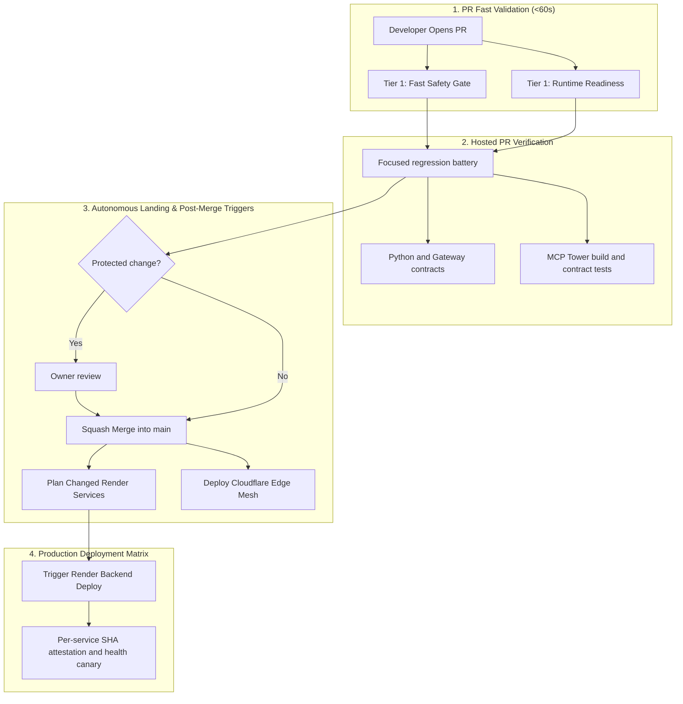
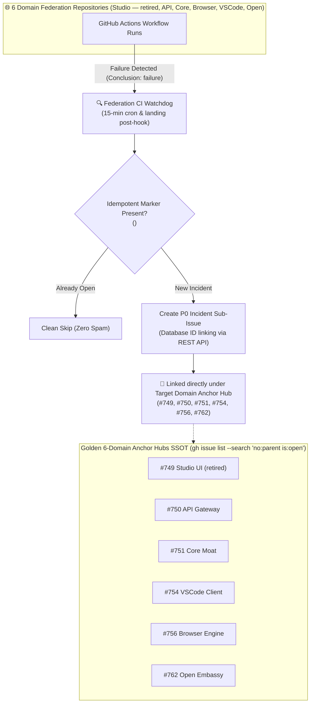

# SupremeAI — Single Door Monorepo SSOT

> **The Single Door Monorepo SSOT for the SupremeAI Federation.**  
> <!-- Fix (wiring audit 2026-11-11): docs/README.bn.md does not exist — dead link removed. -->

This repository (`Supremeai-bd/supremeai`) is the **Single Door Monorepo SSOT** for Core, Gateway, Browser relay, and the MCP Control Plane. The former `studio/` frontend is retired; `vscode/` is reference material, not a monorepo release target.

> [!IMPORTANT]
> ### 🤖 AI Agent & MCP Contributor Quickstart (Where & How to Work)
> If you are an external AI (Claude, Cursor, Antigravity, etc.) connecting via MCP Tower or GitHub:
> 1. **Single Door for Work:** All tasks, bug reports, and PRs live exclusively in **`Supremeai-bd/supremeai`**. Satellite repositories maintain a strict 0 Issues / 0 PRs policy. <!-- Fix (wiring audit 2026-11-11): docs/FEDERATION_CHARTER.md does not exist — dead link removed. -->
> 2. **Where to Write Code:** Edit the corresponding domain folders inside this repository (`core/`, `gateway/`, `browser/`, `infrastructure/`, or `scripts/`). See the ownership map below before adding a build or a deploy target.
> 3. **Autonomous Auto-Landing & Zero Cloud Waste:** Routine PRs can auto-merge after verification. Changes to protected release, authorization, or data boundaries require owner review ([`docs/PR_TO_PRODUCTION_LIFECYCLE.md`](./docs/PR_TO_PRODUCTION_LIFECYCLE.md)).
> 4. **Universal Runner Hierarchy:** PR code runs on hosted runners. The personal runner is reserved for trusted-main CI; Render CI is inactive without verified quota and runner evidence.
>
> **MCP Tower call conventions (avoid argument/format errors):**
> - Tool names are **wave-split** (2026-10-29/30 rename waves, #2493): the core github + bridge queue/order tools are **dotted** (`github.read_file`, `github.list_prs`, `github.workflow_runs`, `bridge.work_queue`, `bridge.work_order`) — their old snake_case forms are dead (-32602). The external-repo explorer family (`github_repo_tree`, `github_search_repos`, ...) and the claim/feedback family (`work_claim`, `bridge_read_feedback`, `bridge_work_renew`, `bridge_work_release`) stay **snake_case**. Never guess: probe `tools/list` first.
> - Repo references must be **`owner/repo`** (e.g. `Supremeai-bd/supremeai`); a bare repo name returns "Invalid repo reference". On repo-resolving list tools pass `repo` explicitly — the omit-repo default resolves through the account registry and has silently drifted before (R66/#2447); every response echoes the resolved target as `targetRepo`/`targetUrl`, so verify it.
> - Use the correct tool name + `owner/repo` form or the call fails.
> - Bridge tools: `bridge_submit_patch` requires `taskId` (`bridge-YYYYMMDD-<slug>`), `summary`, `scopePaths` (1-30), `testsEvidence`, and `files` (each with `path`); pass `originalIssueNumber` so the root issue auto-closes on merge, and `closesOriginalIssue: true` only when a docs-only payload **IS** the resolution of that issue (receipt-closure convention #2485, `contract.receiptClosureConvention` in `bridge_guide`; default keeps the WO open via `Refs #N`). `work_claim` requires `issueNumber` (integer). `bridge.work_order`/`bridge_read_feedback` require `number` (issue number).

## 📐 Architecture & Single Monorepo SSOT Topology

| Owner / source | Status in this repository |
|---|---|
| `core/`, `gateway/`, `browser/`, `infrastructure/mcp-control-plane/` | Active service source. [Service registry](config/service_registry.yaml) owns the Render deploy roles and watch paths. Browser's production build is a relay, not a full browse/scrape product. |
| `infrastructure/`, `scripts/`, `.github/` | Edge services, operations and CI/CD. The Render CI runner is auxiliary, not a production runtime. |
| `vscode/` | Reference and examples only; this checkout has no extension or desktop release source. No root client-release workflow. |
| Former `studio/`, and historical satellite copies | Retired from this monorepo's release path. Do not infer an active release from an old diagram, mirror, or URL. |

### PR-to-production lifecycle

For complete end-to-end documentation of our deterministic multi-tier gates, automated landing, federation sync, and edge deployment, see [`docs/PR_TO_PRODUCTION_LIFECYCLE.md`](docs/PR_TO_PRODUCTION_LIFECYCLE.md).




---

### Historical federation integrations

The older federation map below records integrations, not current release ownership.



> Consuming the platform (not contributing)? Start at
> [`docs/CONSUMERS.md`](https://github.com/Supremeai-bd/supremeai/blob/main/docs/CONSUMERS.md) and the
> [`api-schemas/gateway.openapi.yaml`](./api-schemas/gateway.openapi.yaml)
> Gateway surface. Contributing? [`AGENTS.md`](./AGENTS.md) and
> [`docs/ZERO_ADMIN_GUIDE.md`](https://github.com/Supremeai-bd/supremeai/blob/main/docs/ZERO_ADMIN_GUIDE.md) are the entry points.

### Production endpoint configuration

| Service | Live URL | Description |
|---|---|---|
| **MCP Control Tower** | Configured `RENDER_MCP_URL` | Remote `/mcp` and `/sse`. Releases use the exact configured Paykari service ID and resolve its direct URL from Render. |
| **API Gateway** | [`https://supremeai-api-ulw0.onrender.com`](https://supremeai-api-ulw0.onrender.com) | Unified OpenAI-compatible multi-LLM provider gateway |

| Path | What it is |
|---|---|
| `api-schemas/gateway.openapi.yaml` | **The stable SupremeAI API Gateway surface** (OpenAI-compatible `/v1/chat/completions`) — byte-mirror of `supremeai-api/contracts/openapi.yaml` |
| `examples/gateway_client.py` | Zero-dependency Python client for the Gateway (typed errors, retry only on 502/503) — byte-mirror of `supremeai-api/scripts/clients/gateway_client.py` |
| `docs/CONSUMERS.md` | Consumer registry: known internal/external API consumers, endpoint patterns, auth methods, and signature-verified webhook endpoints |
| `ECOSYSTEM_MAP.md` | **The Federation Ecosystem Map** — architecture directory for agents working across repos |
| [`docs/FEDERATION_TAXONOMY_AND_LICENSING.md`](https://github.com/Supremeai-bd/supremeai/blob/main/docs/FEDERATION_TAXONOMY_AND_LICENSING.md) | **Federation Taxonomy & Licensing SSOT** — 12 domain satellites, institutional memory, and the master umbrella model |
| [`docs/AGENT_PORTAL_SPEC.md`](https://github.com/Supremeai-bd/supremeai/blob/main/docs/AGENT_PORTAL_SPEC.md) | **Agent Portal & Federation Bridge architecture spec** (#23): two-repo relationship, the 3 submission pathways mapped to machinery, guard/gate/router map, clickable contract-schema references |
| [`docs/FAQ.md`](https://github.com/Supremeai-bd/supremeai/blob/main/docs/FAQ.md) | **Operational FAQ** (#23): symptom→cause→fix for every known validation-error class (naming, duplicates, boundary, stale-base, force-push, keyword propagation, env-skips) |
| `AGENTS.md` | Agent entrypoint: autonomous work-submission loop, submission pathways, bridge lane |
| `.github/workflows/unified-pipeline.yml` | PR verification, trusted landing decision and path-scoped production release evidence |
| `.github/workflows/full-test-suite.yml` | Scheduled repository, Core, Gateway, Windows and Tower suites. Separate from PR landing. |
| `.github/ISSUE_TEMPLATE/agent_task.yml` | Agent task template (task group dropdown; <!-- wiring audit 2026-11-11: replaced dead bridge-work-order.yml reference -->) |
| `LICENSE` | MIT |

## The one stable contract

```
Client ──SUPREMEAI_API_KEY──▶ SupremeAI Gateway ──▶ Provider Adapters (Gemini / Groq / …)
```

- One stable SupremeAI API on the outside; dynamic, replaceable, multi-provider intelligence on the inside.
- Provider credentials never leave the server side. Your `SUPREMEAI_API_KEY` is the only thing you need.

## What goes here vs. what never goes here

**Belongs here:** generic interfaces, examples, open schemas, documentation helpers, consumer tooling.

**Never here:** proprietary routing policies, internal autonomy scoring, private repair/healing policy, key-plane internals.

## Drift protection

Mirrors above are byte-parity-checked daily by the federation integration CI
(`supremeai-infrastructure` → `federation-integration.yml`, roadmap §21). If a mirror drifts from its
source-of-truth, that check fails closed.

## 🤖 Continuous Agent Loop & Federation Roles

`supremeai` acts as the **Public Face / Embassy** (`scripts/agents/continuous_agent_loop.py`), providing an open zero-dependency CLI entrypoint for any agent or contributor. The in-tree runtime and orchestration code live under `core/`, `gateway/` and `scripts/`.

> **Continuous Loop Core Doctrine:**
> *"কার কী দায়িত্ব তা বুঝিয়ে দেওয়া, দায়িত্ব পালনের সময় কোন রুলস মানতে হবে আর কোনটা মানবে না তা বেঁধে দেওয়া, এবং কাজে লাঠি লাগবে নাকি ছুরি লাগবে (Weapon Provisioning) তা সুনির্দিষ্ট করে দেওয়াই Continuous Agent Loop-এর মূল কাজ।"*

### 1. Two-Paradigm Dispatch Architecture
- **Task-Driven Roles (Event & Runway Driven):**
  - **Coder:** Feature/bug implementation within scope under atomic single-lock.
  - **CI Fixer:** Preempts backlog to heal failing PR checks and unblock the runway.
  - **Task Auditor:** Pre-landing verification for boundaries, secret leaks, and decision ledgers.
- **Time-Driven / Platform-Driven Roles (Scheduled Cron & Periodic Probing):**
  - **Ecosystem Scout:** Global tech radar scouring outside innovations (Meta, Anthropic, OpenAI) with full-spectrum evaluation (pros, cons, "এটা করা যাবে না", risks) producing min. 10 proposals.
  - **Federation Auditor:** Internal inspector auditing commit parity, drift, and cleanliness for explicitly configured mirror relationships.
  - **Human Eye (Visual QA):** SupremeAI's PR & Styling Team (*"বস, এই ড্রেসে ভালো লাগছে না, ওই ড্রেস পরেন"*), profiling visual polish, typography, and premium user experience (Issue create only).
  - **Rules Breaker:** Dual-vector chaos hacker (breaks existing guards + exploits unprotected gaps to measure worst-case damage, filing failing tests and P0 issues).
  - **3rd-Party Platform Guardian:** High-frequency prober for external model latency and quotas (auto-failovers if possible, else creates issues).

### 2. Weapons & Scoped Permissions Matrix (লাঠি বনাম ছুরি — RBAC)

| Role | Weapon Metaphor | Scoped Tools & Permissions | Forbidden Operations |
|---|---|---|---|
| **Solver** *(Coder + CI Fixer)* | Surgical Knife & Defibrillator 🔪⚡ | Code edit, Local test runner, Git branch, CI fix & PR create | Claiming without atomic lock, breaking scope |
| **Auditor** *(Federation + Task)* | Ledger Microscope & Stamp 🔬📋 | Multi-repo git reader (14 federation repos / 8 active anchors), PR compliance | Direct source code edits |
| **Ecosystem Scout** | Long-Range Telescope 🔭 | Web search, URL readers, High-signal synthesis reports | Local code edits, uncritical hype/speculative tickets |
| **Human Eye** | Stylist Camera & Mirror 📸 | Browser subagent, Screenshot capture, Issue create | Direct code or CSS edits |
| **Rules Breaker** | Sledgehammer & Lockpick 🔨 | Adversarial fuzzers, `tests/adversarial/` commits | Production damage, writing self-patches |
| **Platform Guardian** | Routing Circuit Breaker 🔌 | Provider prober, Dynamic Failover Toggle, Issue create | Corrupting permanent configuration files |

---

## Bridge — external agent work submission (v1)

Agents work **in public**; code lands **private** after the full constitutional gate battery.

> **Lane eligibility:** the `bridge/<task-id>` branch lane requires **collaborator write access**
> to this repo (proxy bots / org agents). Zero-credential agents **cannot push branches here** —
> use §2.1 Pathway 2 of [`AGENTS.md`](./AGENTS.md) (fork + PR) instead; the PR is ingested by the
> same internal automation.

1. Push your patch branch to this repo: `bridge/<task-id>` (diff base = `main`).
2. Open a **Bridge Work Order** issue (issue template above).
3. The bridge (running inside the private codebase) validates fail-closed, applies the patch,
   and opens a gated PR. Status flows back to your issue via labels + comments.

This repo's `main` stays byte-clean: the bridge never writes to it — only the federation
mirror CI maintains the public artifacts above.

---

## Contributing

New here? Start with **[`docs/CONTRIBUTING.md`](https://github.com/Supremeai-bd/supremeai/blob/main/docs/CONTRIBUTING.md)** — the
zero-credential contributor guide covering both human (fork + PR) and autonomous-agent
(8-step loop, MCP Tower lane) workflows, the 3-tier verification contract, scope caps,
and a field-tested troubleshooting table. The governance contracts live in
[`AGENTS.md`](./AGENTS.md) — the Single Door SSOT (the former AGENT_RULES.md was deleted by #1526).

---

## 🏗️ Architecture & Operations Blueprints

- **Universal Lowest-Runtime CI/CD & Deployment SSOT:** [`docs/PR_TO_PRODUCTION_LIFECYCLE.md`](./docs/PR_TO_PRODUCTION_LIFECYCLE.md) — The single SSOT for zero-cloud-quota continuous integration via GitHub Self-Hosted local compute, 24h+ opportunistic nightly maintenance, Harness CD intelligent verification & auto-rollback, and 100% autonomous zero-touch auto-merge.
- **Agent Operating System:** [`docs/AGENT_OPERATING_SYSTEM.md`](./docs/AGENT_OPERATING_SYSTEM.md) — The continuous autonomous verification ladder and self-healing engine.
- **Federation Architecture:** AGENTS.md + [`ECOSYSTEM_MAP.md`](./ECOSYSTEM_MAP.md) — The monorepo SSOT topology. <!-- wiring audit 2026-11-11: docs/FEDERATION_CHARTER.md does not exist — replaced with the repo-root ECOSYSTEM_MAP that does -->
<!-- heartbeat: 2026103106 -->
