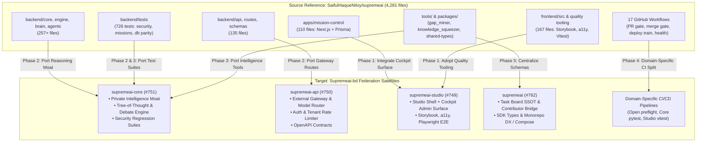

# Architectural Comparison & Adoption Blueprint
**Source Monorepo:** `SaifulHaqueNiloy/supremeai` (Reference Monolith, Commit `53ae2e1`, 4,281 files, ~22.1K AST Nodes)  
**Target Federation:** `Supremeai-bd` Organization Repositories (`supremeai-core`, `supremeai-api`, `supremeai-studio`, `supremeai`, `supremeai-browser`, `supremeai-vscode`, `supremeai`)  
**Date:** November 3, 2026  
**Status:** Canonical Adoption & Reconciliation Blueprint (Updated with 9-Repo Split Plan & Audit Comparison)  

---

## Executive Summary

Cross-repository authenticated comparison between the foundational monolith `SaifulHaqueNiloy/supremeai` and the `Supremeai-bd` federation reveals that while the **Golden 6-Domain Topology** (governed by `federation_anchors.py`) successfully eliminated monolithic coupling and isolated build boundaries, a significant delta of **2,102 source files** has not yet cleanly landed in the respective federation satellites.

The largest operational and reliability gaps lie in **CI/CD Governance (17 workflows vs 2)**, **E2E/Security Regression Suites (726 backend tests)**, **Cockpit Operations (`apps/mission-control`)**, and **Strict Domain Separation (Core reasoning moat vs API gateway)**.

This updated document serves as the Single Source of Truth (SSOT) synthesizing the **৯-রিপোজিটরি Split Plan** and the **তুলনা ও করণীয় তালিকা** into a comprehensive, actionable execution blueprint.

---

## 1. Inventory & Comparative Mapping

| Target Satellite | Visibility | Current Files | Workflows | Tests (Counted) | Canonical Domain Responsibility | Missing Source Assets |
| :--- | :---: | :---: | :---: | :---: | :--- | :--- |
| **`supremeai-core`** (#751) | Private | 1,699 | 1 | 9+ | Hidden reasoning moat, orchestration, memory, security, intelligence engines, database contracts | `backend/core/` (224), `backend/engine/` (13), `backend/agents/` (20), `backend/tests/` (726 split) |
| **`supremeai-api`** (#750) | Private | 522 | 1 | 89 | API gateway, auth, tenant rate-limiting, quota, OpenAPI contracts, model routing | `backend/api/` (135), OpenAPI schemas, API tests |
| **`supremeai-studio`** (#749) | Public | 787 | 2 | 135 | React/Vite UI, workspace shell, and Admin Cockpit | `apps/mission-control/` (110), `frontend/src/` (167), Storybook/a11y |
| **`supremeai`** (#762) | Public | 710 | 1 | 80 | Public Task Board SSOT, Contributor Bridge, zero-dep SDKs, public specs | Public contracts, `packages/shared-types`, root developer DX |
| **`supremeai-vscode`** (#754) | Public | 3,406 | 1 | 1+ | VS Code extension, client desktop/mobile integration | `tools/vscode-extension/` (10), `client/supreme-node/` (4) |
| **`supremeai-browser`** (#756) | Private | 72 | 1 | 6 | Browser automation runtime, stealth scraper, vision grounding | `backend/browser/`, stealth tests, anti-detect configs |
| **`supremeai`** | Private | 4,591 | 2 | 440 | Central umbrella / Federation anchor & MCP Control Tower orchestration | MCP control plane (88), cross-repo integration tests |
| **`supremeai`** | Private | 892 | 0 | 2 | ADRs, lessons learned, historical decisions, migrated commit ledgers | `docs/architecture/`, `LESSONS_LEARNED.md`, retired modules |

---

## 2. Federation Architecture & Adoption Topology

---

## 3. Comprehensive Domain Gap Analysis & Concrete Solutions

### 3.1 P0: Mission Control Cockpit & Frontend Quality Tooling (`apps/mission-control` + `frontend/`)
* **Monolith Asset:** Next.js 16 + Tailwind + Prisma cockpit dashboard (110 files) tracking live dispatch, journal events, agent memory, and node health. Frontend includes Storybook Vitest integration, `@storybook/addon-a11y`, Playwright E2E (`commandcenter.spec.ts`, `multiworkspace.spec.ts`), and strict `npm run quality` gates.
* **Federation Gap:** `supremeai-studio` has a simplified React/Vite dashboard without the integrated telemetry, task pipeline view, or component accessibility testing.
* **Adoption Directive:**
  1. Do NOT deploy `apps/mission-control` as an unauthenticated standalone app. Integrate its operational views as an authenticated admin cockpit surface inside `supremeai-studio`.
  2. Replace direct Prisma DB queries with calls to the live MCP Control Tower / Supabase client.
  3. Port frontend quality tools (`@storybook/addon-a11y`, strict lint/typecheck, Playwright E2E) into `studio/package.json`.

---

### 3.2 P0: CI/CD Pipeline & Merge Gate Contract (17 Workflows vs 2)
* **Monolith Asset:** 17 comprehensive workflows enforcing PR boundary validation, issue reference guards, main CI, merge gate evidence verification, dependency health checks, deploy train, and operational watchdogs.
* **Federation Gap:** Satellites currently have only 1-2 workflows (e.g., `bridge-intake.yml`, `ops-maintenance.yml`). Verification is frequently fragmented across local agent runs.
* **Adoption Directive (Domain CI Split):**
  * **`supremeai`:** PR boundary guard, issue claim/reference guard, preflight lint, fast syntax check (<10s).
  * **`supremeai-core`:** Pytest matrix (3.11/3.12), security regression suites, database schema migration parity.
  * **`supremeai-api`:** Route contract tests, rate-limit / tenant isolation tests, OpenAPI spec validation.
  * **`supremeai-studio`:** Vitest unit tests, Playwright E2E flows, Storybook a11y, bundle size check.
  * *Strict Policy:* Never copy all 17 workflows blindly into every satellite. Assign ownership per domain.

---

### 3.3 P1: Private Intelligence Moat & Autonomous Tools (`backend/core/` + `tools/`)
* **Monolith Asset:** 224 files in `backend/core/` and specialized reasoning tools (`tools/gap_miner`, `tools/knowledge_squeezer`, `tools/multi_model_knowledge_distiller.py`, `tools/solution_synthesizer`, tree-of-thought, debate engine, forge compiler).
* **Federation Gap:** The federation relies heavily on `continuous_agent_loop.py` for task assignment, but lacks internal automated gap detection, AST knowledge distillation, and fix synthesis.
* **Adoption Directive:**
  1. Port `tools/gap_miner` and `tools/solution_synthesizer` into `supremeai-core/tools/intelligence/`.
  2. Register their invocation handlers in MCP Control Tower (`intelligence.tools.ts` or `graphify_call`).
  3. Maintain strict privacy: Keep core reasoning, prompts, and proprietary scoring strictly inside `supremeai-core`.

---

### 3.4 P1: Comprehensive Regression Test Suites (`backend/tests/` - 726 Files)
* **Monolith Asset:** 726 tests covering mission composition (136 tests), security boundaries (SSRF, prompt injection, tenant isolation, cross-account memory leak), database migration parity, and websocket auth.
* **Federation Gap:** Satellites currently possess atomic unit checks and boundary guards, but lack full integration regression coverage.
* **Adoption Directive:**
  1. Distribute tests by domain:
     - Security, core reasoning, database $\rightarrow$ `supremeai-core/tests/`
     - Route contracts, auth, quota $\rightarrow$ `supremeai-api/tests/`
     - Browser stealth, scraping $\rightarrow$ `supremeai-browser/tests/`
  2. Adapt import paths from monolithic `backend.*` to canonical package roots (`core.*`, `gateway.*`, `browser.*`).

---

### 3.5 P2: Database Schema Contracts & Migration Parity
* **Monolith Asset:** `backend/database/contracts/schema_contract.yaml`, `test_migration_parity.py`, `check_database_schema.py`.
* **Federation Gap:** Target database migrations have evolved independently, creating risk of drift between live Supabase instances and repo schemas.
* **Adoption Directive:**
  1. Port schema contract checks and migration parity verifiers to `supremeai-core/database/`.
  2. Strict Rule: Never overwrite target migrations. All migrations must remain strictly **append-only**.

---

### 3.6 P2: Shared Types, SDKs & Unified Local Development
* **Monolith Asset:** `packages/shared-types`, `packages/design-tokens`, profile-driven `docker-compose.yml` (`--profile local` vs `--profile full`).
* **Federation Gap:** Satellite types are duplicated across TypeScript/Python boundaries; local environment setup requires running multiple decoupled servers manually.
* **Adoption Directive:**
  1. Host canonical shared TypeScript types and zero-dependency Python clients in `supremeai`.
  2. Create a unified, profile-driven `docker-compose.yml` in `supremeai` orchestrating Core, Gateway, Studio, and MCP Tower.

---

## 4. Anti-Patterns & Strict Exclusions (What NOT to Copy)

To uphold the Universal Invariants in `AGENTS.md`:
1. **NO Blind Full Copy:** Never overwrite satellite codebases with raw monolithic directories.
2. **NO Credential / Secret Leaks:** Never port `.env`, production secret registries, or provider API keys into public repositories (`supremeai`, `supremeai-studio`, `supremeai-vscode`).
3. **NO Monolithic Re-coupling:** Satellite code must reside strictly within approved boundaries (`core/*`, `studio/*`, `gateway/*`, `browser/*`).
4. **NO Test Erasure:** Never weaken or delete existing passing tests in the target to force compatibility with migrated code.

---

## 5. Prioritized 6-Phase Adoption Roadmap

| Phase | Focus Area | Key Deliverables | Primary Target Repo | Risk / Effort |
| :---: | :--- | :--- | :--- | :---: |
| **Phase 1** | **Cockpit & UI Parity** | Port `apps/mission-control` views into Studio; add Storybook & Playwright a11y gates | `supremeai-studio` | Medium / 2-3 Days |
| **Phase 2** | **Core Reasoning & Security Port** | Port `backend/core/` engines, debate/tree-of-thought, and security regression tests | `supremeai-core` | High / 3-4 Days |
| **Phase 3** | **API Gateway & Route Contracts** | Port missing API routes, OpenAPI swagger specs, rate limiters, and contract tests | `supremeai-api` | Medium / 2 Days |
| **Phase 4** | **Domain CI/CD Pipelines** | Implement domain-tailored workflows (PR preflight, Core pytest, Studio E2E) | All Satellites | High / 2-3 Days |
| **Phase 5** | **DX, Shared Types & Compose** | Standardize `packages/shared-types` and local profile-based `docker-compose.yml` | `supremeai` | Low / 1-2 Days |
| **Phase 6** | **Archive & Audit Ledger** | Record migrated commit hashes and rationale for retired modules in `archive` | `supremeai` | Low / 1 Day |

---

## 6. Verification & Governance Checklist

Every pull request implementing an adoption phase must pass the **3-Tier Verification Contract**:
- [ ] **Tier 1 (Reflection Evidence):** Explicit `why` and `alternatives_rejected` documented in PR body.
- [ ] **Tier 2 (Preflight Smoke):** Branch naming, boundary sanitization, and secret scanning passed.
- [ ] **Tier 3 (Test Evidence):** Zero regressions on existing test suites, with all new ported tests passing cleanly.
- [ ] **Task Envelope Compliance:** Linked to an active tracked work order (`Closes #N` or `Refs #N`).
