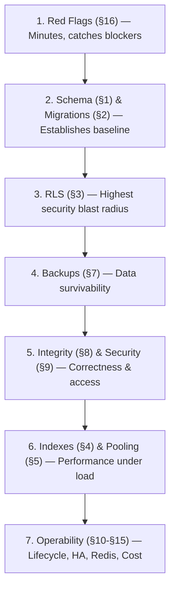

# SupremeAI — Database Audit Checklist

> **Scope:** Schema integrity, migrations, RLS, indexes, performance, backups, security, and data lifecycle. Each item includes a **verification method** so results are reproducible.
>
> **Format:** `[ ]` = Not checked yet | `[x]` = Passed | `[!]` = Failed + reason in Note column | `[~]` = N/A

---

## 0. Pre‑flight (Record Before You Start)

```sql
-- Capture the exact state being audited
SELECT version();                                   -- PostgreSQL version
SELECT current_database(), current_user;
SELECT count(*) FROM information_schema.tables
  WHERE table_schema = 'public';                    -- target: 150 tables per checklist O1
SELECT * FROM alembic_version;                      -- current migration head
```

| # | Parameter | Expected / Target | Recorded Value | Status |
|---|---|---|---|---|
| 0.1 | PostgreSQL Version | PostgreSQL 15+ / 16+ | | `[ ]` |
| 0.2 | Table count in `public` | 150 tables | | `[ ]` |
| 0.3 | `alembic_version` head | Current release head revision | | `[ ]` |
| 0.4 | Monorepo HEAD SHA | Pinned commit hash | | `[ ]` |
| 0.5 | Database Snapshot Timestamp | UTC timestamp | | `[ ]` |

---

## 1. Schema Integrity

| # | Check Item | How to verify | Status | Note |
|---|---|---|---|---|
| 1.1 | Table count matches documented schema (150 per checklist O1) | `SELECT count(*) FROM information_schema.tables WHERE table_schema='public';` | `[ ]` | |
| 1.2 | Every table has a primary key | `SELECT c.relname FROM pg_class c JOIN pg_namespace n ON n.oid=c.relnamespace WHERE n.nspname='public' AND c.relkind='r' AND NOT EXISTS (SELECT 1 FROM pg_index i WHERE i.indrelid=c.oid AND i.indisprimary);` | `[ ]` | |
| 1.3 | No orphaned/legacy tables (`*_old`, `*_backup`, `tmp_*`) | `SELECT tablename FROM pg_tables WHERE schemaname='public' AND (tablename LIKE '%old%' OR tablename LIKE '%backup%' OR tablename LIKE 'tmp_%');` | `[ ]` | |
| 1.4 | Naming convention consistent (`snake_case`, plural or singular — pick one) | Inspect `information_schema.tables` | `[ ]` | |
| 1.5 | Every FK column has a matching index | `SELECT * FROM pg_constraint WHERE contype='f'` → compare `conkey` to existing indexes | `[ ]` | |
| 1.6 | FKs have `ON DELETE` behavior explicitly set (no default `NO ACTION` surprises) | `SELECT conname, confdeltype FROM pg_constraint WHERE contype='f';` | `[ ]` | |
| 1.7 | `created_at` / `updated_at` present on mutable tables, with defaults | `grep -rn "created_at\|updated_at"` in models vs `\d <table>` | `[ ]` | |
| 1.8 | `updated_at` auto‑updated by trigger or ORM `onupdate` | Check trigger: `SELECT tgname FROM pg_trigger WHERE tgrelid='<table>'::regclass;` | `[ ]` | |
| 1.9 | Soft‑delete pattern consistent (`deleted_at` vs hard delete) | Search models for `deleted_at` | `[ ]` | |
| 1.10 | No `NULL`‑able columns that logically shouldn't be (e.g., `user_id`, `tenant_id`) | `SELECT table_name, column_name FROM information_schema.columns WHERE is_nullable='YES' AND column_name IN ('user_id','tenant_id','email');` | `[ ]` | |
| 1.11 | Enum types used instead of free‑text for status columns | `\dT` list enums; compare to status columns | `[ ]` | |
| 1.12 | No wide `JSON` columns storing relational data that should be normalized | Inspect `json`/`jsonb` columns | `[ ]` | |
| 1.13 | Column types appropriate (no `text` for timestamps, no `varchar(255)` for UUIDs) | Sample `\d+ <table>` | `[ ]` | |
| 1.14 | Multi‑tenant tables have `tenant_id`/`workspace_id` | `SELECT table_name FROM information_schema.columns WHERE column_name IN ('tenant_id','workspace_id') GROUP BY 1;` | `[ ]` | |

---

## 2. Migrations (Alembic)

| # | Check Item | How to verify | Status | Note |
|---|---|---|---|---|
| 2.1 | `alembic check` reports no pending autogenerate diff | `alembic check` | `[ ]` | |
| 2.2 | `alembic current` == `alembic heads` | `alembic current && alembic heads` | `[ ]` | |
| 2.3 | Single head (no branch conflicts) | `alembic heads` returns one line | `[ ]` | |
| 2.4 | Every migration has a working `downgrade()` | `grep -L "def downgrade" migrations/versions/*.py` | `[ ]` | |
| 2.5 | Downgrade actually runs (test on a scratch DB) | `alembic downgrade -1 && alembic upgrade head` on staging | `[ ]` | |
| 2.6 | Migrations immutable after merge (no edits to applied revisions) | `git log --follow migrations/versions/<rev>.py` | `[ ]` | |
| 2.7 | No data‑loss operations without backup (`DROP COLUMN`, type narrowing) | `grep -rn "drop_column\|alter_column" migrations/` | `[ ]` | |
| 2.8 | Long‑running migrations use `CONCURRENTLY` for indexes | `grep -rn "CREATE INDEX" migrations/` — check for `CONCURRENTLY` | `[ ]` | |
| 2.9 | Migrations are idempotent where required (`IF NOT EXISTS`) | Read migration bodies | `[ ]` | |
| 2.10 | No `op.execute("DROP TABLE ...")` without explicit review | `grep -rn "op.execute" migrations/` | `[ ]` | |
| 2.11 | Migration timestamps monotonic, filenames consistent | `ls migrations/versions/ \| sort` | `[ ]` | |
| 2.12 | Schema drift between ORM models and DB is zero | `alembic revision --autogenerate -m tmp` then diff (discard) | `[ ]` | |
| 2.13 | Applied migration count matches `alembic history \| wc -l` on prod | Compare staging vs prod `alembic_version` | `[ ]` | |
| 2.14 | Migration has been run on a **copy of prod** (not just dev) | Evidence in staging logs | `[ ]` | |

---

## 3. Row‑Level Security (RLS)

| # | Check Item | How to verify | Status | Note |
|---|---|---|---|---|
| 3.1 | RLS enabled on **every** user‑facing table | `SELECT tablename FROM pg_tables WHERE schemaname='public' AND rowsecurity=false;` → must be empty for user tables | `[ ]` | |
| 3.2 | RLS **forced** on table owner (`FORCE ROW LEVEL SECURITY`) so owner isn't bypassed | `SELECT relname FROM pg_class WHERE relrowsecurity AND NOT relforcerowsecurity;` | `[ ]` | |
| 3.3 | Policies exist for **all four** verbs (SELECT/INSERT/UPDATE/DELETE) | `SELECT tablename, cmd, count(*) FROM pg_policies GROUP BY 1,2;` | `[ ]` | |
| 3.4 | No `USING (true)` policies on tenant tables | `SELECT * FROM pg_policies WHERE qual='true' OR with_check='true';` | `[ ]` | |
| 3.5 | Policies reference `auth.uid()` / JWT claim correctly | Read `qual` in `pg_policies` | `[ ]` | |
| 3.6 | Service‑role bypass is intentional and documented | `grep -rn "service_role"` in backend | `[ ]` | |
| 3.7 | Negative test: anon key cannot read other users' rows | `SELECT * FROM <table>` with anon JWT → expect 0 rows | `[ ]` | |
| 3.8 | Negative test: user A cannot UPDATE user B's row | Attempt via API with A's token on B's `id` | `[ ]` | |
| 3.9 | INSERT policies enforce `auth.uid() = user_id` | Read `with_check` | `[ ]` | |
| 3.10 | Admin/tenant‑admin tables have separate policies, not open | Inspect `admin_*` tables | `[ ]` | |
| 3.11 | Storage buckets have RLS too (Supabase storage) | `SELECT * FROM storage.buckets;` + policies | `[ ]` | |
| 3.12 | RLS does not break legitimate joins (test a full user flow) | E2E with a real user token | `[ ]` | |

---

## 4. Indexes & Query Performance

| # | Check Item | How to verify | Status | Note |
|---|---|---|---|---|
| 4.1 | Every FK has a supporting index | Query `pg_stat_user_indexes` vs `pg_constraint` FKs | `[ ]` | |
| 4.2 | Every `WHERE`/`JOIN`/`ORDER BY` hot column is indexed | Compare `pg_stat_statements` top queries to indexes | `[ ]` | |
| 4.3 | No duplicate indexes (same columns, different order) | `SELECT indexrelid::regclass, indrelid::regclass, indkey FROM pg_index` → dedupe | `[ ]` | |
| 4.4 | No unused indexes (waste write throughput) | `SELECT * FROM pg_stat_user_indexes WHERE idx_scan = 0;` | `[ ]` | |
| 4.5 | Partial indexes used where appropriate (e.g., `WHERE deleted_at IS NULL`) | Inspect index defs | `[ ]` | |
| 4.6 | Composite index column order matches query predicates | `\d+ <table>` vs `EXPLAIN` | `[ ]` | |
| 4.7 | No full‑table scans on tables >100k rows in hot paths | `EXPLAIN (ANALYZE, BUFFERS) <query>` → expect Index Scan | `[ ]` | |
| 4.8 | `pg_stat_statements` enabled and top 20 slow queries reviewed | `SELECT * FROM pg_stat_statements ORDER BY mean_exec_time DESC LIMIT 20;` | `[ ]` | |
| 4.9 | No N+1 patterns from ORM (check `selectinload`/`joinedload` usage) | `grep -rn "lazy=\"select\""` + read loops | `[ ]` | |
| 4.10 | Index bloat <30% on hot tables | `pgstattuple` or `pg_stat_user_tables` | `[ ]` | |
| 4.11 | Autovacuum not disabled on hot tables | `SELECT relname, reloptions FROM pg_class WHERE reloptions IS NOT NULL;` | `[ ]` | |
| 4.12 | Table bloat <20% | `pgstattuple_approx` | `[ ]` | |
| 4.13 | Partitioning considered for tables >10M rows (audit, logs, metrics) | Row counts per table | `[ ]` | |

---

## 5. Connection & Pooling

| # | Check Item | How to verify | Status | Note |
|---|---|---|---|---|
| 5.1 | `max_connections` vs app pool size reconciled | `SHOW max_connections;` vs `pool_size` in SQLAlchemy config | `[ ]` | |
| 5.2 | PgBouncer / Supabase pooler configured | Check connection string (`:6543` vs `:5432`) | `[ ]` | |
| 5.3 | Pool mode (transaction vs session) compatible with app (prepared stmts, temp tables) | Read pooler config | `[ ]` | |
| 5.4 | Pool `pool_pre_ping=True` (handles stale connections) | `grep -rn "pool_pre_ping"` | `[ ]` | |
| 5.5 | Pool `pool_recycle` < DB idle timeout | `grep -rn "pool_recycle"` | `[ ]` | |
| 5.6 | `pool_timeout` set (no infinite waits) | `grep -rn "pool_timeout"` | `[ ]` | |
| 5.7 | No connection leaks (sessions closed on exception) | `grep -rn "SessionLocal()"` → verify `finally` / context manager | `[ ]` | |
| 5.8 | Current connection usage <70% of max | `SELECT count(*) FROM pg_stat_activity;` | `[ ]` | |
| 5.9 | No long‑running idle transactions | `SELECT * FROM pg_stat_activity WHERE state='idle in transaction' AND now()-state_change > interval '5 min';` | `[ ]` | |
| 5.10 | `statement_timeout` and `idle_in_transaction_session_timeout` set | `SHOW statement_timeout;` | `[ ]` | |

---

## 6. Transactions & Consistency

| # | Check Item | How to verify | Status | Note |
|---|---|---|---|---|
| 6.1 | Multi‑step writes wrapped in a transaction | `grep -rn "with session.begin\|async with session"` | `[ ]` | |
| 6.2 | Isolation level appropriate (default Read Committed, SERIALIZABLE for money) | `grep -rn "isolation_level"` | `[ ]` | |
| 6.3 | No `SELECT ... FOR UPDATE` without bounded scope | `grep -rn "with_for_update\|FOR UPDATE"` | `[ ]` | |
| 6.4 | Race conditions tested on counters/quota updates (atomic `UPDATE ... SET x=x+1`) | Read quota/usage increment code | `[ ]` | |
| 6.5 | Money/escrow operations use exact types (`NUMERIC`), not `float` | `\d escrow*` / `\d *payment*` | `[ ]` | |
| 6.6 | Idempotency keys on payment/escrow inserts | `grep -rn "idempotency"` | `[ ]` | |
| 6.7 | No distributed transaction assumed without saga/outbox | Read cross‑service write flow | `[ ]` | |
| 6.8 | Outbox pattern present if events published + DB write must be atomic | Read event publisher | `[ ]` | |
| 6.9 | `SAVEPOINT` used for partial failure recovery where needed | Spot check multi‑write flows | `[ ]` | |

---

## 7. Backups & Recovery

| # | Check Item | How to verify | Status | Note |
|---|---|---|---|---|
| 7.1 | Automated daily backups enabled (Supabase PITR or `pg_dump` cron) | Dashboard / `crontab` / CI config | `[ ]` | |
| 7.2 | Retention meets policy (≥7 daily, ≥4 weekly, ≥12 monthly) | Backup dashboard | `[ ]` | |
| 7.3 | Point‑in‑time recovery (PITR) enabled | Supabase → Database → Backups | `[ ]` | |
| 7.4 | **Restore tested** within last 30 days | Evidence: staging restore log with timestamp | `[ ]` | |
| 7.5 | Restore RTO measured and documented | Runbook says `<X>` minutes; verify | `[ ]` | |
| 7.6 | Restore RPO acceptable (max data loss window) | Documented in DR runbook | `[ ]` | |
| 7.7 | Backups encrypted at rest | Provider config | `[ ]` | |
| 7.8 | Backup access restricted (not public bucket) | IAM / bucket policy | `[ ]` | |
| 7.9 | Logical backup (`pg_dump`) available in addition to physical | Check scripts | `[ ]` | |
| 7.10 | Storage (MinIO/S3) has its own backup | Check bucket replication / snapshot | `[ ]` | |
| 7.11 | Redis persistence: AOF/RDB enabled if Redis holds state | `CONFIG GET appendonly save` | `[ ]` | |
| 7.12 | Restore runbook accessible to on‑call (not only one person) | `docs/runbooks/` | `[ ]` | |
| 7.13 | Backup failure alerting wired | Monitoring config | `[ ]` | |

---

## 8. Data Integrity & Constraints

| # | Check Item | How to verify | Status | Note |
|---|---|---|---|---|
| 8.1 | `CHECK` constraints on bounded fields (status, tier, role) | `SELECT conname, pg_get_constraintdef(oid) FROM pg_constraint WHERE contype='c';` | `[ ]` | |
| 8.2 | `UNIQUE` constraints on natural keys (email, slug, api_key_hash) | `SELECT conname FROM pg_constraint WHERE contype='u';` | `[ ]` | |
| 8.3 | No orphan rows (FK integrity holds) | `SELECT count(*) FROM <child> c LEFT JOIN <parent> p ON c.fk=p.id WHERE p.id IS NULL;` | `[ ]` | |
| 8.4 | Enum values in DB match Python/TS enums | Diff `\dT+` vs source enums | `[ ]` | |
| 8.5 | Money stored as `NUMERIC(precision, 2+)` not `float`/`double` | `SELECT column_name, data_type FROM information_schema.columns WHERE data_type IN ('real','double precision');` | `[ ]` | |
| 8.6 | Timestamps stored as `TIMESTAMPTZ`, not `TIMESTAMP` | `SELECT table_name, column_name FROM information_schema.columns WHERE data_type='timestamp without time zone';` | `[ ]` | |
| 8.7 | UUIDs use `uuid` type, not `varchar(36)` | `SELECT column_name FROM information_schema.columns WHERE column_name LIKE '%_id' AND data_type='character varying';` | `[ ]` | |
| 8.8 | Soft‑deleted rows excluded from unique constraints (partial unique index) | Inspect unique indexes for `WHERE deleted_at IS NULL` | `[ ]` | |
| 8.9 | Cascading deletes reviewed (no accidental mass delete) | `SELECT conname, confdeltype FROM pg_constraint WHERE contype='f' AND confdeltype='c';` | `[ ]` | |
| 8.10 | No nullable FKs where the relation is required | `SELECT * FROM information_schema.columns WHERE column_name LIKE '%_id' AND is_nullable='YES';` | `[ ]` | |

---

## 9. Security & Access

| # | Check Item | How to verify | Status | Note |
|---|---|---|---|---|
| 9.1 | DB user in app has least privilege (no `SUPERUSER`, no `CREATEDB`) | `\du` | `[ ]` | |
| 9.2 | Separate users: migrations user vs runtime user | Compare connection strings | `[ ]` | |
| 9.3 | No hardcoded DB credentials in repo | `gitleaks detect`; `grep -rn "postgres://"` | `[ ]` | |
| 9.4 | SSL enforced on DB connection (`sslmode=require`) | Connection string | `[ ]` | |
| 9.5 | Public schema `CREATE` revoked from `PUBLIC` role | `REVOKE CREATE ON SCHEMA public FROM PUBLIC;` applied | `[ ]` | |
| 9.6 | `search_path` pinned for app user (SQL injection hardening) | `ALTER ROLE <app> SET search_path = public;` | `[ ]` | |
| 9.7 | No `SECURITY DEFINER` functions without `search_path` set | `SELECT proname FROM pg_proc WHERE prosecdef;` | `[ ]` | |
| 9.8 | PII columns identified and encrypted or tokenized | Scan for `email`, `phone`, `nid`, `dob` | `[ ]` | |
| 9.9 | Column‑level encryption for secrets (OAuth tokens, API keys) | Read model + `pgcrypto` usage | `[ ]` | |
| 9.10 | DB audit logging enabled for admin tables | Supabase logs / `pgaudit` | `[ ]` | |
| 9.11 | No `dblink`/`postgres_fdw` to external DBs without review | `SELECT * FROM pg_extension;` | `[ ]` | |
| 9.12 | Extensions limited to vetted list (`pgcrypto`, `uuid-ossp`, `pg_stat_statements`) | `\dx` | `[ ]` | |
| 9.13 | Connection log shows no unknown IPs | Supabase connection logs | `[ ]` | |

---

## 10. Data Lifecycle & Retention

| # | Check Item | How to verify | Status | Note |
|---|---|---|---|---|
| 10.1 | Retention policy documented per table (chat, logs, events) | `docs/data-retention.md` | `[ ]` | |
| 10.2 | PII deletion on account deletion (GDPR/Bangladesh DPA) | Read `delete_user` flow | `[ ]` | |
| 10.3 | Soft‑delete → hard‑delete job scheduled (30/90 days) | Cron/worker config | `[ ]` | |
| 10.4 | Chat/log/event tables have purge job (no unbounded growth) | `grep -rn "DELETE FROM\|purge"` in worker | `[ ]` | |
| 10.5 | Artifacts/uploads have lifecycle policy (S3/MinIO expiry) | Bucket lifecycle config | `[ ]` | |
| 10.6 | Backups also honor retention (no infinite storage cost) | Backup dashboard | `[ ]` | |
| 10.7 | Anonymization for analytics tables | Read ETL | `[ ]` | |
| 10.8 | `VACUUM`/autovacuum keeping dead‑row % healthy | `pg_stat_user_tables.n_dead_tup` | `[ ]` | |

---

## 11. Replication, HA & Failover

| # | Check Item | How to verify | Status | Note |
|---|---|---|---|---|
| 11.1 | Read replica configured (if needed for load) | Supabase → Replication | `[ ]` | |
| 11.2 | App uses replica only for read‑only queries | Read DB routing | `[ ]` | |
| 11.3 | Replica lag monitored (<5s) | `SELECT now()-pg_last_xact_replay_timestamp();` | `[ ]` | |
| 11.4 | Failover procedure documented and tested | Runbook | `[ ]` | |
| 11.5 | Supabase plan matches availability requirement (no single point) | Provider plan | `[ ]` | |
| 11.6 | Redis (if stateful) has replication or is treated as cache‑only | Config + app assumption check | `[ ]` | |

---

## 12. Observability (DB‑Specific)

| # | Check Item | How to verify | Status | Note |
|---|---|---|---|---|
| 12.1 | Slow query logging enabled (`log_min_duration_statement`) | `SHOW log_min_duration_statement;` | `[ ]` | |
| 12.2 | `pg_stat_statements` collecting | `SELECT count(*) FROM pg_stat_statements;` | `[ ]` | |
| 12.3 | Metrics dashboards: connections, TPS, cache hit ratio, replication lag | Grafana/Supabase | `[ ]` | |
| 12.4 | Alert: connection count >80% | Alert config | `[ ]` | |
| 12.5 | Alert: slow query >2s count spike | Alert config | `[ ]` | |
| 12.6 | Alert: replication lag >10s (if replica) | Alert config | `[ ]` | |
| 12.7 | Alert: backup failed | Alert config | `[ ]` | |
| 12.8 | Alert: disk usage >80% | Alert config | `[ ]` | |
| 12.9 | Dead‑lock / lock‑wait monitoring | `pg_locks` dashboard | `[ ]` | |
| 12.10 | Cache hit ratio >99% for hot tables | `SELECT sum(blks_hit)/(sum(blks_hit)+sum(blks_read)) FROM pg_stat_database;` | `[ ]` | |

---

## 13. Supabase‑Specific (if Applicable)

| # | Check Item | How to verify | Status | Note |
|---|---|---|---|---|
| 13.1 | Auth users table not directly exposed | Check API schema exposure | `[ ]` | |
| 13.2 | `auth.uid()` used in RLS, not client‑supplied user_id | Read policies | `[ ]` | |
| 13.3 | Service role key never in frontend bundle | `grep -rn "service_role" supremeai-frontend/` | `[ ]` | |
| 13.4 | Realtime publications scoped to needed tables only | `SELECT * FROM pg_publication_tables;` | `[ ]` | |
| 13.5 | Storage buckets: private by default; signed URLs for downloads | Bucket policies | `[ ]` | |
| 13.6 | Edge Functions secrets not in DB | Check function env | `[ ]` | |
| 13.7 | Supabase logs retained ≥7 days | Project settings | `[ ]` | |
| 13.8 | API keys rotated from defaults | Dashboard | `[ ]` | |
| 13.9 | `pg_net` / `http` extensions not exposed to users | `\dx` | `[ ]` | |

---

## 14. Redis (Treated as Data Layer)

| # | Check Item | How to verify | Status | Note |
|---|---|---|---|---|
| 14.1 | Redis not used as system of record (or has persistence) | `CONFIG GET appendonly save` | `[ ]` | |
| 14.2 | Key namespacing per service (`gateway:`, `brain:`, `scraper:`) | `SCAN 0 MATCH * COUNT 100` | `[ ]` | |
| 14.3 | TTLs set on all cache keys (no unbounded growth) | `SCAN` → `TTL` sample | `[ ]` | |
| 14.4 | 5‑account rotation works (checklist O6) | Read rotation code | `[ ]` | |
| 14.5 | `maxmemory-policy` set (`allkeys-lru` for cache) | `CONFIG GET maxmemory-policy` | `[ ]` | |
| 14.6 | Redis password / TLS enabled | `CONFIG GET requirepass` | `[ ]` | |
| 14.7 | No PII in Redis keys/values without TTL/encryption | `SCAN` sample | `[ ]` | |
| 14.8 | Cache invalidation strategy documented | Read invalidation code | `[ ]` | |

---

## 15. Database Cost & Capacity

| # | Check Item | How to verify | Status | Note |
|---|---|---|---|---|
| 15.1 | Current DB size vs plan limit | `SELECT pg_size_pretty(pg_database_size(current_database()));` | `[ ]` | |
| 15.2 | Top 10 largest tables known and growing predictably | `SELECT relname, pg_size_pretty(pg_total_relation_size(relid)) FROM pg_stat_user_tables ORDER BY pg_total_relation_size(relid) DESC LIMIT 10;` | `[ ]` | |
| 15.3 | Growth rate estimated (rows/day per hot table) | Compare row counts over a week | `[ ]` | |
| 15.4 | Projected capacity ≥6 months | Document | `[ ]` | |
| 15.5 | Backup storage cost tracked | Dashboard | `[ ]` | |
| 15.6 | Read replicas justified by load (not idle cost) | Metrics | `[ ]` | |

---

## 16. Top Red Flags — Auto‑Fail if Any Present

| # | Red Flag | How to verify | Status | Note |
|---|---|---|---|---|
| 16.1 | RLS disabled on a user‑facing table | §3.1 | `[ ]` | |
| 16.2 | `USING (true)` policy on tenant table | §3.4 | `[ ]` | |
| 16.3 | Migration without `downgrade()` | §2.4 | `[ ]` | |
| 16.4 | Pending autogenerate diff (`alembic check` fails) | §2.1 | `[ ]` | |
| 16.5 | No tested backup restore in >90 days | §7.4 | `[ ]` | |
| 16.6 | Money stored as `float` | §8.5 | `[ ]` | |
| 16.7 | FK missing index on hot table | §4.1 | `[ ]` | |
| 16.8 | `service_role` key in frontend | §13.3 | `[ ]` | |
| 16.9 | Public `CREATE` on `public` schema | §9.5 | `[ ]` | |
| 16.10 | No retention on chat/log/event tables | §10.4 | `[ ]` | |
| 16.11 | Idle‑in‑transaction sessions >5min in prod | §5.9 | `[ ]` | |
| 16.12 | DB user is `SUPERUSER` | §9.1 | `[ ]` | |

---

## 17. Execution Order (Fastest Signal First)



---

## 18. Database Audit Scoring & Sign‑off

| Section | Passed | Failed | N/A | Blocking |
|---|---|---|---|---|
| 0. Pre‑flight | /5 | | | |
| 1. Schema Integrity | /14 | | | |
| 2. Migrations (Alembic) | /14 | | | |
| 3. Row-Level Security (RLS) | /12 | | | |
| 4. Indexes & Query Performance | /13 | | | |
| 5. Connection & Pooling | /10 | | | |
| 6. Transactions & Consistency | /9 | | | |
| 7. Backups & Recovery | /13 | | | |
| 8. Data Integrity & Constraints | /10 | | | |
| 9. Security & Access | /13 | | | |
| 10. Data Lifecycle & Retention | /8 | | | |
| 11. Replication, HA & Failover | /6 | | | |
| 12. Observability (DB-Specific) | /10 | | | |
| 13. Supabase-Specific | /9 | | | |
| 14. Redis Data Layer | /8 | | | |
| 15. Cost & Capacity | /6 | | | |
| 16. Red Flags | /12 | | | |
| **Total** | **/172** | | | |

- **Final Database Verdict:** `[ ] PASS` / `[ ] PASS WITH FIXES` / `[ ] BLOCK`
- **Blocking Items Identified:** ____________________
- **Auditor Name & Signature:** ____________________
- **Database Snapshot Ref / Host:** ____________________
- **Audit Date:** ____________________
- **Target Git SHA:** ____________________

