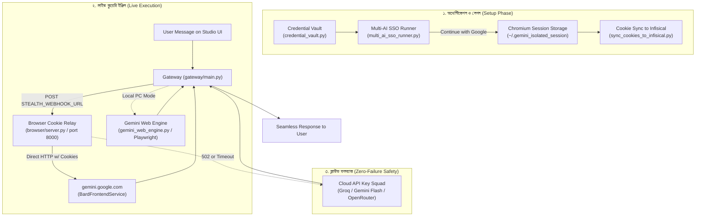

# SupremeAI — Ghost Tower Multi-AI Engine: Architecture & Future Roadmap
> **স্ট্যাটাস:** Active Engineering Standard & Roadmap  
> **ডোমেইন:** `gateway/ghost_tower` & `supremeai-api` (Provider Gateway Moat)  
> **লক্ষ্য:** $0 খরচে মাল্টি-মডেল ওয়েব রিলে (Gemini, ChatGPT, Mistral, Perplexity) পরিচালনা এবং জিরো-ফেইলওভার গেটওয়ে নিশ্চিতকরণ।

---

## ১. ভূমিকা ও প্রেক্ষাপট (Executive Summary)

সুপ্রিমএআই-এর আর্কিটেকচারে **Ghost Tower** হলো এমন একটি স্টেলথ ও ওয়েব-রিলে সাবসিস্টেম, যা সাধারণ পেইড API বিল শূন্যে ($0) নামিয়ে আনার জন্য তৈরি। 

* **মূল দর্শন:** বৈধ ব্রাউজার সেশন ও গুগল এসএসও (Google SSO - "Continue with Google") ব্যবহার করে শীর্ষ এআই প্ল্যাটফর্মগুলোর (Gemini, ChatGPT, Mistral, Perplexity) ফ্রি-টিয়ার আনলক করা।
* **জিরো-ডাউনটাইম গ্যারান্টি:** ব্রাউজার সেশন বা কুকি ফেইল করলে ব্যবহারকারী কোনো এরর দেখতে পাবে না; গেটওয়ে চোখের পলকে ক্লাউড API Key পুলে (Groq, Gemini Flash, OpenRouter) ফলব্যাক করে নিরবচ্ছিন্ন সেবা দেবে।

---

## ২. বর্তমান আর্কিটেকচার কীভাবে কাজ করছে? (How It Works Today)

বর্তমান সিস্টেমে সম্পূর্ণ পাইপলাইনটি ৪টি স্তরে বিভক্ত:



### ২.১ উপাদানগুলোর বর্তমান অবস্থা ও দায়িত্ব:

| ফাইল / উপাদান | মূল দায়িত্ব | বর্তমান অবস্থা |
|---|---|---|
| **`multi_ai_sso_runner.py`** | গুগল অ্যাকাউন্টের মাধ্যমে ChatGPT, Grok, Mistral ও Perplexity-তে স্বয়ংক্রিয়ভাবে লগইন করা। | **সম্পন্ন (Active):** এটি সব এআই-এর সেশন কুকি ব্রাউজার প্রোফাইলে সংরক্ষণ করতে পারে। |
| **`gemini_web_engine.py`** | লোকাল প্লে-রাইট ব্রাউজারে `gemini.google.com`-এ প্রম্পট টাইপ করা এবং উত্তর স্ক্র্যাপ করা। | **সম্পন্ন (Active):** শুধুমাত্র Gemini-এর জন্য কার্যকরী। |
| **`browser/server.py` (PR #796)** | Render Free Tier-এ মাত্র ~30MB RAM দিয়ে গুগল কুকি ব্যবহার করে ক্লাউড থেকে সরাসরি জেমিনির উত্তর আনা। | **সম্পন্ন (Active):** রেন্ডার ফ্রি টিয়ারে লাইভ। |
| **`gateway/stealth_webhook.py`** | গেটওয়ে থেকে স্টেলথ ইঞ্জিনে রিকোয়েস্ট পাঠানো এবং ফেইল হলে ৫ সেকেন্ডে ফলব্যাক ট্রিপ করা। | **সম্পন্ন (Active):** গেটওয়ের ভেতর ইন্টিগ্রেটেড। |

---

## ৩. বর্তমান ব্যবস্থার ফাঁক ও সীমাবদ্ধতা (Current Gaps)

1. **নামের সীমাবদ্ধতা (`gemini_web_engine.py`):**
   - ফাইলটির নাম শুধুমাত্র জেমিনি হওয়ার কারণ—এটি শুধুমাত্র `gemini.google.com`-এর DOM স্ট্রাকচার চেনে।
   - `multi_ai_sso_runner.py` দিয়ে ChatGPT বা Mistral-এ লগইন হলেও তাদের ইনপুট বক্সে মেসেজ পাঠিয়ে উত্তর সংগ্রহ করার কোনো **Scraper/Runner** এখনও তৈরি করা হয়নি।
2. **রিপোজিটরি বাউন্ডারি ত্রুটি (Location Drift):**
   - Ghost Tower-এর সমস্ত স্ক্রিপ্ট বর্তমানে `browser/` ফোল্ডারে অবস্থান করছে।
   - কিন্তু `docs/SUPREMEAI_BROWSER_INTEGRATION.md` §৭ অনুসারে, `supremeai-browser` রিপোজিটরিটি কেবল পাবলিক ও ক্লিন স্যান্ডবক্সের জন্য নির্ধারিত।
   - Ghost Tower যেহেতু LLM ফলব্যাক প্রোভাইডার, তাই এটি **`gateway/` বা `supremeai-api`**-এর অভ্যন্তরীণ অংশ হওয়া উচিত।
3. **জিমেইল বনাম জেমিনি সেশনের বিভ্রান্তি (Gmail Identity vs. Gemini App Invariant):**
   - **সাধারণ ভুল ধারণা:** অনেকেই মনে করেন ব্রাউজারে জিমেইল (Gmail) লগইন থাকা মানেই জেমিনি (Gemini) সেশন রেডি। এটি সম্পূর্ণ সঠিক নয়।
   - **প্রকৃত কারিগরি বাস্তবতা:**
     - **আইডেন্টিটি বনাম সার্ভিস:** জিমেইল হলো সেন্ট্রাল গুগল অ্যাকাউন্ট আইডেন্টিটি (`accounts.google.com`)। এটি ব্যবহার করে অন্যান্য AI প্ল্যাটফর্মে (যেমন: ChatGPT, Perplexity, Mistral) গুগল SSO দিয়ে এক-ক্লিকে লগইন করা যায়।
     - **জেমিনি আলাদা অ্যাপ কনসেন্ট:** `gemini.google.com` হলো একটি স্বতন্ত্র AI প্রোডাক্ট। জিমেইলে সাইন-ইন থাকলেও জেমিনি পেজে প্রথমবারের জন্য "Terms of Service" বা "Continue" কনসেন্ট নিশ্চিত করতে হয়।
     - **কুকি ডোমেইন পার্থক্য:** সেন্ট্রাল গুগল কুকি (`SID`, `SSID`, `__Secure-1PSID`) থাকে `.google.com`-এ (যা জিমেইল ও SSO সচল রাখে), কিন্তু জেমিনির চ্যাট হ্যান্ডলারের কিছু স্টেট থাকে `gemini.google.com`-এর সাবডোমেইন ও লোকাল স্টোরেজে।
     - **অ্যাকাউন্ট টাইপ:** সাধারণ ব্যক্তিগত `@gmail.com` অ্যাকাউন্টে জেমিনি সরাসরি অ্যাক্সেসযোগ্য, কিন্তু প্রাতিষ্ঠানিক/Workspace জিমেইল অ্যাকাউন্টে অ্যাডমিন পারমিশন না থাকলে জিমেইল ইনবক্স কাজ করলেও জেমিনি অ্যাক্সেস ব্লকড থাকে।

---

## ৪. ফিউচার রোডম্যাপ: ভবিষ্যতে কী কী করতে হবে? (Future Engineering Roadmap)

### ফেজ ১: ডোমেইন রি-পজিশনিং (Architecture Relocation)
* **কাজ ১:** `browser/ghost_tower/` ফোল্ডারটিকে সরিয়ে **`gateway/ghost_tower/`**-এ স্থানান্তর করা।
* **কাজ ২:** `browser/server.py` (কুকি রিলে)-কে `gateway/relay/` বা `gateway/ghost_tower/relay_service.py` হিসেবে যুক্ত করা।
* **ফলাফল:** `Supremeai-bd/supremeai-browser` স্যাটেলাইটটি সম্পূর্ণ লিগ্যাল ও ক্লিন ওয়েব-স্যান্ডবক্স থাকবে; আর সমস্ত স্টেলথ ও গ্রে-বক্স রিলে `Supremeai-bd/supremeai-api` (Ghost-Cloaked Moat)-এর সুরক্ষিত ভল্টে থাকবে।

---

### ফেজ ২: ইউনিফাইড মাল্টি-এআই কুয়েরি ইঞ্জিন (`unified_web_engine.py`)
বর্তমানে শুধু জেমিনি থেকে উত্তর নেওয়া যায়। এই ফেজে অন্য সব এআই-এর জন্য স্ক্র্যাপার ইন্টিগ্রেট করে একটি ইউনিফাইড ইঞ্জিন তৈরি করতে হবে:

```python
# লক্ষ্য: unified_web_engine.py
class UnifiedWebEngine:
    async def ask(self, prompt: str, provider: str = "gemini") -> str:
        if provider == "gemini":
            return await self._ask_gemini(prompt)
        elif provider == "chatgpt":
            return await self._ask_chatgpt(prompt)
        elif provider == "mistral":
            return await self._ask_mistral(prompt)
        elif provider == "perplexity":
            return await self._ask_perplexity(prompt)
```

#### বাস্তবায়নের উপাদানসমূহ:
1. **ChatGPT Web Scraper:**
   - URL: `https://chatgpt.com`
   - Input Selector: `#prompt-textarea, textarea, div[contenteditable="true"]`
   - Response Selector: `div[data-message-author-role="assistant"]`
2. **Mistral Le Chat Scraper:**
   - URL: `https://chat.mistral.ai/chat`
   - Input Selector: `textarea[placeholder*="Ask"]`
   - Response Selector: `div.prose, [data-testid="message-content"]`
3. **Perplexity Live Web Search:**
   - URL: `https://perplexity.ai`
   - লাইভ ওয়েব সার্চ ও রিয়েল-টাইম তথ্য সংগ্রহের জন্য ব্যবহৃত হবে।

---

### ফেজ ৩: স্মার্ট মডেল রাউটার (Intelligent Routing Matrix)

প্রম্পটের ধরন বুঝে স্বয়ংক্রিয়ভাবে সেরা ফ্রি এআই মডেল নির্বাচন করার মেকানিজম:

| কাজের ধরন | সেরা মডেল | কেন? |
|---|---|---|
| **জটিল কোডিং ও অ্যালগরিদম** | **Mistral Large / Codestral** | শক্তিশালী রিজনিং ও কোড জেনারেশন। |
| **সাধারণ কনভারসেশন ও সামারি** | **ChatGPT-4o (mini)** | দ্রুত রেসপন্স ও চমৎকার ন্যাচারাল টোন। |
| **লাইভ নিউজ ও ওয়েব রিসার্চ** | **Perplexity (Sonar)** | সরাসরি গুগল/বিং সার্চ করে রেফারেন্সসহ উত্তর দেয়। |
| **বড় ডকুমেন্ট ও লং কনটেক্সট** | **Gemini (1.5/2.0 Pro)** | ২ মিলিয়ন টোকেনের বিশাল কনটেক্সট উইন্ডো। |

---

### ফেজ ৪: সেশন হেলথ গার্ড ও কুকি অটো-রোটেশন (Session Resilience)
1. **টেলিগ্রাম অ্যালার্ট ব্রিজ:** কোনো প্ল্যাটফর্মে গুগল সেশন এক্সপায়ার হলে বা ক্লাউডফ্লেয়ার ক্যাপচা আসলে টেলিগ্রাম বটে নোটিফিকেশন পাঠানো (`notify_telegram`)।
2. **ব্যাকগ্রাউন্ড অটো-রিফ্রেশ:** প্রতিদিন রাতে ব্যাকগ্রাউন্ডে একবার সব ট্যাবে ভিজিট করে কুকির মেয়াদ বাড়িয়ে নেওয়া।
3. **ইনফিসিকাল ভল্ট সিঙ্ক:** লোকাল পিসিতে কুকি তৈরি হওয়া মাত্রই `sync_cookies_to_infisical.py` দিয়ে ক্লাউড ভল্টে পুশ করে দেওয়া, যাতে Render সার্ভার সাথে সাথে লেটেস্ট কুকি পেয়ে যায়।

---

## ৫. সংক্ষেপ ও কার্যনির্বাহী সুপারিশ (Actionable Next Steps)

1. **তাৎক্ষণিক কাজ:** বর্তমান `browser/ghost_tower` এবং রিলে কোডগুলোকে `gateway/` ফোল্ডারে রিফ্যাক্টর করে PR ওপেন করা।
2. **মধ্যবর্তী কাজ:** `chatgpt_scraper` এবং `mistral_scraper` মডিউল দুটি লিখে `gemini_web_engine`-এর সাথে যুক্ত করে `unified_web_engine` তৈরি করা।
3. **চূড়ান্ত ফল:** কোনো মাসিক API বিল ছাড়াই সুপ্রিমএআই একটি শক্তিশালী **Multi-Model Ghost Fleet** হিসেবে ২৪/৭ ফ্রিতে পরিচালিত হবে।
