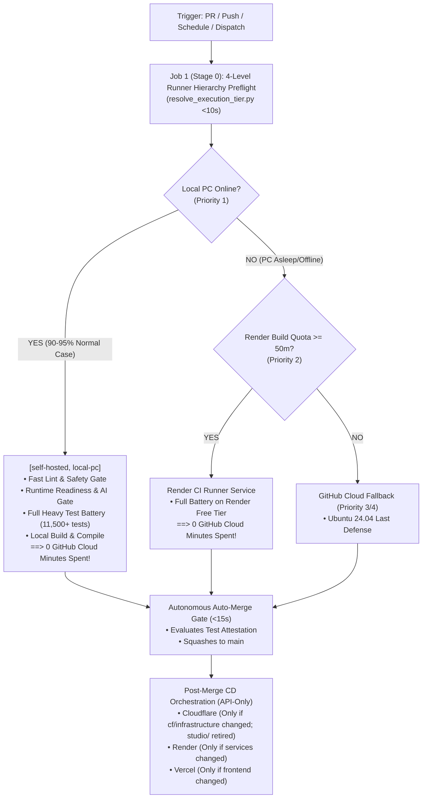
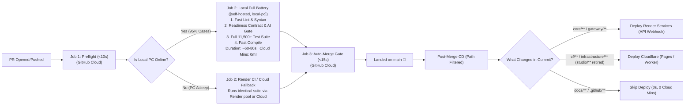

# SupremeAI Pipeline Architecture & Execution SSOT
> **Universal Master Blueprint: সকল পাইপলাইনের পূর্ণাঙ্গ তালিকা, বর্তমান ত্রুটি ও কাঙ্ক্ষিত আদর্শ আর্কিটেকচার**  
> **Document Status:** Canonical Single Source of Truth (SSOT)  
> **Target Cloud Budget:** ≤ 15–20 Seconds GitHub Cloud Runtime per PR | Work Budget ≤ 0.01%

---

## সূচিপত্র (Table of Contents)
1. [মূল সাংবিধানিক নীতিমালা (Core Constitutional Invariants)](#১-মূল-সাংবিধানিক-নীতিমালা-core-constitutional-invariants)
2. [সকল পাইপলাইনের পূর্ণাঙ্গ রেজিস্ট্রি ও অডিট (Comprehensive Pipeline Audit)](#২-সকল-পাইপলাইনের-পূর্ণাঙ্গ-রেজিস্ট্রি-ও-অডিট)
   - [২.১ Unified CI/CD Pipeline (`unified-pipeline.yml`)](#২১-supremeai-unified-cicd-pipeline-unified-pipelineyml)
   - [২.২ Client Release Pipeline (`client-release.yml`)](#২২-client-release-pipeline-client-releaseyml)
   - [২.৩ Nightly Ops & Maintenance (`ops-maintenance.yml`)](#২৩-nightly-ops--maintenance-ops-maintenanceyml)
   - [২.৪ Opportunistic 24h+ Audit (`opportunistic-nightly-audit.yml`)](#২৪-opportunistic-24h-audit-opportunistic-nightly-audityml)
   - [২.৫ Test Local Runner (`test-local-runner.yml`)](#২৫-test-local-runner-test-local-runneryml)
3. [শনাক্তকৃত প্রধান ত্রুটি ও অপচয় বিশ্লেষণ (Cloud Waste & Gap Analysis)](#৩-শনাক্তকৃত-প্রধান-ত্রুটি-ও-অপচয়-বিশ্লেষণ)
   - [গ্যাপ ১: লোকাল পিসি অনলাইন থাকা সত্ত্বেও ক্লাউডে ফাস্ট গেট চলা](#গ্যাপ-১-লোকাল-পিসি-অনলাইন-থাকা-সত্ত্বেও-ক্লাউডে-ফাস্ট-গেট-চলা)
   - [গ্যাপ ২: Cloudflare Deploy-এ Path-Filter না থাকা ও ক্লাউডে ভারী বিল্ড](#গ্যাপ-২-cloudflare-deploy-এ-path-filter-না-থাকা-ও-ক্লাউডে-ভারী-বিল্ড)
   - [গ্যাপ ৩: ডিপ্লয়মেন্ট জবের ক্লাউড ও লোকাল আইসোলেশন](#গ্যাপ-৩-ডিপ্লয়মেন্ট-জবের-ক্লাউড-ও-লোকাল-আইসোলেশন)
4. [সার্বজনীন আদর্শ এক্সিকিউশন মেট্রিক্স ও ফ্লোচার্ট (Ideal Execution Flowchart & Matrix)](#৪-সার্বজনীন-আদর্শ-এক্সিকিউশন-মেট্রিক্স-ও-ফ্লোচার্ট)
5. [বাস্তবায়ন কর্মপরিকল্পনা ও নির্দেশিকা (Action Plan)](#৫-বাস্তবায়ন-কর্মপরিকল্পনা-ও-নির্দেশিকা)

---

## ১. মূল সাংবিধানিক নীতিমালা (Core Constitutional Invariants)

আমাদের সিস্টেমের প্রতিটি পাইপলাইন (বর্তমান ও ভবিষ্যতের ১,০০,০০০+ ওয়ার্কফ্লো) কঠোরভাবে নিচের **৩টি মূল নীতি** মেনে চলবে:



### ১.১ Universal Job 1 Hierarchy Check Invariant
- যে কোনো পাইপলাইনের **প্রথম কাজ (Job 1)** হবে `<10` সেকেন্ডের একটি লাইটওয়েট ক্লাউড চেক (`resolve_execution_tier.py`)।
- এটি ৪টি স্তরের অগ্রাধিকার নির্ধারণ করে:
  1. **Priority 1 (লোকাল পিসি):** `[self-hosted, local-pc]` (Windows PC).
  2. **Priority 2 (১ম বিকল্প):** Render CI Runner Service (`srv-dbl8tbmtlv9c73bbkvqg`).
  3. **Priority 3 (২য় বিকল্প):** GitHub Cloud Runner + Render Backend.
  4. **Priority 4 (জরুরি অবস্থা):** GitHub Cloud Emergency.

### ১.২ Total Local Execution Invariant (Zero Cloud Waste)
- **যদি Job 1 দেখে লোকাল পিসি অনলাইন আছে:** তবে ক্লাউডে আর কোনো টেস্টিং জব চলবে না! ফাস্ট গেট, সিনট্যাক্স, রেডিনেস কন্ট্রাক্ট, এআই সিম্যান্টিক গেট এবং হেভি টেস্ট ব্যাটারি—**সবকিছু একবারে লোকাল পিসিতে চলবে (ক্লাউড খরচ = ০ মিনিট)**।
- ক্লাউড রানারের কাজ সীমাবদ্ধ থাকবে শুধুমাত্র:
  1. Job 1 Preflight (~৮ সেকেন্ড)
  2. Auto-Merge Land (~১০–১৫ সেকেন্ড)
  - **মোট ক্লাউড সময়: সর্বোচ্চ ২০–২৫ সেকেন্ড (≤ ০.৪ মিনিট)!**

### ১.৩ Deployment Independence & Strict Path-Filter Invariant
- ডিপ্লয়মেন্ট কখনো লোকাল পিসির ওপর নির্ভর করবে না; এটি সবসময় ক্লাউড API ট্রিগার (`ubuntu-latest`) হিসেবে পোস্ট-মার্জে চলবে।
- **কঠোর Path-Filter:** যে সার্ভিসের কোড পরিবর্তিত হয়নি, তার ডিপ্লয়মেন্ট কখনো চলবে না। `studio/` সারফেস অবসরপ্রাপ্ত (retired) — তাই এখন থেকে `infrastructure/cloudflare*` পরিবর্তন না হলে Cloudflare Pages বিল্ড সম্পূর্ণ স্কিপ থাকবে (০ মিনিট)।

---

## ২. সকল পাইপলাইনের পূর্ণাঙ্গ রেজিস্ট্রি ও অডিট

SupremeAI রিপোজিটরির `.github/workflows/` ডিরেক্টরিতে মোট ৫টি পাইপলাইন রয়েছে। নিচে প্রতিটি পাইপলাইনের বর্তমান অবস্থা এবং পরিকল্পনা অনুযায়ী আসলে কেমন হওয়া উচিত তা বিশ্লেষণ করা হলো:

```
.github/workflows/
├── unified-pipeline.yml             # প্রধান CI/CD ও প্রোডাকশন রোলআউট পাইপলাইন
├── client-release.yml               # ভিএস কোড এক্সটেনশন, ডেস্কটপ ও মোবাইল রিলিজ
├── ops-maintenance.yml              # নাইটলি অপারেশনস, সিকিউরিটি অডিট ও রক্ষণাবেক্ষণ
├── opportunistic-nightly-audit.yml  # ২৪ ঘণ্টার লোকাল-ওয়েক অপোরচুনিস্টিক অডিট
└── test-local-runner.yml            # লোকাল সেলফ-হোস্টেড রানার সংযোগ ভেরিফায়ার
```

---

### ২.১ SupremeAI Unified CI/CD Pipeline (`unified-pipeline.yml`)

#### বর্তমান কাজের পরিধি (Scope):
সব ধরণের পুল রিকোয়েস্ট (PR), মেইন ব্রাঞ্চ পুশ, এবং ম্যানুয়াল ডিসপ্যাচে এটি প্রধান গেটকিপার ও প্রোডাকশন ডিপ্লয়মেন্ট ইঞ্জিন হিসেবে কাজ করে।

#### ❌ বর্তমানে কী ভুল/অপচয় হচ্ছে?
1. **ক্লাউডে ফাস্ট গেট চালানো:** Job 1-এ লোকাল পিসি অনলাইন ডিটেক্ট হওয়া সত্ত্বেও `fast-gate` (২৪ সে.) এবং `runtime-readiness` (১ মি. ৪ সে.) গিটহাব ক্লাউডে রান হচ্ছে। ফলে প্রতি পিআরে প্রায় **১.৩ মিনিট ক্লাউড কোটা অপ্রয়োজনে নষ্ট হচ্ছে**।
2. **Cloudflare Deploy-এ Path-Filter অনুপস্থিত:** মেইন ব্রাঞ্চে কোনো ব্যাকএন্ড বা ডকস ফাইল পুশ হলেও `deploy-cloudflare` জব ট্রিগার হয়ে `npm install` ও `npm run build` চালাচ্ছে, যা **৩ থেকে ৫ মিনিট ক্লাউড মিনিট অপচয় করছে**।

#### ✅ পরিকল্পনা অনুযায়ী আসলে কীভাবে চলা উচিত (Ideal Target):



#### আদর্শ জবের তালিকা ও রানার ম্যাপিং:
1. **`resolve-execution-tier` (Stage 0):** `ubuntu-latest` (<10s) — রানার স্ট্যাটাস ও কোটা আউটপুট দেবে।
2. **`run-all-tests-local` (Stage 1 — Primary):** `[self-hosted, local-pc]` (`if: is_local_online == 'true'`)
   - ফাস্ট লিন্ট + রেডিনেস + হেভি টেস্ট ব্যাটারি সব একযোগে লোকাল উইন্ডোজে চলবে।
   - **ক্লাউড মিনিট: ০ মিনিট।**
3. **`run-all-tests-render-ci` (Stage 1 — Fallback 1):** `render-ci-runner` (`if: is_local_online != 'true' && tier == 'render-ci-runner'`)
   - Render-এর ফ্রি ৫০০ মিনিটের পুলে চলবে।
   - **ক্লাউড মিনিট: ০ মিনিট।**
4. **`run-all-tests-github-cloud` (Stage 1 — Fallback 2/3):** `ubuntu-latest` (জরুরি ক্লাউড ফলব্যাক)।
5. **`auto-merge` (Stage 2):** `ubuntu-latest` (১০–১৫ সে.) — স্কোয়াশ মার্জ।
6. **`deploy-cloudflare` (Stage 3):** `ubuntu-latest` — `paths:` ফিল্টার যুক্ত:
   ```yaml
   # studio/ সারফেস অবসরপ্রাপ্ত (retired) — এখন শুধু Edge/Cloudflare infra বদলালে ডিপ্লয় চলবে
   if: contains(changed_files, 'infrastructure/cloudflare')
   ```
   অন্যথায় সরাসরি স্কিপ।

---

### ২.২ Client Release Pipeline (`client-release.yml`)

#### বর্তমান কাজের পরিধি (Scope):
ভিএস কোড এক্সটেনশন (`.vsix`), ডেস্কটপ ক্লায়েন্ট (`.exe`/NSIS via Tauri), এবং মোবাইল ক্লায়েন্ট (`.apk` via Capacitor) রিলিজ তৈরি করে।

#### বর্তমান অবস্থা:
- এতে ইতিমধ্যে Job 1 হিসেবে `runner-check` (`resolve_execution_tier.py`) আছে।
- এতে `detect-changes` (paths-filter) কাজ করছে।
- ডেস্কটপ বিল্ড লোকাল পিসিতে এবং ক্লাউড ফলব্যাকে বিভক্ত রয়েছে।

#### ✅ পরিকল্পনা অনুযায়ী ফাইনাল টিউনিং:
- Job 1-এর নাম স্ট্যান্ডার্ডাইজেশন: `resolve-execution-tier` (SSOT অনুসারে)।
- এক্সটেনশন ও মোবাইল বিল্ডেও লোকাল রানার প্রিফারেন্স কার্যকর করা যাতে কোনো ক্লাউড মিনিট খরচ না হয়।

---

### ২.৩ Nightly Ops & Maintenance (`ops-maintenance.yml`)

#### বর্তমান কাজের পরিধি (Scope):
প্রতি রাত ৩:০০ টায় এবং রবিবার সাপ্তাহিক অডিটে ২০টির বেশি ডিপ অডিট, মিউটেশন টেস্টিং, পারফরম্যান্স বেঞ্চমার্ক, এবং ডিবি রিটেনশন পরিচালনা করে।

#### ❌ বর্তমানে কী সমস্যা হচ্ছে?
- `deep-audit` প্রায় ৪৫ মিনিট সময় নেয় এবং এটি সরাসরি `ubuntu-latest` ক্লাউড রানারে চলে।
- ফলে প্রতি সপ্তাহে শত শত ক্লাউড মিনিট নষ্ট হয়।

#### ✅ পরিকল্পনা অনুযায়ী আসলে কীভাবে চলা উচিত:
- Job 1 হিসেবে `resolve-execution-tier` চেক করবে।
- যদি লোকাল পিসি অন থাকে, তবে `deep-audit` লোকাল উইন্ডোজ পিসিতে চলবে।
- লোকাল পিসি বন্ধ থাকলে Render CI বা নাইটলি অপোরচুনিস্টিক শিডিউলে ডিফার করবে।

---

### ২.৪ Opportunistic 24h+ Audit (`opportunistic-nightly-audit.yml`)

#### বর্তমান কাজের পরিধি (Scope):
নির্দিষ্ট মধ্যরাতে ক্লাউড মিনিট নষ্ট না করে, প্রতি ২ ঘণ্টা পর পর হালকা চেক করে দেখে যে লোকাল পিসি সচল আছে কি না এবং ২৪ ঘণ্টা পার হয়েছে কি না। সচল থাকলে লোকাল পিসিতে গভীর অডিট চালায়।

#### বর্তমান অবস্থা ও সঠিকতা:
- এটি ইতিমধ্যেই শতভাগ সংবিধানসম্মতভাবে তৈরি।
- এটি ফিক্সড ক্রন এড়িয়ে দিনে ১,২০০+ ক্লাউড মিনিট সেভ করছে।
- এতে Job 1 হিসেবে `evaluate-audit-timing` রানার স্ট্যাটাস চেক করে।

---

### ২.৫ Test Local Runner (`test-local-runner.yml`)

#### বর্তমান কাজের পরিধি (Scope):
শুধুমাত্র ম্যানুয়াল ডিসপ্যাচের মাধ্যমে লোকাল উইন্ডোজ রানারের পরিবেশ, পাথ, এবং টেস্ট এক্সিকিউশন সক্ষমতা পরীক্ষা করা।

#### বর্তমান অবস্থা ও সঠিকতা:
- এটি শতভাগ সঠিক (`[self-hosted, local-pc]`) এবং কোনো পরিবর্তনের প্রয়োজন নেই।

---

## ৩. শনাক্তকৃত প্রধান ত্রুটি ও অপচয় বিশ্লেষণ

### গ্যাপ ১: লোকাল পিসি অনলাইন থাকা সত্ত্বেও ক্লাউডে ফাস্ট গেট চলা
- **সমস্যা:** PR #575-এ দেখা গেছে, Job 1 মাত্র ৮ সেকেন্ডে জানিয়ে দিয়েছে যে লোকাল পিসি অনলাইনে আছে। তবুও GitHub Cloud-এ `fast-gate` এবং `runtime-readiness` চালানো হয়েছে, যা প্রায় ১ মিনিট ২৮ সেকেন্ড ক্লাউড সময় খেয়েছে।
- **সমাধান:** লোকাল পিসি অনলাইন থাকলে ফাস্ট গেট ক্লাউডে না চালিয়ে সরাসরি লোকাল জবের প্রথম স্টেপ হিসেবে চালানো হবে। এতে ক্লাউড খরচ সরাসরি **০-তে নেমে আসবে**।

### গ্যাপ ২: Cloudflare Deploy-এ Path-Filter না থাকা ও ক্লাউডে ভারী বিল্ড
- **সমস্যা:** `deploy-cloudflare` জবে কোনো `paths` গার্ড ছিল না। ফলে প্রতিটি পুশে GitHub Cloud রানার `npm install` এবং `npm run build` করেছে (৩-৪ মিনিট অপচয়)।
- **সমাধান:**
  1. `paths` ফিল্টার যুক্ত করা: শুধুমাত্র `infrastructure/cloudflare*/**` পরিবর্তিত হলেই চলবে (`studio/**` সারফেস অবসরপ্রাপ্ত/retired, তাই আর কোনো স্টুডিও বিল্ড ট্রিগার নেই)।
  2. Cloudflare Pages-এর নেটিভ অটোমেটেড বিল্ড ব্যবহার করা (Cloudflare-এর নিজস্ব ফ্রি ক্লাউড), যাতে GitHub Actions-এ কোনো Nodejs বিল্ড রান করতে না হয়।

### গ্যাপ ৩: ডিপ্লয়মেন্ট জবের ক্লাউড ও লোকাল আইসোলেশন
- **সাংবিধানিক বিধান:** প্রোডাকশন ডিপ্লয়মেন্ট কখনো লোকাল মেশিনের ওপর নির্ভরশীল হবে না। লোকাল মেশিন স্লিপে যাক বা বন্ধ থাকুক, মার্জ হওয়ার পর ক্লাউড রানার সরাসরি Render ও Cloudflare API ট্রিগার করে প্রোডাকশন আপডেট করবে।

---

## ৪. সার্বজনীন আদর্শ এক্সিকিউশন মেট্রিক্স ও ফ্লোচার্ট

| পাইপলাইনের নাম | ট্রিগার ইভেন্ট | Job 1 Preflight | লোকাল পিসি অনলাইন থাকলে (Priority 1) | লোকাল পিসি অফ থাকলে (Priority 2-4) | ডিপ্লয়মেন্ট রুট ও ফিল্টার | টার্গেট ক্লাউড রানটাইম |
| :--- | :--- | :--- | :--- | :--- | :--- | :--- |
| **Unified CI/CD** (`unified-pipeline.yml`) | Pull Request, Push to `main` | `resolve-execution-tier` (<10s) | সম্পূর্ণ টেস্টিং ব্যাটারি লোকাল পিসিতে (০ মিনিট) | Render CI Runner (০ মিনিট) -> ক্লাউড ফলব্যাক | Path-Filtered (Render/CF/Vercel API) | **≤ ২০–২৫ সেকেন্ড** |
| **Client Release** (`client-release.yml`) | Push to `vscode/**`, Dispatch | `resolve-execution-tier` (<10s) | লোকাল উইন্ডোজ ডেস্কটপ বিল্ড | Cloud Windows Fallback | GitHub Releases & Artifact Attestation | **০ মিনিট (লোকাল)** / ৫ মিনিট (ফলব্যাক) |
| **Ops Maintenance** (`ops-maintenance.yml`) | Sunday 03:00, Daily 04:00 | `resolve-execution-tier` (<10s) | লোকাল মেশিনে ডিপ অডিট | Render CI Runner | কোনো ডিপ্লয় নেই (অডিট রিপোর্ট Tower-এ পোস্ট) | **০ মিনিট (লোকাল)** |
| **Opportunistic Audit** (`opportunistic-nightly-audit.yml`) | ২ ঘণ্টা অন্তর ওয়েক-চেক | `evaluate-audit-timing` (<5s) | লোকাল মেশিনে ডিপ অডিট | স্কিপ (পিসি অন হওয়া পর্যন্ত অপেক্ষা) | কোনো ডিপ্লয় নেই | **০ মিনিট** |
| **Test Local Runner** (`test-local-runner.yml`) | Manual Dispatch | — | সরাসরি লোকাল রানার টেস্ট | — | — | **০ মিনিট** |

---

## ৫. বাস্তবায়ন কর্মপরিকল্পনা ও নির্দেশিকা

এই আদর্শ কাঠামো পূর্ণাঙ্গভাবে কার্যকর করার জন্য নিচের ৩টি সুনির্দিষ্ট পদক্ষেপ গ্রহণ করতে হবে:

1. **`unified-pipeline.yml` রিফ্যাক্টরিং:**
   - লোকাল পিসি অনলাইন থাকলে একক সমন্বিত লোকাল জব (`pipeline-local-pc`) রান করানো (Fast Gate + Readiness + Heavy Tests সব একসাথে লোকাল পিসিতে)।
   - `deploy-cloudflare`-এ `paths-filter` যুক্ত করে অপ্রয়োজনীয় বিল্ড পুরোপুরি বন্ধ করা।
2. **`ops-maintenance.yml` অপটিমাইজেশন:**
   - `deep-audit` এবং ভারী সিকিউরিটি স্ক্যানগুলোকে `resolve-execution-tier`-এর ফলাফলের সাথে ডাইনামিক্যালি বাইন্ড করা।
3. **SSOT আর্কিটেকচার নথিবদ্ধকরণ:**
   - এই সম্পূর্ণ মাস্টার ব্লুপ্রিন্টটি রিপোজিটরির স্থায়ী ডকুমেন্ট হিসেবে [`docs/PIPELINE_ARCHITECTURE_AND_EXECUTION_SSOT.md`](file:///f:/supremeai/docs/PIPELINE_ARCHITECTURE_AND_EXECUTION_SSOT.md)-এ সংরক্ষণ করা হলো।

---
*SupremeAI Sovereign Autonomous Architecture — Approved and codified for zero cloud waste.*

