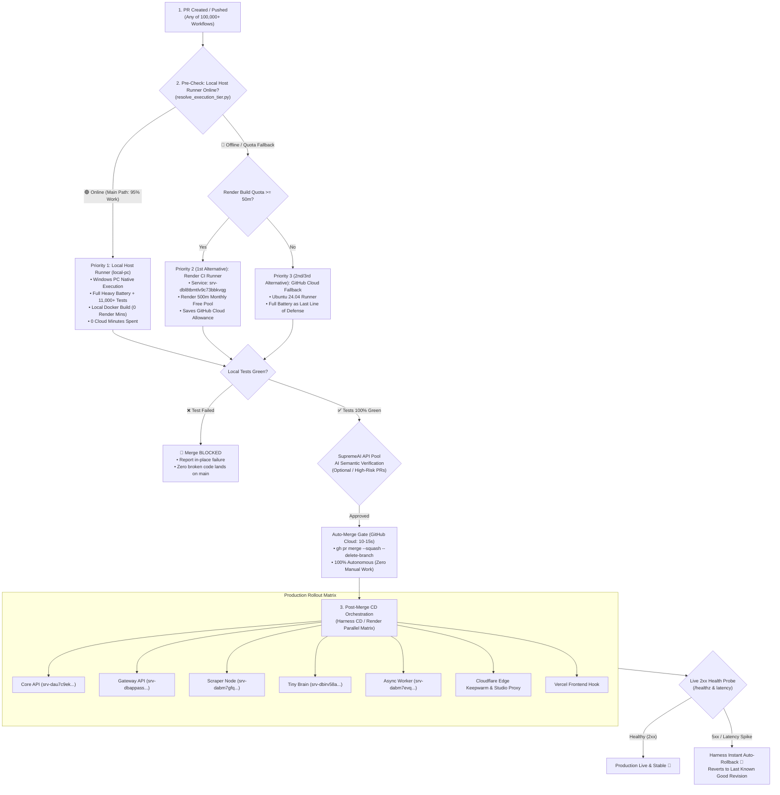

# SupremeAI Universal CI/CD, Lowest-Runtime & Production Deployment Architecture (Single Door SSOT)

> **SSOT Notice:** এই ডকুমেন্টটি SupremeAI ইকোসিস্টেমের **GitHub Actions, Local Host Runner (`local-pc`), Render CI Runner, Render Auto-Deployment, এবং Harness CD Engine**-এর একমাত্র ও প্রামাণ্য একক উৎস (Single Door SSOT)। বর্তমান ও ভবিষ্যতের যে কোনো পাইপলাইন (১,০০,০০০+ ওয়ার্কফ্লো, Dependabot, Dependency Graph, Maintenance Sweeps, Client Releases)—সকল ক্ষেত্রে এই আর্কিটেকচার অপরিবর্তনীয় সাংবিধানিক আইন হিসেবে প্রযোজ্য। পূর্বের সমস্ত বিচ্ছিন্ন ডকুমেন্টেশন এই একমাত্র ফাইলে একীভূত করা হলো।

---

## ১. মূল সাংবিধানিক উদ্দেশ্য (Prime Directive: Lowest Runtime & Zero Cloud Waste)

1. **সর্বনিম্ন ক্লাউড মিনিটস খরচ (Lowest GitHub Runtime):** GitHub Actions ক্লাউড রানারের কাজ সীমাবদ্ধ থাকবে শুধুমাত্র প্রি-ফ্লাইট ট্রিগার ও অটো-মার্জ গেটকিপিং-এ। প্রতি পিআরে ক্লাউড রানটাইম উইন্ডো **সর্বোচ্চ ১০–২০ সেকেন্ড**।
2. **১০০% স্বয়ংক্রিয় মেইন মার্জ (Zero Manual Merge — 100% Autonomous):** `main` ব্রাঞ্চে কোড মার্জ কোনো মানুষের ম্যানুয়াল কাজ নয়। সব টেস্ট (Tier 1 + Tier 2) ১০০% সবুজ হলে স্বয়ংক্রিয়ভাবে স্কোয়াশ মার্জ হবে; একটি টেস্টও ফেইল করলে মার্জ কঠোরভাবে ব্লক থাকবে।
3. **জিরো-আনচেকড পিআর (Zero Unchecked PRs Invariant):** কোনো পিআরে যেন `Checks 0` না দেখায়। রিপোজিটরির যেকোনো ফাইলে পরিবর্তন আসলেই সিআই পাইপলাইন সক্রিয় হবে এবং স্ট্যাটাস চেক রান সম্পন্ন করবে।
4. **লোকাল রানার প্রথম অগ্রাধিকার (Priority 1: Local Host `local-pc`):** পিআর পুশ হওয়া মাত্রই ৯০–৯৫% ভারী টেস্ট ব্যাটারি, কম্পাইল ও ডকার বিল্ড লোকাল মেশিনে চলবে (০ ক্লাউড মিনিটস খরচ)।
5. **একক সার্বজনীন নীতি বনাম নিয়মের বিস্তার রোধ (Single Universal Rule — Zero Rule Proliferation):** একই ধরনের ১০, ১০,০০০ বা ১০,০০,০০০ (১০ লক্ষ) পাইপলাইন বা টাস্ক থাকুক না কেন, তাদের জন্য ১০ লক্ষ আলাদা নিয়ম তৈরি নিষিদ্ধ। **সবগুলো কাজ একটিমাত্র সার্বজনীন নিয়ম মেনে চলবে।**
6. **সুপ্রিমএআই এআই ভেরিফিকেশন গেট (AI Semantic Gate via SupremeAI Key Pool):** কোড রিফ্লেকশন ও টেস্টের পাশাপাশি সুপ্রিমএআই-এর নিজস্ব ইন্টারনাল API Key Pool ব্যবহার করে এলএলএম দ্বারা পিআর ডিফ ও সিকিউরিটি বাউন্ডারি স্বয়ংক্রিয়ভাবে অডিট করার সুনির্দিষ্ট গেট।
7. **হারনেস সিডি ইঞ্জিন ও অটো-রোলব্যাক (Harness CD Engine):** প্রোডাকশন ডিপ্লয়মেন্ট রেন্ডার ও ক্লাউডফ্লেয়ারে রোলআউট করবে হারনেস; লাইভ এন্ডপয়েন্টে অস্বাভাবিক ল্যাটেন্সি বা ক্র্যাশ ধরা পড়া মাত্রই জিরো-টাচ স্বয়ংক্রিয় রোলব্যাক (Auto-Rollback) কার্যকর হবে।

---

## ১.১ অনুমোদিত ব্যাতিক্রমের রেজিস্ট্রি (Approved Exceptions Registry)

> **সাংবিধানিক বিধান:** কোনো নতুন নিয়ম বানিয়ে ব্যাতিক্রম চালানো যাবে না। শুধুমাত্র সুনির্দিষ্ট কারিগরি বা নিরাপত্তার কারণে যদি কোনো কাজের নিয়মে ব্যাতিক্রম ঘটে, তবে তা এই টেবিলে পূর্ব-নথিবদ্ধ থাকতে হবে:

| ব্যাতিক্রম (Exception) | প্রযোজ্য ক্ষেত্র | কেন এটি ব্যাতিক্রম? (Rationale) | বিকল্প সুরক্ষা মেকানিজম |
| :--- | :--- | :--- | :--- |
| **Fork PR Cloud Sandbox** | বহিরাগত বা ফর্ক করা পিআর | ফর্ক পিআরে থার্ড-পার্টির অপিরীক্ষিত কোড থাকে, যা লোকাল মেশিনে চালালে লোকাল হোস্টের নিরাপত্তা ঝুঁকিতে পড়তে পারে। | লোকাল রানারের পরিবর্তে নিরাপদ ও আইসোলেটেড GitHub Cloud Runner (`ubuntu-24.04`)-এ চলবে। |
| **Short Preflight Gate (<30s)** | সিনট্যাক্স, লিন্ট ও রানার প্রাক-যাচাই | লোকাল রানার সচল আছে কি না তা আগে যাচাই করতে ১০-১৫ সেকেন্ডের একটি লাইটওয়েট ক্লাউড চেক প্রয়োজন। | ডিপেনডেন্সি বিল্ড সম্পূর্ণ বাদ দিয়ে শুধু রফ ও পাইথন রানার স্ক্রিপ্ট চালানো হয়। |

---

## ১.২ সার্বজনীন পাইপলাইন এক্সিকিউশন অর্ডার নীতি (Universal Job 1 Preflight Hierarchy Check Invariant)

> **🔒 Universal Job 1 Hierarchy Check Invariant (বর্তমান ও ভবিষ্যৎ সকল পাইপলাইনের জন্য):**  
> GitHub Actions-এ বর্তমানে বিদ্যমান এবং ভবিষ্যতে যত পাইপলাইন তৈরি করা হবে (PR CI/CD, Client Release, Ops Maintenance, Nightly Audit, Dependabot ইত্যাদি), সেগুলোতে এক্সিকিউশনের অর্ডার অপরিবর্তনীয়ভাবে নিচের ক্রম অনুসরণ করবে:
> 
> 1. **Job 1 (Stage 0): 4-Level Runner Hierarchy Preflight (`resolve_execution_tier.py`)**  
>    - প্রতিটি পাইপলাইনের **প্রথম কাজ (Job 1)** হিসেবে সর্বদা `<10` সেকেন্ডে রানার অগ্রাধিকার যাচাই সম্পন্ন হবে (Priority 1: `[self-hosted, local-pc]` -> Priority 2: Render CI Runner -> Priority 3: GitHub Ubuntu + Render Backend -> Priority 4: GitHub Emergency)।
> 2. **Job 2 (Stage 1): Tier 1 Fast Safety Gates (<30s)**  
>    - সিনট্যাক্স, লিন্ট, বাউন্ডারি গার্ড ও স্যানিটেশন চেক দ্রুত সম্পন্ন হবে (`fast-gate`, `runtime-readiness`)।
> 3. **Job 3 (Stage 2): Tier 2 Heavy Test Battery (কঠোর ক্রমানুসারে Tier 1-এর পরে)**  
>    - হেভি টেস্ট ব্যাটারি বা বিল্ড কাজসমূহ **কঠোরভাবে Tier 1 Fast Safety Gate এবং Runtime Readiness ১০০% সবুজ হওয়ার পরে** শুরু হবে এবং Job 1 দ্বারা নির্ধারিত রানার টায়ারে এক্সিকিউট হবে।
> 4. **Job 4 (Stage 3): 100% অটোনমাস অটো-মার্জ গেট (`auto-merge`)**  
>    - সমস্ত গেট ১০০% সবুজ হলে অ্যাকশনস নিজে পিআর স্কোয়াশ মার্জ করবে।
> 5. **ডিপ্লয়মেন্ট স্বাধীনতা (Deployment Independence Invariant):**  
>    - প্রোডাকশন ডিপ্লয়মেন্ট (`deploy-render-services`, `deploy-cloudflare`, `deploy-vercel`, `Harness CD`) এই রানার হায়ারার্কি অনুসরণ করে না। ডিপ্লয়মেন্ট সবসময় সরাসরি ক্লাউড রানারে (`ubuntu-latest`) এপিআই কলের মাধ্যমে চলে।

---

## ২. এন্ড-টু-এন্ড ৪-স্তরের এক্সিকিউশন ও ডিপ্লয়মেন্ট ফ্লোচার্ট



---

## ৩. বিস্তারিত স্তরভিত্তিক কার্যপ্রণালী (Tier Breakdown)

### স্তর ১: পিআর ট্রিগার ও প্রাক-যাচাই (GitHub Cloud: ১০–২০ সেকেন্ড)
- **উদ্দেশ্য:** দ্রুত পিআরের সিনট্যাক্স, বাউন্ডারি গার্ড ও রানার স্ট্যাটাস যাচাই করা।
- **জব:** `fast-gate` এবং `runtime-readiness`।
- **রানটাইম অপটিমাইজেশন:** কোনো ভারি ডিপেনডেন্সি ইনস্টল না করে সরাসরি পাইথন স্ক্রিপ্ট ও `ruff` চালাবে।
- **রানার স্ট্যাটাস কুয়েরি:** GitHub API-এর মাধ্যমে `local-pc` সেলফ-হোস্টেড রানার অনলাইনে আছে কি না নিশ্চিত করা।

### স্তর ২: ভারী টেস্ট ব্যাটারি (কঠোর ক্রমানুসারে Tier 1-এর পরে)

> **🔒 Tier 2 Sequence Lock Invariant:** Tier 2 হেভি টেস্ট ব্যাটারি কখনোই Tier 1-এর সাথে প্যারালালে শুরু হতে পারবে না। এটি কঠোরভাবে নির্ধারিত: `Tier 1: Fast Safety Gate (<30s)` এবং `Tier 1: Runtime Readiness & Boundaries (<30s)` উভয়েই ১০০% সবুজ (PASS) হওয়ার পরেই কেবল Tier 2 রানার সক্রিয় হবে (`needs: [fast-gate, runtime-readiness]`)।

#### 🥇 অগ্রাধিকার ১ (Primary): লোকাল সেলফ-হোস্টেড রানার (`local-pc`)
- **টার্গেট লেবেল:** `[self-hosted, local-pc]` (আপনার উইন্ডোজ পিসি)।
- **কাজের পরিধি (৯০–৯৫% হেভি লোড):**
  - পুরো ব্যাকএন্ড টেস্ট ব্যাটারি (`tests/`, `core/tests/`, `gateway/tests/`—১১,৫০০+ টেস্ট)।
  - পাইথন ফুল কম্পাইল চেক (`python -m compileall -q core/ scripts/`)।
  - ওয়্যারিং অ্যাটলাস ও সিকিউরিটি বাউন্ডারি গার্ড।
- **ক্লাউড খরচ:** **০ মিনিট (Zero Cloud Minutes)**।
- **অ্যাটেস্টেশন:** সফল হলে MCP Tower-এ রেজাল্ট প্রকাশ করে (`publish_ci_attestation.py`)।

#### 🥈 অগ্রাধিকার ২ (১ম বিকল্প): Render CI Runner
- **কখন চলবে:** লোকাল পিসি বন্ধ বা স্লিপে থাকলে।
- **টার্গেট সার্ভিস:** `srv-dbl8tbmtlv9c73bbkvqg` (Render ফ্রি টায়ার কোটায় ব্যাকড)।
- **সুবিধা:** GitHub Actions-এর ২০০০ মিনিটের ক্লাউড কোটা অক্ষত থাকে।

#### 🥉 অগ্রাধিকার ৩ ও ৪ (২য় ও ৩য় বিকল্প): GitHub Cloud Fallback
- **কখন চলবে:** লোকাল হোস্ট ও Render CI উভয়ই অনুপলব্ধ থাকলে।
- **টার্গেট রানার:** `ubuntu-24.04` (Fast, isolated fallback)।
- **উদ্দেশ্য:** কোনো অবস্থাতেই যেন পিআর আটকে না থাকে (Fail-safe continuity)।

---

## ৪. স্তর ২খ: ১০০% অটোনমাস অটো-মার্জ গেট (Zero Manual Merge)

- **সম্পূর্ণ স্বয়ংক্রিয় ও ইন-ওয়ার্কফ্লো নিয়ন্ত্রিত:** কোড মার্জ করার জন্য কোনো ম্যানুয়াল ক্লিকের প্রয়োজন নেই।
- **টার্মিনাল থেকে `gh pr merge --auto` নিষিদ্ধ:** প্রাইভেট রিপোজিটরিতে (GitHub Free Plan) ব্র্যাঞ্চ প্রোটেকশন রুলস না থাকায় টার্মিনাল থেকে `--auto` দিলে গিটহাব কোনো চেক ছাড়াই তৎক্ষণাৎ পিআর মার্জ করে দেয়! তাই টার্মিনাল থেকে মার্জ কমান্ড দেওয়া সম্পূর্ণ নিষিদ্ধ।
- **একমাত্র মার্জ অথরিটি (`Auto-Merge PR (gated)`):** সিআই পাইপলাইনের শেষ ধাপ হিসেবে গিটহাব অ্যাকশনস নিজে পিআর মার্জ করবে।
- **কঠোর মার্জ পূর্বশর্ত:** 
  1. `fast-gate` এবং `runtime-readiness` সবুজ হতে হবে।
  2. `render-heavy-gate` (লোকাল পিসি অথবা ক্লাউড ফলব্যাক) সম্পূর্ণ পাস হতে হবে।
  3. কোনো টেস্ট ফেইল থাকলে বা স্কিপ করা হলে `Squash merge PR` স্টেপ স্কিপ হবে এবং পিআর মার্জ কঠোরভাবে আটকে থাকবে।
- **মার্জ অ্যাকশন:** সমস্ত গেট ১০০% সবুজ হলে অ্যাকশনস নিজে `gh pr merge "$PR_NUMBER" --squash --delete-branch` চালাবে।
- **রানটাইম:** মাত্র ১০–১৫ সেকেন্ড।

---

## ৫. সুপ্রিমএআই এআই ভেরিফিকেশন গেট (AI Semantic Gate via SupremeAI Key Pool)

যখন পিআরে গুরুত্বপূর্ণ আর্কিটেকচারাল পরিবর্তন বা কোর সিকিউরিটি ফাইল পরিবর্তিত হয়, তখন সুপ্রিমএআই-এর নিজস্ব API Key Pool ব্যবহার করে এআই অডিট পরিচালিত হয়:

```
[PR Diff & Reflection] 
          ↓
[SupremeAI Key Pool Router] (rotates active keys from api_keys table)
          ↓
[LLM Semantic Audit] 
  ├── Security Boundaries (Secret leaks, permission bypass)
  ├── Anti-Bloat Invariant (Occam's razor, minimal patch verification)
  └── Zero-Recurrence Check (Regression test coverage)
          ↓
[Sign CI Attestation / Approve Auto-Merge]
```

- **খরচ:** জিরো এক্সটার্নাল ক্লাউড খরচ; সুপ্রিমএআই-এর অভ্যন্তরীণ মাল্টি-প্রোভাইডার কী-পুল রাউটার ব্যবহারের মাধ্যমে সম্পন্ন হয়।
- **সুবিধা:** হিউম্যান কোড রিভিউর উপর নির্ভর না করে স্বয়ংক্রিয় ইন্টেলিজেন্ট কোড গার্ড নিশ্চিত করা।

---

## ৬. হারনেস সিডি ও প্রোডাকশন ডিপ্লয়মেন্ট (Cloud-Native Direct API Deployment)

> **🚀 Deployment Independence Invariant:** প্রোডাকশন ডিপ্লয়মেন্ট (`Deploy changed Render services`, `Deploy Cloudflare Edge Mesh`, `Deploy Vercel Frontend Hook`, `Harness CD Rollout`) এই ৩-টায়ার/৪-টায়ার রানার হায়ারার্কি **অনুসরণ করে না**। 
> - **কেন?** ডিপ্লয়মেন্ট হলো ক্লাউড API (Render, Cloudflare, Vercel) অর্কেস্ট্রেশন। এটি লোকাল পিসিতে চালানো বা লোকাল পিসির জন্য অপেক্ষা করানো সম্পূর্ণ নিষিদ্ধ (অন্যথায় ডেভেলপার ল্যাপটপ বন্ধ করলে প্রোডাকশন ডিপ্লয় আটকে যাবে)।
> - **কোথায় চলে?** ডিপ্লয় জবসমূহ সবসময় সরাসরি ক্লাউড রানারে (`ubuntu-latest`) চলে এবং ক্লাউড এপিআই-তে অনুমোদিত টোকেনসহ ডিপ্লয় ট্রিগার ও লাইভ হেলথ ভেরিফিকেশন পরিচালনা করে।

### ধাপ ১: লোকাল ডকার বিল্ড ও GHCR পুশ (Zero Render Build Minutes)
- লোকাল রানারে কোড মার্জ হওয়ার সাথে সাথে ডকার ইমেজ বিল্ড হয়ে `ghcr.io/supremeai-bd/supremeai:latest`-এ পুশ হবে।
- রেন্ডার সরাসরি প্রি-বিল্ট ডকার ইমেজ টানবে, ফলে রেন্ডারের ৫০০ মিনিটের ফ্রি বিল্ড কোটার ১ মিনিটও অপচয় হবে না।

### ধাপ ২: হারনেস ডিপ্লয়মেন্ট অর্কেস্ট্রেশন
- **কানেক্টর:** হারনেস `default_project`-এ পূর্বে কনফিগারকৃত GitHub Connector, Render API, Cloudflare ও Vercel কানেক্টর ব্যবহার করবে।
- **ট্রিগার:** GitHub Actions মার্জের পর মাত্র ১টি লাইটওয়েট ওয়েবহুক কল করে হারনেস সিডি শুরু করবে।

### ধাপ ৩: লাইভ প্রোব ও অটো-রোলব্যাক (Instant Fail-Safe)
- ডিপ্লয়মেন্ট শেষে লাইভ অ্যান্ডপয়েন্টে (`https://supremeai.onrender.com/healthz`) কন্টিনিউয়াস হেলথ প্রোব চলবে।
- ডিপ্লয় পরবর্তী ৫ মিনিটে যদি কোনো ক্র্যাশ (5xx), মেমোরি লিক বা রেসপন্স টাইম অস্বাভাবিক বাড়ে, হারনেস স্বয়ংক্রিয়ভাবে পূর্ববর্তী স্টেবল রিলিজে রোলব্যাক করবে।

---

## ৭. ইভেন্ট-ড্রিভেন ২৪ ঘণ্টার নাইটলি অডিট (Local-Wake Opportunistic Sweep)

- **ফিক্সড মিডনাইট ক্রন নিষিদ্ধ:** মধ্যরাতে আপনার পিসি বন্ধ থাকলে ক্লাউড মিনিট নষ্ট করার কোনো প্রয়োজন নেই।
- **পিসি অন হওয়া মাত্র ট্রিগার:** আপনার লোকাল পিসি চালু হওয়া মাত্রই যদি দেখা যায় সর্বশেষ অডিটের পর ২৪ ঘণ্টা বা তার বেশি সময় পার হয়েছে, তবে লোকাল রানার স্বয়ংক্রিয়ভাবে ব্যাকগ্রাউন্ডে সিকিউরিটি সুইপ ও ডিপ টেস্ট সম্পন্ন করবে।
- **ক্লাউড কোটা সাশ্রয়:** মাসে প্রায় ১,২০০+ ক্লাউড মিনিট সম্পূর্ণ সাশ্রয় হয়।

---

## ৮. সমস্যা ও সমাধান নির্দেশিকা (Troubleshooting & Invariants)

| সমস্যা | কারণ | স্বয়ংক্রিয় প্রতিকার |
| :--- | :--- | :--- |
| `MCP_TOWER_ATTESTATION_URL not configured` | রিপো ভ্যারিয়েবল অনুপস্থিত ছিল | রিপো ভ্যারিয়েবলে `https://supremeai-mcp-tower.onrender.com/api/ci/attestation` কনফিগার করা হয়েছে। |
| PR-এ `Checks 0` দেখানো (যেমন PR #543) | `pull_request.paths` ফিল্টারে `.github` অনুপস্থিত ছিল | `unified-pipeline.yml`-এ সব পিআরের জন্য চেক বাধ্যতামূলক করা হয়েছে, কোনো পিআর আনচেকড থাকবে না। |
| Render ডিপ্লয় এটেস্টেশনে `build_in_progress` ফেইলিওর (PR #542) | এটেস্টেশন স্ক্রিপ্টে পোলিং লুপ ছিল না | `render_deploy_attestation.py`-এ ১৫ সেকেন্ড অন্তর টার্মিনাল স্টেট (`live`) পোলিং কার্যকর করা হয়েছে। |
| লোকাল রানার অনলাইন থাকা সত্ত্বেও ফলব্যাকে যাওয়া | Actions API-তে `actions: read` পারমিশন ঘাটতি | `.github/workflows/unified-pipeline.yml`-এ পারমিশন নিশ্চিত করা হয়েছে। |
| ফর্ক পিআরে লোকাল রানার চলা | সিকিউরিটি থ্রেট | ফর্ক পিআর স্বয়ংক্রিয়ভাবে ক্লাউড ফলব্যাকে চলবে, লোকাল মেশিনে কখনো চলবে না (অনুমোদিত ব্যাতিক্রম)। |
| Render কোটা সংকট | অতিরিক্ত বিল্ড মিনিট খরচ | `render_quota_preflight.py` প্রতি বিল্ডের আগে রেন্ডার কোটা অডিট করে। |
| টেস্ট ফেইল সত্ত্বেও মার্জের চেষ্টা | আনঅথরাইজড বাইপাস | ইনভেরিয়েন্ট #৪ ও #১২ অনুযায়ী মার্জ গেট ১০০% সবুজ টেস্ট ছাড়া মার্জ ব্লক রাখে। |
