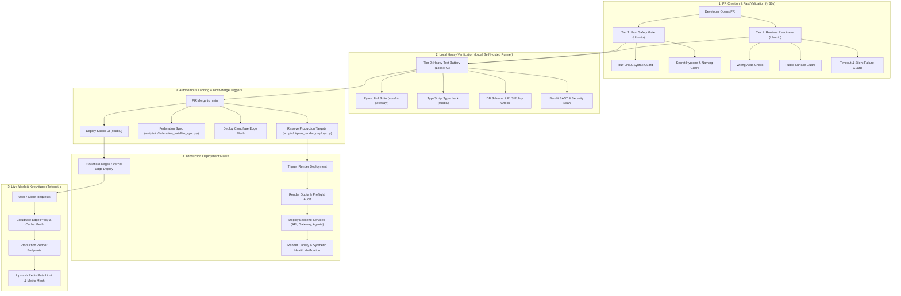

# SupremeAI PR-to-Production Lifecycle Architecture

## 1. Overview
This document specifies the authoritative, deterministic lifecycle of code in the SupremeAI monorepo from the moment a Pull Request (PR) is opened until changes are verified in production.

---

## 2. End-to-End Pipeline Workflow

---

## 3. Stages Detailed Breakdown

### Stage 1: Fast Safety & Runtime Gates (Tier 1)
- **Runner:** GitHub-hosted `ubuntu-24.04` (Fast, isolated).
- **Target Execution Time:** `< 60 seconds`.
- **Components:**
  - `scripts/ops/wiring_atlas.py --check`: Validates full dependency graph and service topology.
  - `scripts/ci/secret_hygiene_guard.py`: Detects hardcoded secrets, keys, or credentials.
  - `scripts/ci/timeout_policy_guard.py`: Enforces timeout boundaries across all external API calls.
  - `scripts/ci/silent_failure_guard.py`: Forbids swallowed exceptions (`except: pass`).

### Stage 2: Heavy Gate Verification (Tier 2)
- **Runner:** Self-hosted runner (`supremeai-local-pc`) or fallback runner.
- **Components:**
  - Full backend test suites across `core/` and `gateway/`.
  - Frontend typecheck and build validation for `studio/`.
  - Database schema safety and contract validation.

### Stage 2b: Autonomous Auto-Merge (Gated)
- **Role Isolation:** Autonomous agents only write code, verify locally, and open the Pull Request. Agents must never force-merge or bypass gates.
- **Merge Condition:** The gated `auto-merge` job in `unified-pipeline.yml` executes natively once `fast-gate`, `runtime-readiness`, and `render-heavy-gate` (or fallback) pass 100%. No human or bot manual intervention is needed.

### Stage 3: Post-Merge Actions & Deployment
- **Single-Monorepo SSOT:** All builds and artifacts deploy directly from the unified monorepo.
- **Target Resolution:** `scripts/ci/plan_render_deploys.py` identifies changed services to deploy only what changed.
- **Edge Deployment:** Deploys Cloudflare Worker proxy and Studio frontend (`studio/`).

### Stage 4: Continuous Audits & Health Watchdog
- Nightly and periodic health scans via `.github/workflows/ops-maintenance.yml` and `.github/workflows/opportunistic-nightly-audit.yml`.
