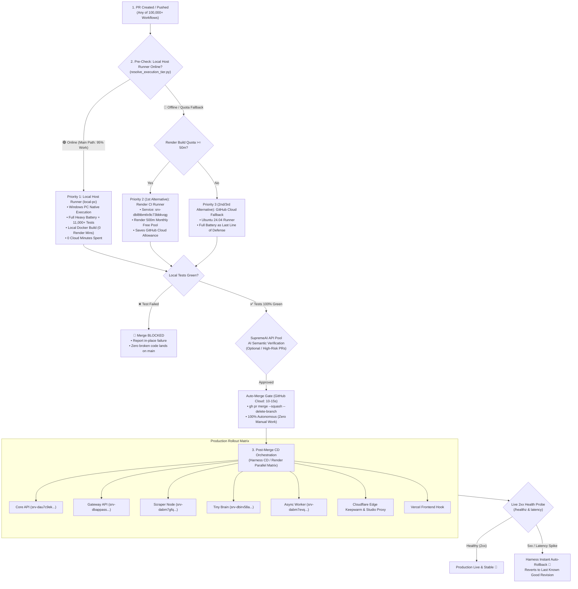

# SupremeAI Universal CI/CD, Lowest-Runtime & Production Deployment Architecture (Single Door SSOT)

> **SSOT Notice:** এই ডকুমেন্টটি SupremeAI ইকোসিস্টেমের **GitHub Actions, Local Host Runner (`local-pc`), Render CI Runner, Render Auto-Deployment, এবং Harness CD Engine**-এর একমাত্র ও প্রামাণ্য একক উৎস (Single Door SSOT)। বর্তমান ও ভবিষ্যতের যে কোনো পাইপলাইন (১,০০,০০০+ ওয়ার্কফ্লো, Dependabot, Dependency Graph, Maintenance Sweeps, Client Releases)—সকল ক্ষেত্রে এই আর্কিটেকচার অপরিবর্তনীয় সাংবিধানিক আইন হিসেবে প্রযোজ্য। পূর্বের সমস্ত বিচ্ছিন্ন ডকুমেন্টেশন এই একমাত্র ফাইলে একীভূত করা হলো।

---

## ১. মূল সাংবিধানিক উদ্দেশ্য (Prime Directive: Lowest Runtime & Zero Cloud Waste)

1. **সর্বনিম্ন ক্লাউড মিনিটস খরচ (Lowest GitHub Runtime):** GitHub Actions ক্লাউড রানারের কাজ সীমাবদ্ধ থাকবে শুধুমাত্র প্রি-ফ্লাইট ট্রিগার ও অটো-মার্জ গেটকিপিং-এ। প্রতি পিআরে ক্লাউড রানটাইম উইন্ডো **সর্বোচ্চ ১০–২০ সেকেন্ড**।
2. **১০০% স্বয়ংক্রিয় মেইন মার্জ (Zero Manual Merge — 100% Autonomous):** `main` ব্রাঞ্চে কোড মার্জ কোনো মানুষের ম্যানুয়াল কাজ নয়। সব টেস্ট (Tier 1 + Tier 2) ১০০% সবুজ হলে স্বয়ংক্রিয়ভাবে স্কোয়াশ মার্জ হবে; একটি টেস্টও ফেইল করলে মার্জ কঠোরভাবে ব্লক থাকবে।
3. **লোকাল রানার প্রথম অগ্রাধিকার (Priority 1: Local Host `local-pc`):** পিআর পুশ হওয়া মাত্রই ৯০–৯৫% ভারী টেস্ট ব্যাটারি, কম্পাইল ও ডকার বিল্ড লোকাল মেশিনে চলবে (০ ক্লাউড মিনিটস খরচ)।
4. **১,০০,০০০+ পাইপলাইন সার্বজনীন আইন (Universal Invariant #13):** সাধারণ পিআর পাইপলাইন হোক বা ১,০০,০০০+ ডিপেনডাবট/শিডিউলড পাইপলাইন—কোনো ওয়ার্কফ্লো ক্লাউড কোটা অপচয় করতে পারবে না। ৩০ সেকেন্ডের বেশি যে কোনো কাজ এই ৪-স্তরের হায়ারার্কি মেনে চলবে।
5. **সুপ্রিমএআই এআই ভেরিফিকেশন গেট (AI Semantic Gate via SupremeAI Key Pool):** কোড রিফ্লেকশন ও টেস্টের পাশাপাশি সুপ্রিমএআই-এর নিজস্ব ইন্টারনাল API Key Pool ব্যবহার করে এলএলএম দ্বারা পিআর ডিফ ও সিকিউরিটি বাউন্ডারি স্বয়ংক্রিয়ভাবে অডিট করার সুনির্দিষ্ট গেট।
6. **হারনেস সিডি ইঞ্জিন ও অটো-রোলব্যাক (Harness CD Engine):** প্রোডাকশন ডিপ্লয়মেন্ট রেন্ডার ও ক্লাউডফ্লেয়ারে রোলআউট করবে হারনেস; লাইভ এন্ডপয়েন্টে অস্বাভাবিক ল্যাটেন্সি বা ক্র্যাশ ধরা পড়া মাত্রই জিরো-টাচ স্বয়ংক্রিয় রোলব্যাক (Auto-Rollback) কার্যকর হবে।

---

## ২. এন্ড-টু-এন্ড ৪-স্তরের এক্সিকিউশন ও ডিপ্লয়মেন্ট ফ্লোচার্ট



---

## ৩. বিস্তারিত স্তরভিত্তিক কার্যপ্রণালী (Tier Breakdown)

### স্তর ১: পিআর ট্রিগার ও প্রাক-যাচাই (GitHub Cloud: ১০–২০ সেকেন্ড)
- **উদ্দেশ্য:** দ্রুত পিআরের সিনট্যাক্স, বাউন্ডারি গার্ড ও রানার স্ট্যাটাস যাচাই করা।
- **জব:** `fast-gate` এবং `runtime-readiness`।
- **রানটাইম অপটিমাইজেশন:** কোনো ভারি ডিপেনডেন্সি ইনস্টল না করে সরাসরি পাইথন স্ক্রিপ্ট ও `ruff` চালাবে।
- **রানার স্ট্যাটাস কুয়েরি:** GitHub API-এর মাধ্যমে `local-pc` সেলফ-হোস্টেড রানার অনলাইনে আছে কি না নিশ্চিত করা।

### স্তর ২: ভারী টেস্ট ব্যাটারি (৪-স্তরের অগ্রাধিকার)

#### 🥇 অগ্রাধিকার ১ (Primary): লোকাল সেলফ-হোস্টেড রানার (`local-pc`)
- **টার্গেট লেবেল:** `[self-hosted, local-pc]` (আপনার উইন্ডোজ পিসি)।
- **কাজের পরিধি (৯০–৯৫% হেভি লোড):**
  - পুরো ব্যাকএন্ড টেস্ট ব্যাটারি (`tests/`, `core/tests/`, `gateway/tests/`—১১,৫০০+ টেস্ট)।
  - পাইথন ফুল কম্পাইল চেক (`python -m compileall -q core/ scripts/`)।
  - ওয়্যারিং অ্যাটলাস ও সিকিউরিটি বাউন্ডারি গার্ড।
- **ক্লাউড খরচ:** **০ মিনিট (Zero Cloud Minutes)**।
- **অ্যাটেস্টেশন:** সফল হলে MCP Tower-এ রেজাল্ট প্রকাশ করে (`publish_ci_attestation.py`)।

#### 🥈 অগ্রাধিকার ২ (১ম বিকল্প): Render CI Runner
- **কখন চলবে:** লোকাল পিসি বন্ধ বা স্লিপে থাকলে।
- **টার্গেট সার্ভিস:** `srv-dbl8tbmtlv9c73bbkvqg` (Render ফ্রি টায়ার কোটায় ব্যাকড)।
- **সুবিধা:** GitHub Actions-এর ২০০০ মিনিটের ক্লাউড কোটা অক্ষত থাকে।

#### 🥉 অগ্রাধিকার ৩ ও ৪ (২য় ও ৩য় বিকল্প): GitHub Cloud Fallback
- **কখন চলবে:** লোকাল হোস্ট ও Render CI উভয়ই অনুপলব্ধ থাকলে।
- **টার্গেট রানার:** `ubuntu-24.04` (Fast, isolated fallback)।
- **উদ্দেশ্য:** কোনো অবস্থাতেই যেন পিআর আটকে না থাকে (Fail-safe continuity)।

---

## ৪. স্তর ২খ: ১০০% অটোনমাস অটো-মার্জ গেট (Zero Manual Merge)

- **সম্পূর্ণ স্বয়ংক্রিয়:** কোড রিভিউ বা মার্জ করার জন্য কোনো ম্যানুয়াল ক্লিকের প্রয়োজন নেই।
- **কঠোর মার্জ পূর্বশর্ত:** 
  1. `fast-gate` এবং `runtime-readiness` সবুজ হতে হবে।
  2. `render-heavy-gate` (লোকাল পিসি অথবা ক্লাউড ফলব্যাক) সম্পূর্ণ পাস হতে হবে।
  3. কোনো টেস্ট ফেইল থাকলে বা স্কিপ করা হলে পিআর মার্জ তাৎক্ষণিকভাবে প্রত্যাখ্যাত হবে।
- **মার্জ মেকানিজম:** গিটহাবের নেটিভ `gh pr merge --squash --delete-branch` স্বয়ংক্রিয়ভাবে কোড ল্যান্ড করাবে।
- **রানটাইম:** মাত্র ১০–১৫ সেকেন্ড।

---

## ৫. সুপ্রিমএআই এআই ভেরিফিকেশন গেট (AI Semantic Gate via SupremeAI Key Pool)

যখন পিআরে গুরুত্বপূর্ণ আর্কিটেকচারাল পরিবর্তন বা কোর সিকিউরিটি ফাইল পরিবর্তিত হয়, তখন সুপ্রিমএআই-এর নিজস্ব API Key Pool ব্যবহার করে এআই অডিট পরিচালিত হয়:

```
[PR Diff & Reflection] 
          ↓
[SupremeAI Key Pool Router] (rotates active keys from api_keys table)
          ↓
[LLM Semantic Audit] 
  ├── Security Boundaries (Secret leaks, permission bypass)
  ├── Anti-Bloat Invariant (Occam's razor, minimal patch verification)
  └── Zero-Recurrence Check (Regression test coverage)
          ↓
[Sign CI Attestation / Approve Auto-Merge]
```

- **খরচ:** জিরো এক্সটার্নাল ক্লাউড খরচ; সুপ্রিমএআই-এর অভ্যন্তরীণ মাল্টি-প্রোভাইডার কী-পুল রাউটার ব্যবহারের মাধ্যমে সম্পন্ন হয়।
- **সুবিধা:** হিউম্যান কোড রিভিউর উপর নির্ভর না করে স্বয়ংক্রিয় ইন্টেলিজেন্ট কোড গার্ড নিশ্চিত করা।

---

## ৬. হারনেস সিডি ইঞ্জিন ও অটো-রোলব্যাক (Harness CD Engine Blueprint)

Harness CD-কে প্রোডাকশন ডিপ্লয়মেন্টের অভিভাবক হিসেবে যুক্ত করার পূর্ণাঙ্গ ব্লুপ্রিন্ট:

### ধাপ ১: লোকাল ডকার বিল্ড ও GHCR পুশ (Zero Render Build Minutes)
- লোকাল রানারে কোড মার্জ হওয়ার সাথে সাথে ডকার ইমেজ বিল্ড হয়ে `ghcr.io/supremeai-bd/supremeai:latest`-এ পুশ হবে।
- রেন্ডার সরাসরি প্রি-বিল্ট ডকার ইমেজ টানবে, ফলে রেন্ডারের ৫০০ মিনিটের ফ্রি বিল্ড কোটার ১ মিনিটও অপচয় হবে না।

### ধাপ ২: হারনেস ডিপ্লয়মেন্ট অর্কেস্ট্রেশন
- **কানেক্টর:** হারনেস `default_project`-এ পূর্বে কনফিগারকৃত GitHub Connector, Render API, Cloudflare ও Vercel কানেক্টর ব্যবহার করবে।
- **ট্রিগার:** GitHub Actions মার্জের পর মাত্র ১টি লাইটওয়েট ওয়েবহুক কল করে হারনেস সিডি শুরু করবে।

### ধাপ ৩: লাইভ প্রোব ও অটো-রোলব্যাক (Instant Fail-Safe)
- ডিপ্লয়মেন্ট শেষে লাইভ অ্যান্ডপয়েন্টে (`https://supremeai.onrender.com/healthz`) কন্টিনিউয়াস হেলথ প্রোব চলবে।
- ডিপ্লয় পরবর্তী ৫ মিনিটে যদি কোনো ক্র্যাশ (5xx), মেমোরি লিক বা রেসপন্স টাইম অস্বাভাবিক বাড়ে, হারনেস স্বয়ংক্রিয়ভাবে পূর্ববর্তী স্টেবল রিলিজে রোলব্যাক করবে।

---

## ৭. ইভেন্ট-ড্রিভেন ২৪ ঘণ্টার নাইটলি অডিট (Local-Wake Opportunistic Sweep)

- **ফিক্সড মিডনাইট ক্রন নিষিদ্ধ:** মধ্যরাতে আপনার পিসি বন্ধ থাকলে ক্লাউড মিনিট নষ্ট করার কোনো প্রয়োজন নেই।
- **পিসি অন হওয়া মাত্র ট্রিগার:** আপনার লোকাল পিসি চালু হওয়া মাত্রই যদি দেখা যায় সর্বশেষ অডিটের পর ২৪ ঘণ্টা বা তার বেশি সময় পার হয়েছে, তবে লোকাল রানার স্বয়ংক্রিয়ভাবে ব্যাকগ্রাউন্ডে সিকিউরিটি সুইপ ও ডিপ টেস্ট সম্পন্ন করবে।
- **ক্লাউড কোটা সাশ্রয়:** মাসে প্রায় ১,২০০+ ক্লাউড মিনিট সম্পূর্ণ সাশ্রয় হয়।

---

## ৮. সমস্যা ও সমাধান নির্দেশিকা (Troubleshooting & Invariants)

| সমস্যা | কারণ | স্বয়ংক্রিয় প্রতিকার |
| :--- | :--- | :--- |
| `MCP_TOWER_ATTESTATION_URL not configured` | রিপো ভ্যারিয়েবল অনুপস্থিত ছিল | রিপো ভ্যারিয়েবলে `https://supremeai-mcp-tower.onrender.com/api/ci/attestation` কনফিগার করা হয়েছে। |
| লোকাল রানার অনলাইন থাকা সত্ত্বেও ফলব্যাকে যাওয়া | Actions API-তে `actions: read` পারমিশন ঘাটতি | `.github/workflows/unified-pipeline.yml`-এ পারমিশন নিশ্চিত করা হয়েছে। |
| ফর্ক পিআরে লোকাল রানার চলা | সিকিউরিটি থ্রেট | ফর্ক পিআর স্বয়ংক্রিয়ভাবে ক্লাউড ফলব্যাকে চলবে, লোকাল মেশিনে কখনো চলবে না। |
| Render কোটা সংকট | অতিরিক্ত বিল্ড মিনিট খরচ | `render_quota_preflight.py` প্রতি বিল্ডের আগে রেন্ডার কোটা অডিট করে। |
| টেস্ট ফেইল সত্ত্বেও মার্জের চেষ্টা | আনঅথরাইজড বাইপাস | ইনভেরিয়েন্ট #৪ ও #১২ অনুযায়ী মার্জ গেট ১০০% সবুজ টেস্ট ছাড়া মার্জ ব্লক রাখে। |
