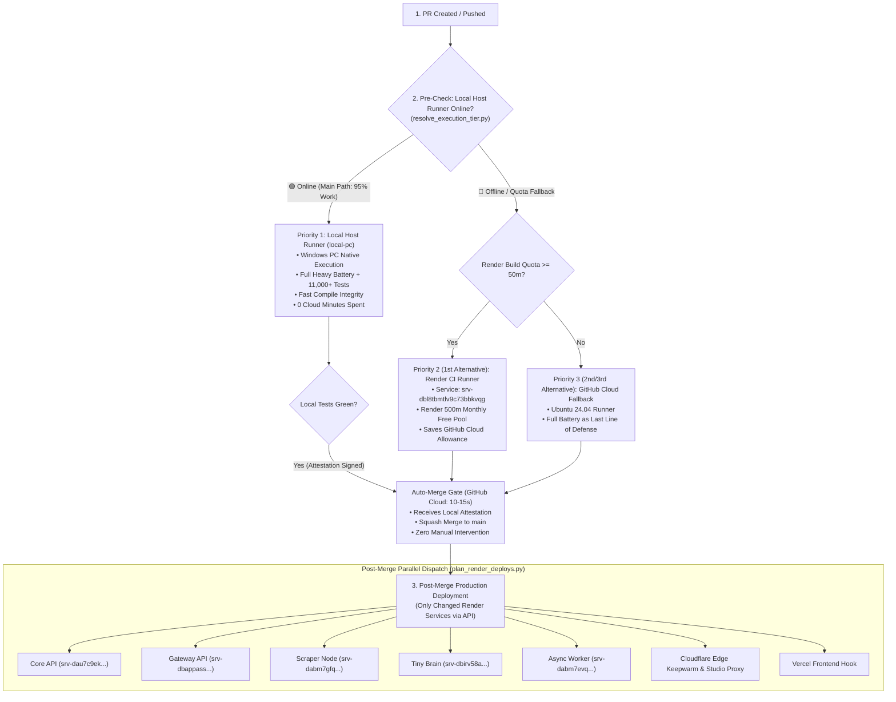

# SupremeAI 3-Tier Zero-Cost CI/CD & Production Deployment Architecture (Single SSOT)

> **SSOT Notice:** এই ডকুমেন্টটি SupremeAI রিপোজিটরির **GitHub Actions, Local Host Runner (`local-pc`), Render CI Runner, এবং Render Auto-Deployment**-এর একমাত্র ও প্রামাণ্য সিঙ্গেল সোর্স অব ট্রুথ (Single Door SSOT)। রানার ও ডিপ্লয়মেন্ট সংক্রান্ত পূর্বের সমস্ত বিক্ষিপ্ত বা ডুপ্লিকেট নির্দেশিকা এই ডকুমেন্টে একীভূত করা হলো।

---

## ১. মূল উদ্দেশ্য (Prime Directive: Lowest GitHub Runtime & Zero Cloud Waste)

1. **সর্বনিম্ন ক্লাউড মিনিটস খরচ (Lowest GitHub Runtime):** GitHub Actions-এর ক্লাউড রানটাইম প্রতি পিআর-এ **সর্বোচ্চ ১০–২০ সেকেন্ড** রাখা।
2. **লোকাল রানার প্রথম অগ্রাধিকার (Priority 1: Local Host `local-pc`):** পিআর পুশ হওয়া মাত্রই ৯০–৯৫% ভারী টেস্ট ও কম্পাইল লোকাল হোস্ট রানারে চলবে (০ ক্লাউড মিনিটস খরচ)।
3. **৪-স্তরের ফলব্যাক চেইন (Deterministic Failover Hierarchy):** লোকাল পিসি স্লিপ বা অফলাইনে থাকলে সরাসরি অল্টারনেটিভ রানারে অটো-হ্যান্ডঅফ হবে, পিআর কখনো আটকে থাকবে না।
4. **জিরো-টাচ অটো-ল্যান্ডিং (Autonomous Auto-Merge):** সব টেস্ট সবুজ হলে গিটহাব ক্লাউড রানার মাত্র ১০-১৫ সেকেন্ডের জন্য সক্রিয় হয়ে পিআর স্কোয়াশ মার্জ করবে।

---

## ২. এন্ড-টু-এন্ড ৪-স্তরের রানার ও ডিপ্লয়মেন্ট ফ্লোচার্ট

---

## ৩. বিস্তারিত স্তরভিত্তিক কার্যপ্রণালী (Tier Breakdown)

### স্তর ১: পিআর ট্রিগার ও প্রাক-যাচাই (GitHub Cloud: ১০–২০ সেকেন্ড)
- **উদ্দেশ্য:** পিআরের প্রাথমিক সিনট্যাক্স ও লোকাল রানার স্ট্যাটাস নিমিষেই যাচাই করা।
- **জব:** `fast-gate` এবং `runtime-readiness`।
- **অপটিমাইজেশন:** ডিপেনডেন্সি বিল্ড বাদ দিয়ে শুধুমাত্র `ruff` ও `scripts/ci/resolve_execution_tier.py` চালাবে।
- **রানার স্ট্যাটাস কুয়েরি:** GitHub Runners API কুয়েরি করে দেখে `local-pc` ট্যাগের সেলফ-হোস্টেড রানার অনলাইন আছে কি না।

### স্তর ২: ভারী টেস্ট ব্যাটারি (৪-স্তরের অগ্রাধিকার)

#### 🥇 অগ্রাধিকার ১ (Primary): লোকাল সেলফ-হোস্টেড রানার (`local-pc`)
- **টার্গেট লেবেল:** `[self-hosted, local-pc]` (আপনার উইন্ডোজ পিসি)।
- **কাজের পরিধি (৯০–৯৫% হেভি লোড):**
  - পুরো ব্যাকএন্ড টেস্ট ব্যাটারি (`tests/`, `core/tests/`, `gateway/tests/`)।
  - পাইথন ফুল কম্পাইল চেক (`python -m compileall -q core/ scripts/`)।
  - ওয়্যারিং অ্যাটলাস ও সিকিউরিটি বাউন্ডারি গার্ড।
- **ক্লাউড খরচ:** **০ মিনিট (Zero Cloud Minutes)**।
- **অ্যাটেস্টেশন:** সফল হলে MCP Tower-এ রেজাল্ট প্রকাশ করে (`publish_ci_attestation.py`)।

#### 🥈 অগ্রাধিকার ২ (১ম বিকল্প): Render CI Runner
- **কখন চলবে:** যদি লোকাল পিসি বন্ধ/স্লিপে থাকে বা রানার অফলাইন দেখায়।
- **টার্গেট সার্ভিস:** `srv-dbl8tbmtlv9c73bbkvqg` (Render ফ্রি টায়ার কোটায় ব্যাকড)।
- **সুবিধা:** GitHub Actions-এর ২০০০ মিনিটের ক্লাউড কোটা অক্ষত থাকে।

#### 🥉 অগ্রাধিকার ৩ ও ৪ (২য় ও ৩য় বিকল্প): GitHub Cloud Fallback
- **কখন চলবে:** লোকাল হোস্ট ও Render CI উভয়ই অনুপলব্ধ থাকলে।
- **টার্গেট রানার:** `ubuntu-24.04` (Fast, isolated fallback)।
- **উদ্দেশ্য:** কোনো অবস্থাতেই যেন পিআর আটকে না থাকে (Fail-safe continuity)।

---

## ৪. স্তর ২খ: অটোনমাস অটো-মার্জ গেট (Auto-Merge PR: ১০–১২ সেকেন্ড)
- **ভূমিকা:** কোনো মানুষ বা বটের ম্যানুয়াল ক্লিকের প্রয়োজন নেই।
- **শর্ত:** `fast-gate`, `runtime-readiness`, এবং `render-heavy-gate` (লোকাল পিসি অথবা ফলব্যাক) ১০০% সবুজ হতে হবে।
- **অ্যাকশন:** গিটহাবের নেটিভ `gh pr merge --squash --delete-branch` চালিয়ে লেটেস্ট কোড `main` ব্রাঞ্চে ল্যান্ড করিয়ে দেয়।
- **রানটাইম:** মাত্র ১০–১৫ সেকেন্ড।

---

## ৫. স্তর ৩: পোস্ট-মার্জ রেন্ডার ও ক্লাউড অটো-ডিপ্লয়মেন্ট (Production Matrix)

পিআর `main`-এ মার্জ হওয়া মাত্রই `deploy-and-verify` পাইপলাইন সক্রিয় হয়:

1. **সিলেক্টিভ সার্ভিস প্ল্যানিং (`plan_render_deploys.py`):**
   - কোন কোন ফাইলে পরিবর্তন এসেছে তা স্ক্যান করে। যে সার্ভিসে পরিবর্তন আসেনি, সেটির ডিপ্লয়মেন্ট এড়িয়ে যায় (`No Render deploy required`)।
2. **প্যারালাল রেন্ডার ট্রিগার:**
   - পরিবর্তিত সার্ভিসগুলোতে একযোগে ডিপ্লয় ট্রিগার পাঠানো হয় (Core, API, Scraper, Worker, Brain, CI-Runner)।
3. **ক্লাউডফ্লেয়ার এজ কিপওয়ার্ম মেশিন:**
   - Cloudflare Worker (`worker.js`) এজ রাউটস `/health`, `/healthz`, `/release` লাইভ ডিপ্লয় করে।
4. **স্মোক ভেরিফিকেশন (`Verify changed Render services`):**
   - ডিপ্লয় শেষে রেন্ডার থেকে লাইভ SHA ভেরিফাই করে কনফার্ম করে যে সার্ভারে লেটেস্ট কমিট চলছে।

---

## ৬. সমস্যা ও সমাধান নির্দেশিকা (Troubleshooting & Invariants)

| সমস্যা | কারণ | স্বয়ংক্রিয় প্রতিকার |
| :--- | :--- | :--- |
| `MCP_TOWER_ATTESTATION_URL not configured` | রিপো ভ্যারিয়েবল অনুপস্থিত ছিল | রিপো ভ্যারিয়েবলে `https://supremeai-mcp-tower.onrender.com/api/ci/attestation` কনফিগার করা হয়েছে। |
| লোকাল রানার অনলাইন থাকা সত্ত্বেও ফলব্যাকে যাওয়া | Actions API-তে `actions: read` পারমিশন ঘাটতি | `.github/workflows/unified-pipeline.yml`-এ পারমিশন নিশ্চিত করা হয়েছে। |
| ফর্ক পিআরে লোকাল রানার চলা | সিকিউরিটি থ্রেট | ফর্ক পিআর স্বয়ংক্রিয়ভাবে ক্লাউড ফলব্যাকে চলবে, লোকাল মেশিনে কখনো চলবে না। |
| Render কোটা সংকট | অতিরিক্ত বিল্ড মিনিট খরচ | `render_quota_preflight.py` প্রতি বিল্ডের আগে রেন্ডার কোটা অডিট করে। |
