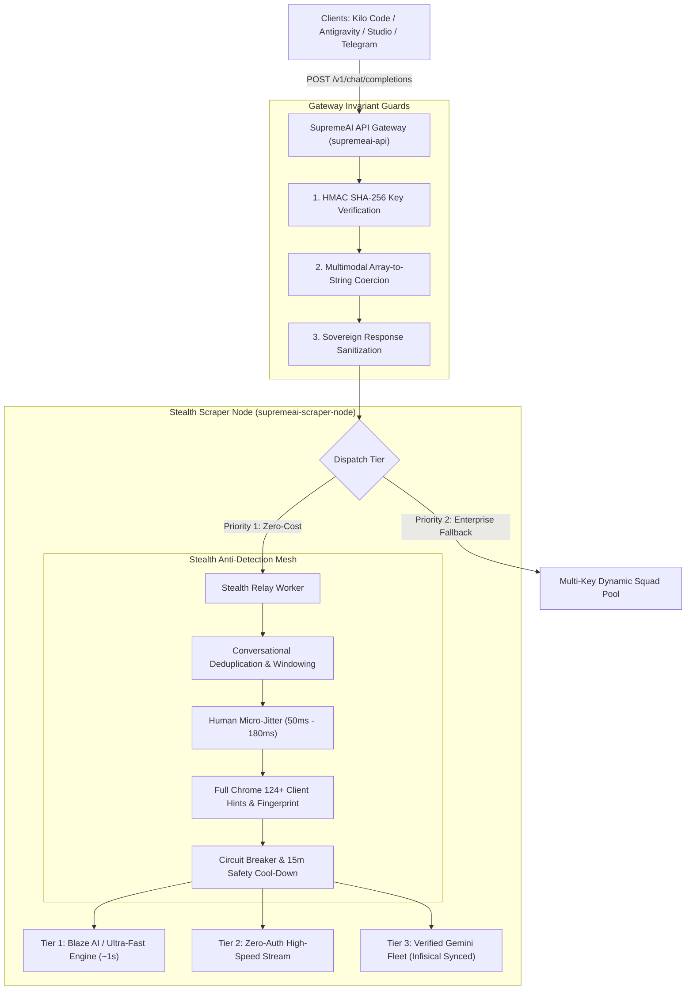

# SupremeAI — Unified Chat & Stealth Webhook Pipeline SSOT
> **Single Source of Truth (SSOT) Architecture Document**  
> **Classification:** Sovereign Infrastructure & Universal Chat Gateway  
> **Status:** Active Standard (Production Architecture)

---

## 1. Executive Summary & Sole Identity Doctrine

All chat, agentic reasoning, code assistance, and conversational capabilities across SupremeAI (Studio Web, Kilo Code, Roo Code, Antigravity IDE, Browser Extension, Telegram Bot, and external OpenAI-compatible clients) flow through a **Single Unified Gateway**.

### The Sole Identity Invariant (Zero-Vendor Bleed)
To the outside world, clients, IDEs, and users, **SupremeAI is the sole AI entity**.
1. **Zero External Provider Branding:** No third-party AI provider names (such as OpenAI, Gemini, Claude, Groq, OpenRouter, Perplexity, etc.) may ever appear in public model lists (`/v1/models`), chat responses, badge labels, metadata, error logs returned to clients, or frontend interfaces.
2. **Standardized Identity Badges:** Every response is stamped with sovereign SupremeAI telemetry:
   - `SupremeAI w.bz Turbo` (Blaze High-Speed)
   - `SupremeAI w.dk Turbo` (Zero-Cost Web Relay)
   - `SupremeAI w.ge Deep-Research` (Verified Session Relay)
   - `SupremeAI api.sq Enterprise` (Multi-Key Dynamic Squad)

---

## 2. Standardized Public Model Registry

The gateway (`/v1/models`) strictly exposes five sovereign SupremeAI model IDs:

| Model ID | Public Tier | Default Latency | Primary Routing Target | Use Case |
|---|---|---|---|---|
| **`auto`** | Autonomous | ~1.0 – 1.8s | Dynamic Smart Router | Default choice for all IDEs and tools; auto-routes based on task complexity. |
| **`supremeai-turbo`** | Ultra-Fast | ~0.8 – 1.2s | Blaze & High-Speed Stream | Fast coding, autocomplete, quick Q&A, and terminal commands. |
| **`supremeai-webhook`** | Zero-Cost Web | ~1.2 – 2.0s | Stealth Webhook Fleet | Standard zero-cost conversational & code assistance lane. |
| **`supremeai-deep-research`** | Reasoning | ~3.0 – 6.0s | Deep Synthesis Session | Architectural refactoring, multi-file analysis, and deep debugging. |
| **`supremeai-api`** | Enterprise Pool | ~1.0 – 2.5s | Sovereign Multi-Key Pool | High-concurrency enterprise tasks requiring dedicated throughput. |

---

## 3. High-Level System Architecture



---

## 4. Stealth & Anti-Detection Architecture (Zero Ban Risk)

To guarantee that upstream providers and security filters (Cloudflare, Google Safety, PerimeterX) never detect automated bot activity or flag user accounts, every outbound request must pass through the **4-Tier Stealth Shield**:

### 1. Smart Conversational Deduplication & Windowing
- **The Problem:** IDEs often send conversation histories with repeated "hi", ping checks, or large static headers (`<environment_details>`). Concatenating these naively triggers provider bot-chatter heuristics (e.g. *"I see you're pinging me a lot"*).
- **The Solution:** 
  - Consecutive redundant prompts are de-duplicated.
  - History is formatted as natural human dialogue (`User: ... \nAssistant: ...`).
  - Sliding context window preserves the last 4–6 active turns, pruning stale ping clutter.

### 2. Human Micro-Jitter Delay
- Every request introduces an asynchronous Gaussian human-like jitter between **50ms and 180ms** before network dispatch.
- Eliminates machine-exact request intervals (0ms sub-millisecond cadence).

### 3. Realistic Browser Fingerprint & Client Hints
Every outgoing HTTP request synthesizes genuine Chrome 124+ Windows 10/11 browser signatures:
```http
User-Agent: Mozilla/5.0 (Windows NT 10.0; Win64; x64) AppleWebKit/537.36 (KHTML, like Gecko) Chrome/124.0.0.0 Safari/537.36
sec-ch-ua: "Chromium";v="124", "Google Chrome";v="124", "Not-A.Brand";v="99"
sec-ch-ua-mobile: ?0
sec-ch-ua-platform: "Windows"
sec-fetch-dest: empty
sec-fetch-mode: cors
sec-fetch-site: same-site
Accept: application/json, text/event-stream, */*
Accept-Language: en-US,en;q=0.9,bn;q=0.8
```

### 4. Circuit Breaker & Safety Cool-Down
- If any session token, cookie, or endpoint receives an HTTP 429 (Rate Limit) or security challenge, the circuit breaker trips **immediately**.
- The flagged session is placed in a **15-minute cool-down** quarantine.
- The request fails over instantly to the next clean engine without repeating failed requests or risking account suspension.

---

## 5. Multi-Engine Failover Topology

1. **Primary Lane — Blaze AI & High-Speed Stream (~1.0s):**
   - Uses active Blaze session tokens / zero-auth stream.
   - High throughput, low latency, ideal for real-time streaming in IDEs.
2. **Secondary Lane — Sovereign AI Fleet (Infisical Synced):**
   - Exported and encrypted from `C:\Users\N\Downloads\skill\ghost tower` to Infisical Cloud Vault.
   - Used for complex deep research and large contextual queries.
3. **Tertiary Lane — Multi-Key API Pool (Controlled Fallback):**
   - Enterprise API pool across multi-cloud credentials stored securely in Infisical.

---

## 6. Client Configuration Reference

Any OpenAI-compatible tool or IDE can connect using the following single configuration:

| Setting | Value |
|---|---|
| **Base URL** | `https://supremeai-api-ulw0.onrender.com/v1` |
| **API Key** | `sk-supreme-studio-admin.unlimited.4774ac06eb55a4633870ac8bdd25ba72-47f8df2df685be6a731aaa9b06a0f17d3524778be733c6354574a1dd49404ebb` |
| **Model** | `auto` (or `supremeai-turbo`, `supremeai-webhook`) |
| **Streaming** | Enabled (`stream: true`) |
