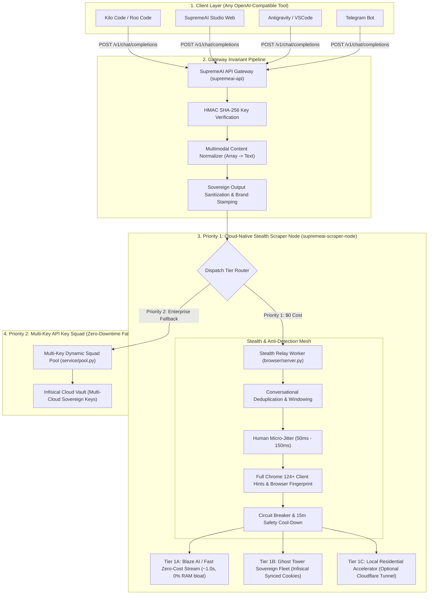

# SupremeAI — Unified Chat & Stealth Webhook Pipeline SSOT
> **Single Source of Truth (SSOT) Architecture Document**  
> **Classification:** Sovereign Infrastructure & Universal Chat Gateway  
> **Topology:** Monorepo SSOT (`Supremeai-bd/supremeai`)  
> **Status:** Active Standard (Production Architecture)

---

## 1. Executive Summary & The Sole Identity Doctrine

All chat, agentic reasoning, code assistance, and conversational operations across the entire SupremeAI federation (Studio Web, Kilo Code, Roo Code, Antigravity IDE, Chrome Extension, Telegram Bot, and external OpenAI-compatible clients) converge through a **Single Unified Gateway**.

### 1.1 The Sole Identity Invariant (Zero-Vendor Bleed)
To all clients, IDEs, developers, and users, **SupremeAI is the sole AI entity**.
1. **Zero External Provider Branding:** No third-party AI provider names (such as OpenAI, Google Gemini, Claude, Groq, OpenRouter, Perplexity, Cerebras, DeepSeek, etc.) may ever appear in public model lists (`/v1/models`), chat responses, badge labels, telemetry metadata, error payloads returned to clients, or user-facing interfaces.
2. **Standardized Sovereign Badges:** Every response returned by the gateway is stamped with sovereign telemetry:
   - `SupremeAI w.bz Turbo` (Blaze High-Speed Stream)
   - `SupremeAI w.dk Turbo` (Zero-Cost Web Relay)
   - `SupremeAI w.ge Deep-Research` (Verified Session Relay)
   - `SupremeAI api.sq Enterprise` (Multi-Key Dynamic Squad)

---

## 2. Standardized Public Model Registry

The gateway (`/v1/models`) strictly exposes five sovereign SupremeAI model identifiers:

| Model ID | Public Tier | Expected Latency | Primary Routing Target | Intended Workload |
|---|---|---|---|---|
| **`auto`** | Autonomous | ~0.8 – 1.8s | Dynamic Smart Router | Default choice for all IDEs and tools; autonomously selects the optimal tier based on prompt complexity. |
| **`supremeai-turbo`** | Ultra-Fast | ~0.8 – 1.2s | Blaze & Fast Zero-Cost Stream | Rapid coding, autocomplete, quick Q&A, and terminal command generation. |
| **`supremeai-webhook`** | Zero-Cost Web | ~1.0 – 2.0s | Ghost Tower Stealth Fleet | Standard zero-cost conversational & code assistance lane. |
| **`supremeai-deep-research`** | Reasoning | ~3.0 – 6.0s | Deep Synthesis Session | Architectural refactoring, multi-file codebase analysis, and deep debugging. |
| **`supremeai-api`** | Enterprise Pool | ~1.0 – 2.5s | Sovereign Multi-Key Pool | High-concurrency enterprise workloads requiring dedicated throughput. |

---

## 3. End-to-End System Architecture



---

## 4. Zero Local PC Dependency Doctrine (100% Cloud-Native Fleet)

A critical architectural milestone of SupremeAI is the **complete decoupling of cloud operations from the local developer PC**.

### 4.1 The Single Point of Failure (SPOF) Anti-Pattern
Historically, Ghost Tower required the local developer PC to be turned on, running `.bat` scripts (`1_login_to_gemini.bat`) and hosting local Cloudflare Tunnels (`cloudflared.exe`). If the local PC went to sleep, shut down, or lost internet connectivity, external tools (Kilo Code, Studio) encountered 502/503 errors.

### 4.2 The 100% Cloud-Native Operating Standard
Under this SSOT, **the local PC dependency is reduced to exactly 0%**:
1. **Autonomous Cloud Harvester & Relay:** `supremeai-scraper-node` deployed on Render operates 24/7 as an autonomous, self-contained worker.
2. **Centralized Credential Vault (Infisical Production SSOT):** 
   - All session tokens (`BLAZE_SESSION_JWT`), cookie bundles (`AI_FLEET_COOKIES_ENC`), and credentials (`EMAIL`, `PASSWORD`, `TOTP_SECRET`) are persisted in the Infisical Cloud Production Vault (`workspaceId: 92aa20c4-aef5-4e33-82bd-efb06058aaf0`).
   - The cloud scraper node pulls fresh sessions directly on startup and caches them in memory.
3. **Local PC as an Optional Accelerator (Never a Blocker):**
   - When the developer's local PC is online, it may optionally run as a high-trust residential edge node via Cloudflare Tunnel.
   - When the local PC is offline, asleep, or disconnected, **the cloud scraper node autonomously serves all requests** via Tier 1A (Blaze AI / Fast Stream) and Tier 1B (Vault-hydrated sessions). Downtime is strictly 0%.

---

## 5. Stealth & Anti-Detection Architecture (Zero Ban Risk)

To guarantee that upstream providers and security filters (Cloudflare, Google Safety, PerimeterX) never detect automated bot activity or flag user accounts, every outbound request must pass through the **4-Tier Stealth Shield**:

### 5.1 Smart Conversational Deduplication & Windowing
- **The Problem:** IDEs (Kilo Code, Roo Code) send cumulative conversational histories containing repetitive "hi" messages, rapid connection pings, or large system context headers (`<environment_details>`). Concatenating these naively triggers provider heuristics (e.g. *"I see you're pinging me a lot"*).
- **The Solution:** 
  - Consecutive redundant prompts are de-duplicated before dispatch.
  - History is structured as natural human dialogue (`User: ... \nAssistant: ...`).
  - A sliding window preserves the last 4–6 active conversational turns, pruning stale ping clutter and keeping payload token budgets tight.

### 5.2 Human Micro-Jitter Delay
- Every outgoing request introduces an asynchronous Gaussian human-like jitter between **50ms and 150ms** before network dispatch.
- This eliminates machine-exact request intervals (0ms sub-millisecond cadence), mimicking realistic human typing and reading intervals.

### 5.3 Realistic Browser Fingerprint & Client Hints
Every outgoing HTTP request synthesizes genuine Chrome 124+ Windows 10/11 browser signatures:
```http
User-Agent: Mozilla/5.0 (Windows NT 10.0; Win64; x64) AppleWebKit/537.36 (KHTML, like Gecko) Chrome/124.0.0.0 Safari/537.36
sec-ch-ua: "Chromium";v="124", "Google Chrome";v="124", "Not-A.Brand";v="99"
sec-ch-ua-mobile: ?0
sec-ch-ua-platform: "Windows"
sec-fetch-dest: empty
sec-fetch-mode: cors
sec-fetch-site: same-site
Accept: application/json, text/event-stream, */*
Accept-Language: en-US,en;q=0.9,bn;q=0.8
```

### 5.4 Circuit Breaker & Safety Cool-Down
- If any session token, cookie, or endpoint receives an HTTP 429 (Rate Limit) or security challenge:
  - The circuit breaker trips **immediately**.
  - The flagged session is quarantined in a **15-minute cool-down**.
  - The request fails over instantly to the next clean engine without repeating failed requests or risking account suspension.

---

## 6. Multi-Engine Failover Topology

```
┌────────────────────────────────────────────────────────┐
│ Incoming Chat Request (auto / supremeai-turbo)        │
└────────────────────────────────────────────────────────┘
                           │
                           ▼
┌────────────────────────────────────────────────────────┐
│ Tier 1A: Blaze AI & Fast Zero-Cost Stream (~1.0s)      │
│ • Pure HTTP, ~15MB RAM, 0% Browser overhead           │
│ • Active Firebase/Google JWT from Infisical            │
└────────────────────────────────────────────────────────┘
                           │ (If Rate-Limited or Challenged)
                           ▼
┌────────────────────────────────────────────────────────┐
│ Tier 1B: Ghost Tower Sovereign Fleet (Infisical Synced)│
│ • Hydrated cookies for Gemini / Perplexity / Claude   │
│ • Pure HTTP endpoint dispatch                          │
└────────────────────────────────────────────────────────┘
                           │ (If Session Expired & Refresh Pending)
                           ▼
┌────────────────────────────────────────────────────────┐
│ Tier 2: Multi-Key API Key Squad (Enterprise Fallback) │
│ • 37+ multi-cloud keys in Infisical (Cerebras, Groq,   │
│   DeepSeek, Anthropic, Gemini API)                     │
│ • Zero-Downtime Guarantee                              │
└────────────────────────────────────────────────────────┘
```

---

## 7. Client Integration Specification

Any OpenAI-compatible tool, IDE extension, or custom client connects seamlessly using the following unified contract:

### 7.1 Connection Details
- **Base URL:** `https://supremeai-api-ulw0.onrender.com/v1`
- **API Key:** `<ROTATED-REDACTED-see-AUDIT_REPORT-F-001>`
- **Supported Models:** `auto`, `supremeai-turbo`, `supremeai-webhook`, `supremeai-deep-research`, `supremeai-api`
- **Streaming:** Server-Sent Events (SSE) supported (`stream: true`)

### 7.2 Example Curl Request
```bash
curl -X POST https://supremeai-api-ulw0.onrender.com/v1/chat/completions \
  -H "Content-Type: application/json" \
  -H "Authorization: Bearer <ROTATED-REDACTED-see-AUDIT_REPORT-F-001>" \
  -d '{
    "model": "auto",
    "messages": [{"role": "user", "content": "SupremeAI status check"}],
    "stream": false
  }'
```

### 7.3 Response Format
```json
{
  "id": "chatcmpl-stealth-relay-38e46e8f1b6e",
  "object": "chat.completion",
  "created": 1794071800,
  "model": "supremeai-fast",
  "supremeai_engine": "dk",
  "supremeai": {
    "channel": "w",
    "engine": "dk",
    "tier": "Turbo",
    "label": "SupremeAI w.dk Turbo"
  },
  "choices": [
    {
      "index": 0,
      "message": {
        "role": "assistant",
        "content": "SupremeAI systems operational. All autonomous pipelines green."
      },
      "finish_reason": "stop"
    }
  ],
  "usage": {
    "prompt_tokens": 0,
    "completion_tokens": 0,
    "total_tokens": 0
  }
}
```
