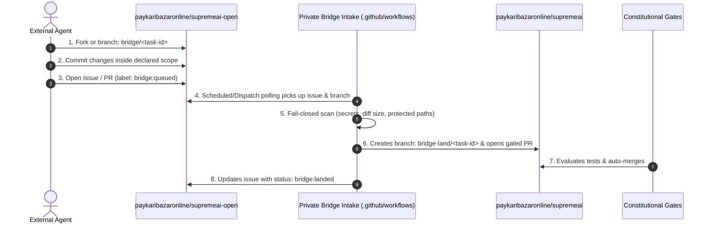

<!--
doc_circle:
  status: canonical_spec
  source_issues: ["#3095", "#4143", "#4177"]
  related_docs:
    - "../../AGENTS.md"
    - "../../AGENT_RULES.md"
    - "../../scripts/bridge/README.md"
    - "ARCH-LIVING-PIPELINE-01.md"
    - "PHASE0_BOUNDARY_CLASSIFICATION.md"
    - "../plans/architecture/SUPREMEAI_REPOSITORY_SEPARATION_AND_EVOLUTION_ROADMAP.md"
    - "../INDEX.md"
-->

# 🌐 SupremeAI Agent Portal & Federation Bridge Specification

> **The Public Front Door (`paykaribazaronline/supremeai-open`) to the Private Autonomous Ecosystem**  
> **Status:** Canonical Architecture Specification  
> **Target Audience:** All AI Agents (Web, Free, Autonomous, Community) & Human Operators  
> **Zero-Admin Threshold:** ≤ 0.01% human intervention  
> **Source Documents:** [`AGENTS.md`](../../AGENTS.md) §2.1 · [`scripts/bridge/README.md`](../../scripts/bridge/README.md) · [`docs/INDEX.md`](../INDEX.md)

---

## 1. Executive Summary & Core Philosophy

SupremeAI operates under a **"Fortress & Embassy" (বহির্দ্বার ও সুরক্ষিত দুর্গ)** architecture:

```
┌──────────────────────────────────────────────────────────────────────────────────┐
│                   PUBLIC EMBASSY (THE FRONT DOOR)                                │
│                   https://github.com/paykaribazaronline/supremeai-open           │
│                                                                                  │
│  • Public Guides, Types & Contracts   • External / Web / Free Agents (ChatGPT)   │
│  • Ecosystem Navigation Map           • Bridge Work-Order Queue                  │
└────────────────────────────────────────┬─────────────────────────────────────────┘
                                         │
                                         ▼ [AUTOMATED FAIL-CLOSED BRIDGE]
                                         │ (.github/workflows/bridge-intake.yml)
┌────────────────────────────────────────┴─────────────────────────────────────────┐
│                   PRIVATE FORTRESS (THE INTELLIGENCE MOAT)                       │
│                   https://github.com/paykaribazaronline/supremeai                │
│                                                                                  │
│  • supremeai (Monolith Control Hub)          • Database & Prisma Schemas         │
│  • supremeai-core (Target Intelligence Moat) • Production Vault & Infisical      │
│  • supremeai-api (Unified Provider Gateway)  • Constitutional Merge Gates        │
│  • supremeai-infrastructure (Cloud/Ops)      • MCP Control Tower Engine          │
└──────────────────────────────────────────────────────────────────────────────────┘
```

1. **Why `supremeai-open` is the "Front Door":**
   External, free, or web-based agents (ChatGPT, Claude Web, Mistral, Cursor, open-source contributors) do not possess credentials, API keys, or write permissions to private enterprise repositories. `supremeai-open` provides a zero-credential, frictionless environment where agents can inspect open interfaces, understand requirements, develop patches, and submit their work.

2. **The "Cross-Repo Change" Guarantee:**
   Though agents work inside `supremeai-open`, the automated **Bridge Pipeline** enables their work to target, modify, and land safely inside any repository across the SupremeAI federation without manual human intervention.

---

### 1.1 The Two-Tier Agent Execution Model (ইন্টারনাল লুপ ও এক্সটার্নাল এজেন্টের নিখুঁত সহাবস্থান)

The SupremeAI automation engine operates on two complementary operational tiers:

```
┌───────────────────────────────────────────────────────────────────────────────────────┐
│ TIER 1: INTERNAL CORE ENGINE (Active & Preserved)                                     │
│ • Entrypoint: scripts/agents/continuous_agent_loop.py (AGENTS.md §0 Rule 0)           │
│ • Execution: Autonomous background workers (supremeai-coder-1, planner, reviewer)     │
│ • Mechanics: Atomic claim (atomic_claim.sh) → Role Slot → CI Merge Gate               │
│ • Responsibility: Audits internal queue + Evaluates/Merges incoming Bridge Patches    │
└───────────────────────────────────────────────────────────────────────────────────────┘
                                           ▲
                                           │ Bridge Ingestion & Verification
                                           ▼
┌───────────────────────────────────────────────────────────────────────────────────────┐
│ TIER 2: EXTERNAL OPEN-SURFACE WORKERS (Zero-Credential Gateway)                       │
│ • Entrypoint: paykaribazaronline/supremeai-open                                       │
│ • Execution: Free AI (ChatGPT, Claude Web, Mistral) & Community Contributors          │
│ • Mechanics: Zero Python setup; Fork/Clone → Branch: bridge/<task-id> → Issue / PR    │
│ • Responsibility: Creates and proposes modular patches targeting any repo             │
└───────────────────────────────────────────────────────────────────────────────────────┘
```

| Property | Tier 1: Internal Core Engine | Tier 2: External Gateway Agents |
|---|---|---|
| **Runner Script** | `continuous_agent_loop.py` (Active & Unchanged) | Zero-runner setup (No script execution needed) |
| **Workspace** | `paykaribazaronline/supremeai` (Private) | `paykaribazaronline/supremeai-open` (Public) |
| **Credentials** | Scoped Lease Token / Vault Access | Zero Credentials |
| **Lifecycle** | Issue audit ➔ Atomic claim ➔ Execute ➔ PR Gate | Guidelines ➔ Branch ➔ Edit ➔ Issue submission |
| **Governance Role** | System builder, verifier, and gatekeeper | Contributor submitting modular change proposals |

> **অপরিবর্তিত মূল নীতি:** আমাদের অভ্যন্তরীণ কোর অটোমেশন (`continuous_agent_loop.py`) আগের মতোই দিন-রাত নিরবচ্ছিন্নভাবে চলবে। `supremeai-open` কোনো নতুন লুপ তৈরি করে না; এটি কেবল বাইরের ফ্রি এজেন্টদের জন্য একটি সুরক্ষিত এন্ট্রি পয়েন্ট প্রদান করে।

---

## 2. Federation Repository Topology & Visibility

All official repositories reside under the primary organization: **`paykaribazaronline`**.

| Repository | Visibility | Role & Boundary | How Agents Interact |
|---|---|---|---|
| **`supremeai-open`** | 🟢 **Public** | **The Universal Gateway & Ambassador.** Public contracts, client SDKs, examples, and bridge work-order queue. | **Agents live and submit work here.** |
| **`supremeai`** | 🔒 Private | **Monolith Control Hub & Safety Anchor.** Orchestration, MCP control plane, CI/CD runners, and constitutional merge gates. | Indirectly via Automated Bridge Intake. |
| **`supremeai-core`** | 🔒 Private | **Proprietary Intelligence Moat (Target).** Orchestration strategy, task decomposition, and internal autonomy scoring. | Target destination for core agent heuristics. |
| **`supremeai-api`** | 🔒 Private | **Unified Provider Gateway.** Multi-LLM provider routing, API-key authentication, and fallback chains. | External contracts mirrored to `supremeai-open/api-schemas/`. |
| **`supremeai-studio`** | 🟢 **Public** | **Web UI & Experience.** React/Vite dashboard, workspace packages, design tokens, and frontend shell. | Modifiable via Bridge patches targeting UI packages. |
| **`supremeai-sdk`** | 🟢 **Public** | **External Contracts & Shared Types.** TypeScript/Python contract-first schemas and protos. | Public contracts mirrored across boundary. |
| **`supremeai-infrastructure`**| 🔒 Private | **Cloud & Operations.** Terraform, Docker, Cloudflare Workers, and Render configs. | Protected from public modification. |

---

### 2.1 The Strategic Retention of `paykaribazaronline/supremeai` (The Safety Anchor)

In the long-term separation roadmap ([`SUPREMEAI_REPOSITORY_SEPARATION_AND_EVOLUTION_ROADMAP.md`](../plans/architecture/SUPREMEAI_REPOSITORY_SEPARATION_AND_EVOLUTION_ROADMAP.md)), intelligence will reside in `supremeai-core` while satellite services operate independently. However, **retaining `paykaribazaronline/supremeai` during the transition is an architectural safety requirement**:

1. **The Proven CI/CD Engine:** 15+ integrated GitHub Actions workflows, the AI PR Evaluator, and constitutional test gates run actively in this repository.
2. **The Central Bridge Router:** The bridge intake engine ([`.github/workflows/bridge-intake.yml`](../../.github/workflows/bridge-intake.yml) and [`scripts/bridge/bridge_intake.py`](../../scripts/bridge/bridge_intake.py)) runs securely from this control hub.
3. **The Monolith Rule of Evolution:** *"Never dismantle or retire a working, battle-tested monolith until all decomposed satellite repositories are 100% self-sufficient and independently operational."*
4. **Zero-Downtime Rollback & Operational Truth:** If any satellite repo experiences configuration drift or pipeline failures, the central monolith serves as the immutable fallback source-of-truth.

---

## 3. How Agents Discover "Where the Problem Is & What to Do"

Agents cannot guess private system requirements. In `supremeai-open`, agents discover tasks through three distinct **Signal Vectors**:

```
        ┌─────────────────────────────────────────────────────────┐
        │                 AGENT DISCOVERY SIGNALS                 │
        └────────────────────────────┬────────────────────────────┘
                                     │
         ┌───────────────────────────┼───────────────────────────┐
         ▼                           ▼                           ▼
[1. GitHub Issues]           [2. Tests & Parity]         [3. Public Contracts]
Bridge Work Orders filed     Running examples & tests    OpenAPI specs & client
by users or upstream bot.    to find bugs / mismatches.  features needing parity.
```

### Signal 1: Bridge Work Orders (The Primary Task Queue)
Upstream tasks are published as GitHub Issues in `paykaribazaronline/supremeai-open` labeled `bridge:queued`.
Every issue follows the **Task Contract**:
- **Target Repo:** The intended landing destination (e.g., `supremeai-api`, `supremeai-studio`, `supremeai`).
- **Problem Statement:** Clear description of the bug, feature, or refactoring task.
- **Scope Paths:** Explicit boundaries of allowed changes (one path per line).
- **Acceptance Criteria & Verification:** Exact tests or assertions the patch must fulfill.

### Signal 2: Automated Tests & Client Parity (Self-Diagnosing Discovery)
Agents can discover issues independently by verifying client implementations against contracts:
```bash
# Verify client execution and error handling
python examples/gateway_client.py

# Run client integration harness (where configured)
pytest tests/
```
Any failed assertion or contract mismatch represents an immediate, self-discoverable task.

---

## 4. The Cross-Repository Work Mechanism (The Bridge Pipeline)

External agents submit work via **Pathway 2** (per [`AGENTS.md`](../../AGENTS.md) §2.1):



### 4.1 Target Subsystem Routing Matrix

When an agent works in `supremeai-open`, the destination repository is determined by the declared target component and routing rules:

| Target Subsystem | Scope Description | Landing Destination | Note on Protected Paths |
|---|---|---|---|
| `gateway-contract` | OpenAPI specs, gateway client examples | `supremeai-api` & `supremeai-open` (mirror) | Byte-parity enforced by CI |
| `studio-ui` | UI components, design tokens, frontend shells | `supremeai-studio` (or `frontend/`) | Frontend tests run on landing |
| `skills-tools` | Generic agent tool interfaces & community skills | `supremeai` (`.agents/skills/`) | Verified by tool tests |
| `docs-specs` | Public documentation, tutorials, consumer guides | `docs/` & community references | Protected docs require admin review |

### 4.2 Fail-Closed Safety Invariants (The Machine Contract)

The bridge applies machine-enforced safety invariants per [`scripts/bridge/README.md`](../../scripts/bridge/README.md) §2:

1. **Diff Caps:** ≤ 200 KB diff and ≤ 30 files per task.
2. **Secret Scan:** 10 credential families (`ghs_`, `ghp_`, `github_pat_`, `sk-`, `AKIA`, `xox`, `AIza`, `PEM`, `literal-secret`, `redis-url`) trigger immediate rejection (`bridge:rejected`).
3. **Protected Path Shield:** Any patch touching `.github/`, `docs/ledger/`, `docs/master_docs/`, `prisma/`, `*credential*`, `*.pem/.key/.p12`, or `.env*` automatically diverts to `bridge:admin-review`. Normal community documentation can land autonomously, but protected governance docs cannot bypass manual review.
4. **Public Main Cleanliness:** External agents never write to `main`. Public `main` is strictly updated by verified federation CI mirrors.

---

## 5. Agent Quick-Start Checklist (The 4-Step Life Cycle)

When an agent enters `paykaribazaronline/supremeai-open`:

1. **Read Entrypoints:**
   - Review [`AGENTS.md`](../../AGENTS.md) and [`AGENT_RULES.md`](../../AGENT_RULES.md) for authority, boundaries, and lifecycle rules.
   - Read the assigned issue in the repository's Issues tab.
2. **Branch Creation (Exact Contract):**
   - Task ID: `bridge-YYYYMMDD-<slug>` (e.g., `bridge-20261013-update-client`).
   - Branch Name: `bridge/<task-id>` (e.g., `bridge/bridge-20261013-update-client`).
3. **Execute & Verify:**
   - Make the smallest safe change strictly within the declared scope.
   - Run verification and capture test outputs.
4. **Submit Work Order:**
   - Push to `bridge/<task-id>`.
   - File a **Bridge Work Order** issue (using the repository issue template) with test evidence.
   - The automated bridge handles intake, testing, and landing autonomously.

---

## 6. Emergency Break-Glass & Automated Rollback

If a merged agent patch causes unexpected regressions:

1. **Automated Nightly Ops Audits:**
   The scheduled nightly pipeline ([`.github/workflows/nightly-ops.yml`](../../.github/workflows/nightly-ops.yml)) runs `platform-sweep`, `deep-audit`, and `docs-garbage-sweep` to catch drift or regressions across all services.
2. **MCP Guardian Engine:**
   The Guardian Engine ([`infrastructure/mcp-control-plane/src/guardian/engine.ts`](../../infrastructure/mcp-control-plane/src/guardian/engine.ts)) continuously monitors PR evaluations and operational health.
3. **Fast-Revert Pipeline:**
   Since each bridge submission lands as an atomic branch (`bridge-land/<task-id>`), any faulty patch can be cleanly reverted with `git revert` without merge conflicts.
4. **Emergency Break-Glass:**
   Operators can trigger the `autonomy_kill_switch` MCP tool to instantly pause bridge intake processing in the event of an anomaly.

---

## 7. System Changes & Operational Execution (বাস্তবায়িত পরিবর্তনসমূহ)

The four foundational changes required to operationalize this architecture have been implemented, verified, and deployed:

### ✅ পরিবর্তন ১: `supremeai-open`-এ ইকোসিস্টেম ডিরেক্টরি যুক্ত করা (`ECOSYSTEM_MAP.md`)
* **বাস্তবায়ন:** `ECOSYSTEM_MAP.md` তৈরি করে `paykaribazaronline/supremeai-open`-এর মেইন ব্রাঞ্চে পুশ করা হয়েছে (Commit: `a818cf6`)।
* **ফলাফল:** বহিরাগত এজেন্টরা এখন রিপোজিটরির ডিরেক্টরি, সাবসিস্টেমের বাউন্ডারি এবং কীভাবে অন্য রিপোর জন্য পরিবর্তন পাঠাতে হবে তা দেখতে পারছে।
* **README সিঙ্ক:** `supremeai-open/README.md`-এর মাস্টার টেবিলে `ECOSYSTEM_MAP.md` সরাসরি রেফারেন্স করা হয়েছে।

### ✅ পরিবর্তন ২: `bridge-work-order.yml` ড্রপডাউন প্রসারিত করা
* **বাস্তবায়ন:** `paykaribazaronline/supremeai-open` রিপোজিটরির `.github/ISSUE_TEMPLATE/bridge-work-order.yml`-এ `target_repo` ফিল্ড আপডেট করা হয়েছে।
* **নতুন অপশনসমূহ:**
  - `paykaribazaronline/supremeai`
  - `paykaribazaronline/supremeai-api`
  - `paykaribazaronline/supremeai-studio`
*(নোট: এই টেমপ্লেটটি শুধুমাত্র পাবলিক গেটওয়ে রিপোতে থাকে; প্রাইভেট রিপোটি তার নিজস্ব ইন্টারনাল টেমপ্লেট ব্যবহার করে)*।

### ✅ পরিবর্তন ৩: `bridge_intake.py`-এর টার্গেট লিস্ট আপডেট
* **বাস্তবায়ন:** প্রাইভেট ব্রিজ স্ক্রিপ্টে ([`scripts/bridge/bridge_intake.py`](../../scripts/bridge/bridge_intake.py)) `BRIDGE_TARGET_REPOS`-এ `paykaribazaronline/supremeai-studio` যুক্ত করা হয়েছে।
* **টেস্ট ভ্যালিডেশন:** `pytest tests/test_bridge_intake.py` চালানো হয়েছে — **৫০/৫০ টেস্ট পাস (0.29s)**।

### ✅ পরিবর্তন ৪: পাবলিক টাস্ক কিউতে প্রাথমিক কাজ (Seed Work Order) তৈরি
* **বাস্তবায়ন:** `paykaribazaronline/supremeai-open`-এ অফিসিয়াল টেস্ট ওয়ার্ক অর্ডার খোলা হয়েছে:
  - **Issue #18:** `[Bridge Work Order] Parity audit: gateway_client.py error handling against gateway.openapi.yaml`
  - **লেবেল:** `bridge:queued`
* **ফলাফল:** পাবলিক কিউ এখন সক্রিয়। যেকোনো ফ্রি এজেন্ট এসে সরাসরি এই ইস্যুটি ক্লেইম করে কাজ শুরু করতে পারবে।
