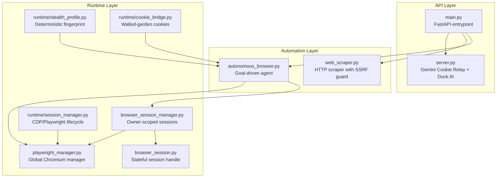
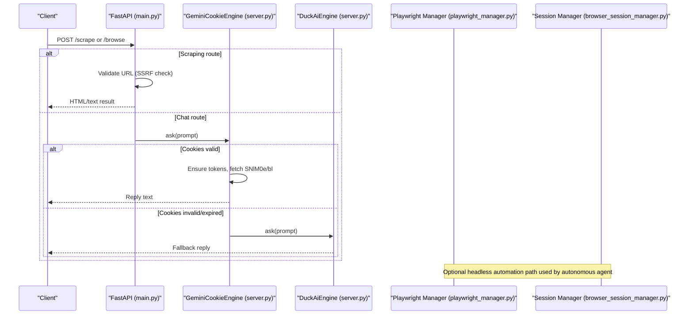
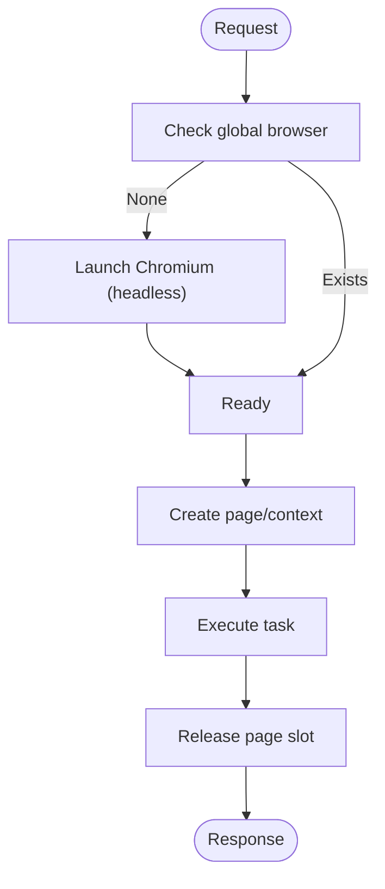
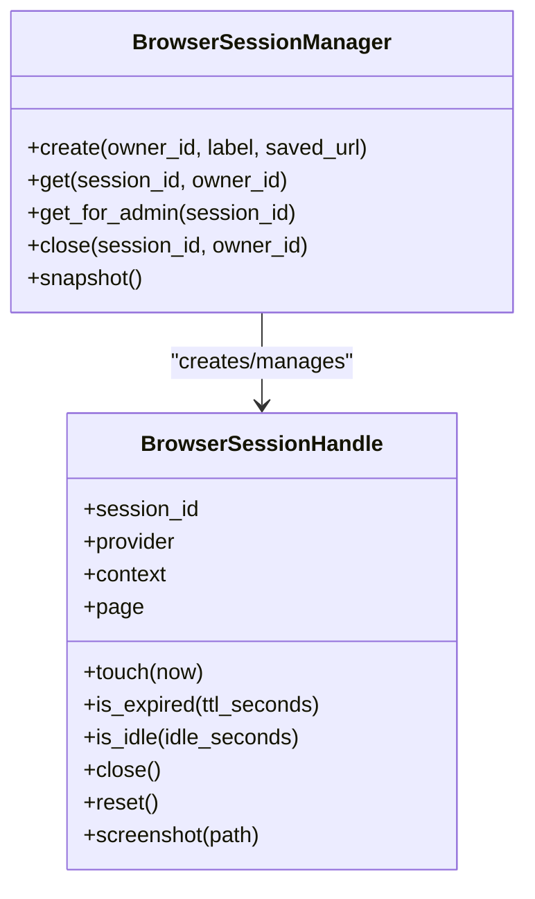
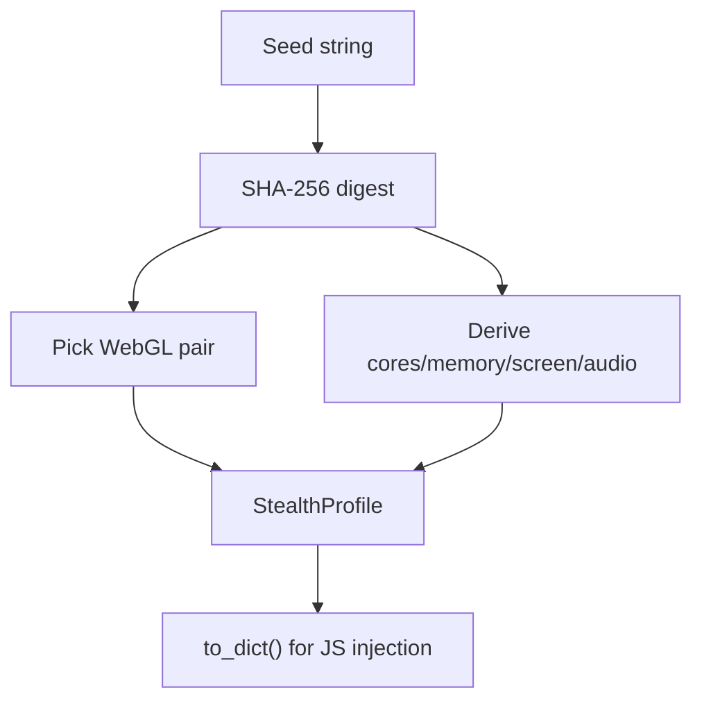
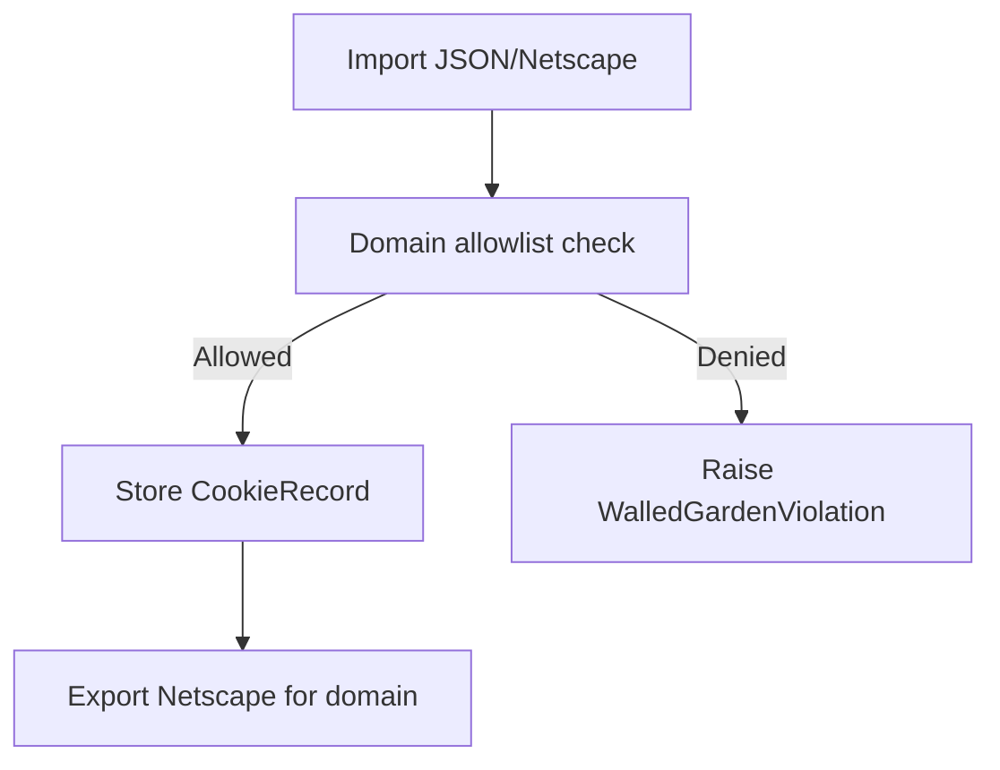
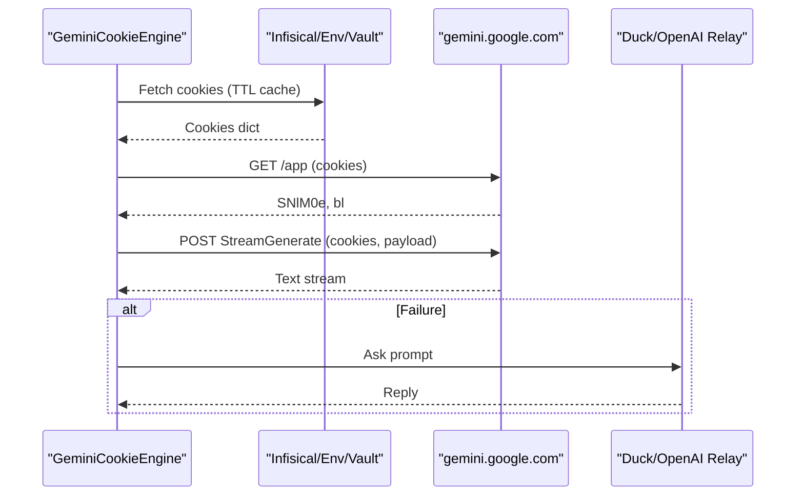
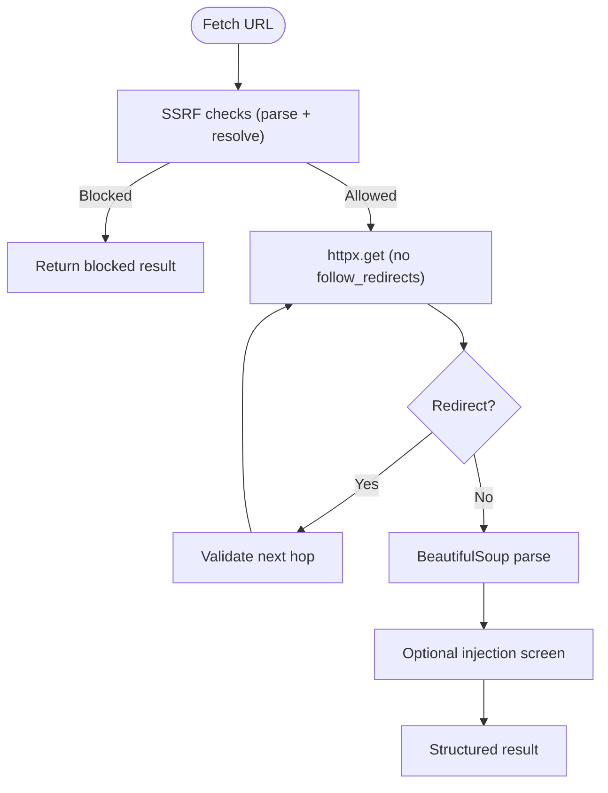
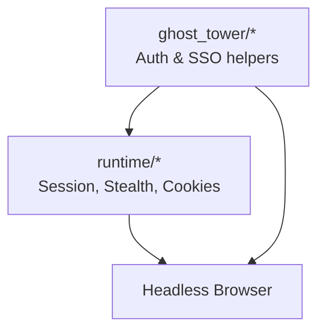
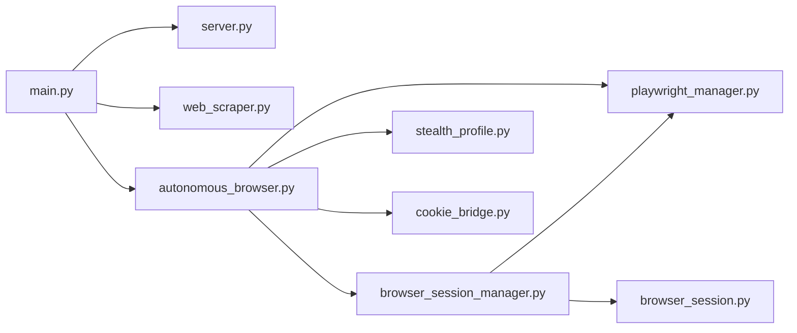

# Browser Automation

<cite>
**Referenced Files in This Document**
- [main.py](../../browser/main.py)
- [server.py](../../browser/server.py)
- [autonomous_browser.py](../../browser/autonomous_browser.py)
- [browser_session.py](../../browser/browser_session.py)
- [browser_session_manager.py](../../browser/browser_session_manager.py)
- [playwright_manager.py](../../browser/playwright_manager.py)
- [web_scraper.py](../../browser/web_scraper.py)
- [session_manager.py](../../browser/runtime/session_manager.py)
- [stealth_profile.py](../../browser/runtime/stealth_profile.py)
- [cookie_bridge.py](../../browser/runtime/cookie_bridge.py)
</cite>

## Introduction (Browser Automation)
This document explains the SupremeAI Browser Automation service, focusing on headless browser architecture, session management, stealth capabilities, cookie handling, authentication flows, content extraction, DOM manipulation, and operational configuration. It also covers anti-detection measures, fingerprinting protection, proxy settings, resource limits, common automation tasks, error handling, debugging techniques, performance optimization, scaling considerations, and monitoring approaches.

The service provides two complementary paths:
- A lightweight HTTP-only Gemini relay that avoids headless browsers entirely for chat-like interactions.
- A full headless Playwright-based automation stack for interactive browsing, scraping, and semantic analysis.

## Project Structure
The browser module is organized into clear layers:
- Entry points and API routes expose scraping and browsing endpoints.
- The runtime layer manages Playwright lifecycle, sessions, stealth profiles, and cookies.
- The ghost tower contains specialized engines and helpers for authentication and web interaction.
- Tools provide reusable agents and clients for automation and stealth HTTP access.

**Diagram sources**
- [main.py:21-97](../../browser/main.py#L21-L97)
- [server.py:34-59](../../browser/server.py#L34-L59)
- [autonomous_browser.py:39-54](../../browser/autonomous_browser.py#L39-L54)
- [web_scraper.py:76-146](../../browser/web_scraper.py#L76-L146)
- [playwright_manager.py:24-57](../../browser/playwright_manager.py#L24-L57)
- [browser_session_manager.py:49-89](../../browser/browser_session_manager.py#L49-L89)
- [browser_session.py:56-78](../../browser/browser_session.py#L56-L78)
- [session_manager.py:40-105](../../browser/runtime/session_manager.py#L40-L105)
- [stealth_profile.py:55-85](../../browser/runtime/stealth_profile.py#L55-L85)
- [cookie_bridge.py:54-91](../../browser/runtime/cookie_bridge.py#L54-L91)

**Section sources**
- [main.py:21-97](../../browser/main.py#L21-L97)
- [server.py:34-59](../../browser/server.py#L34-L59)

## Core Components
- FastAPI entrypoint registers optional scraping and browsing routes and integrates the lightweight Gemini Cookie Relay engine when available.
- Gemini Cookie Relay provides a zero-headless path to gemini.google.com using stored cookies, with rotating proxies and fallbacks.
- Headless automation uses Playwright via a global browser manager, owner-scoped session manager, and stateful session handles.
- Stealth profile generates deterministic fingerprints for consistent anti-detection behavior.
- Cookie bridge enforces strict allowlist scoping for importing/exporting walled-garden cookies.

Key responsibilities:
- API routing and request validation.
- Session lifecycle and concurrency control.
- Stealth fingerprint generation and pointer gesture simulation.
- Secure cookie import/export with redaction and domain checks.
- Lightweight HTTP scraping with SSRF protection and redirect walking.

**Section sources**
- [main.py:21-97](../../browser/main.py#L21-L97)
- [server.py:84-477](../../browser/server.py#L84-L477)
- [playwright_manager.py:24-57](../../browser/playwright_manager.py#L24-L57)
- [browser_session_manager.py:49-89](../../browser/browser_session_manager.py#L49-L89)
- [browser_session.py:56-78](../../browser/browser_session.py#L56-L78)
- [stealth_profile.py:55-85](../../browser/runtime/stealth_profile.py#L55-L85)
- [cookie_bridge.py:54-91](../../browser/runtime/cookie_bridge.py#L54-L91)
- [web_scraper.py:76-146](../../browser/web_scraper.py#L76-L146)

## Architecture Overview
The system supports two primary execution modes:
- Lightweight HTTP mode: Pure HTTP requests to external services (gemini.google.com, duck.ai, zero-auth OpenAI-compatible relays). No headless browser overhead.
- Full automation mode: Playwright-managed Chromium with bounded concurrency, owner-scoped sessions, and stealth features.

**Diagram sources**
- [main.py:62-95](../../browser/main.py#L62-L95)
- [server.py:367-477](../../browser/server.py#L367-L477)
- [server.py:594-663](../../browser/server.py#L594-L663)
- [playwright_manager.py:24-57](../../browser/playwright_manager.py#L24-L57)
- [browser_session_manager.py:61-89](../../browser/browser_session_manager.py#L61-L89)

## Detailed Component Analysis

### Headless Browser Lifecycle and Concurrency
- Global Playwright manager lazily starts a single Chromium instance with headless flags and sandbox options.
- Page capacity is bounded via a semaphore configured through environment variables.
- Shutdown routines close browser and runner processes cleanly.

**Diagram sources**
- [playwright_manager.py:24-57](../../browser/playwright_manager.py#L24-L57)
- [playwright_manager.py:60-72](../../browser/playwright_manager.py#L60-L72)
- [playwright_manager.py:75-104](../../browser/playwright_manager.py#L75-L104)

**Section sources**
- [playwright_manager.py:24-57](../../browser/playwright_manager.py#L24-L57)
- [playwright_manager.py:60-72](../../browser/playwright_manager.py#L60-L72)
- [playwright_manager.py:75-104](../../browser/playwright_manager.py#L75-L104)

### Session Management
- Owner-scoped sessions are created with isolated contexts and pages.
- Idle timeout and max sessions are enforced; expired sessions are closed automatically.
- Admin takeover allows privileged access for human-in-the-loop scenarios.
- Stateful session handle tracks TTL, idle time, status, and provides safe close/reset/screenshot operations.

**Diagram sources**
- [browser_session_manager.py:49-89](../../browser/browser_session_manager.py#L49-L89)
- [browser_session_manager.py:100-128](../../browser/browser_session_manager.py#L100-L128)
- [browser_session_manager.py:130-165](../../browser/browser_session_manager.py#L130-L165)
- [browser_session.py:56-78](../../browser/browser_session.py#L56-L78)
- [browser_session.py:111-162](../../browser/browser_session.py#L111-L162)

**Section sources**
- [browser_session_manager.py:49-89](../../browser/browser_session_manager.py#L49-L89)
- [browser_session_manager.py:100-128](../../browser/browser_session_manager.py#L100-L128)
- [browser_session_manager.py:130-165](../../browser/browser_session_manager.py#L130-L165)
- [browser_session.py:56-78](../../browser/browser_session.py#L56-L78)
- [browser_session.py:111-162](../../browser/browser_session.py#L111-L162)

### Stealth Profile and Anti-Detection
- Deterministic fingerprint generation from a seed ensures reproducible canvas noise, WebGL vendor/renderer pairs, audio fingerprint, hardware concurrency, device memory, and screen dimensions.
- Natural pointer gestures use cubic Bezier curves with deterministic jitter to mimic human input.

**Diagram sources**
- [stealth_profile.py:55-85](../../browser/runtime/stealth_profile.py#L55-L85)
- [stealth_profile.py:161-192](../../browser/runtime/stealth_profile.py#L161-L192)

**Section sources**
- [stealth_profile.py:55-85](../../browser/runtime/stealth_profile.py#L55-L85)
- [stealth_profile.py:107-154](../../browser/runtime/stealth_profile.py#L107-L154)
- [stealth_profile.py:161-192](../../browser/runtime/stealth_profile.py#L161-L192)

### Cookie Handling and Walled-Garden Security
- CookieBridge enforces an explicit allowlist of domains; all imports and exports are scoped to those domains.
- Values are redacted in logs and summaries; Netscape format round-trips byte-stably.
- Violations raise a specific permission error when domains are not allowed.

**Diagram sources**
- [cookie_bridge.py:54-91](../../browser/runtime/cookie_bridge.py#L54-L91)
- [cookie_bridge.py:94-150](../../browser/runtime/cookie_bridge.py#L94-L150)
- [cookie_bridge.py:153-174](../../browser/runtime/cookie_bridge.py#L153-L174)

**Section sources**
- [cookie_bridge.py:54-91](../../browser/runtime/cookie_bridge.py#L54-L91)
- [cookie_bridge.py:94-150](../../browser/runtime/cookie_bridge.py#L94-L150)
- [cookie_bridge.py:153-174](../../browser/runtime/cookie_bridge.py#L153-L174)

### Authentication Flows and Session Persistence
- GeminiCookieEngine loads cookies from environment variables or Infisical vault, parses multiple formats, and caches them with TTL.
- It obtains SNlM0e and bl tokens from gemini.google.com/app, then posts to the streaming endpoint to retrieve replies.
- If cookies expire or upstream fails, it falls back to Duck AI or zero-auth OpenAI-compatible relays.

**Diagram sources**
- [server.py:136-183](../../browser/server.py#L136-L183)
- [server.py:185-247](../../browser/server.py#L185-L247)
- [server.py:308-343](../../browser/server.py#L308-L343)
- [server.py:367-477](../../browser/server.py#L367-L477)
- [server.py:454-477](../../browser/server.py#L454-L477)

**Section sources**
- [server.py:136-183](../../browser/server.py#L136-L183)
- [server.py:185-247](../../browser/server.py#L185-L247)
- [server.py:308-343](../../browser/server.py#L308-L343)
- [server.py:367-477](../../browser/server.py#L367-L477)
- [server.py:454-477](../../browser/server.py#L454-L477)

### Content Extraction and Semantic Analysis
- WebScraper performs SSRF-safe HTTP fetching with manual redirect walking and IP resolution checks.
- It extracts title, cleaned text, and links, optionally runs prompt-injection screening, and returns structured results.
- AutonomousBrowserAgent orchestrates goal-driven navigation and interaction using a reasoning orchestrator and guarded click cascade.

**Diagram sources**
- [web_scraper.py:63-74](../../browser/web_scraper.py#L63-L74)
- [web_scraper.py:76-146](../../browser/web_scraper.py#L76-L146)

**Section sources**
- [web_scraper.py:63-74](../../browser/web_scraper.py#L63-L74)
- [web_scraper.py:76-146](../../browser/web_scraper.py#L76-L146)
- [autonomous_browser.py:84-165](../../browser/autonomous_browser.py#L84-L165)
- [autonomous_browser.py:199-256](../../browser/autonomous_browser.py#L199-L256)
- [autonomous_browser.py:258-324](../../browser/autonomous_browser.py#L258-L324)

### Ghost Tower Stealth Engine and Anti-Detection Measures
- The ghost tower includes specialized engines and helpers for authentication and web interaction, including cookie synchronization and SSO runners.
- The runtime stealth profile provides deterministic fingerprints and natural pointer gestures to reduce detection risk.
- The cookie bridge enforces strict domain allowlists to prevent unauthorized cookie usage.

**Diagram sources**
- [session_manager.py:40-105](../../browser/runtime/session_manager.py#L40-L105)
- [stealth_profile.py:55-85](../../browser/runtime/stealth_profile.py#L55-L85)
- [cookie_bridge.py:54-91](../../browser/runtime/cookie_bridge.py#L54-L91)

**Section sources**
- [session_manager.py:40-105](../../browser/runtime/session_manager.py#L40-L105)
- [stealth_profile.py:55-85](../../browser/runtime/stealth_profile.py#L55-L85)
- [cookie_bridge.py:54-91](../../browser/runtime/cookie_bridge.py#L54-L91)

## Dependency Analysis
- main.py conditionally imports server components and optional scraping routes.
- server.py depends on httpx for HTTP calls and implements both GeminiCookieEngine and DuckAiEngine.
- playwright_manager.py provides a global browser instance and bounded page slots.
- browser_session_manager.py creates and manages owner-scoped sessions backed by Playwright contexts/pages.
- browser_session.py defines a durable session handle with lifecycle methods.
- web_scraper.py relies on httpx and BeautifulSoup with SSRF protections.
- runtime modules encapsulate capability checks, stealth fingerprinting, and secure cookie handling.

**Diagram sources (dependency view)**
- [main.py:21-97](../../browser/main.py#L21-L97)
- [server.py:34-59](../../browser/server.py#L34-L59)
- [web_scraper.py:76-146](../../browser/web_scraper.py#L76-L146)
- [autonomous_browser.py:39-54](../../browser/autonomous_browser.py#L39-L54)
- [playwright_manager.py:24-57](../../browser/playwright_manager.py#L24-L57)
- [browser_session_manager.py:49-89](../../browser/browser_session_manager.py#L49-L89)
- [browser_session.py:56-78](../../browser/browser_session.py#L56-L78)
- [stealth_profile.py:55-85](../../browser/runtime/stealth_profile.py#L55-L85)
- [cookie_bridge.py:54-91](../../browser/runtime/cookie_bridge.py#L54-L91)

**Section sources**
- See Diagram sources (dependency view) above.

## Performance Considerations
- Lightweight HTTP mode avoids headless browser overhead, suitable for constrained environments like Render free tiers.
- Global Chromium instance is launched once and reused; page creation is bounded by a semaphore to limit concurrent pages.
- Session manager enforces idle timeouts and maximum sessions to prevent resource leaks.
- Web scraper walks redirects manually and validates each hop to avoid unnecessary network hops and SSRF risks.
- Cookie caching with TTL reduces repeated secret retrieval and token refreshes.

Recommendations:
- Tune SCRAPER_MAX_CONCURRENCY and SCRAPER_TIMEOUT_SECONDS for scraping workloads.
- Adjust BROWSER_MAX_CONCURRENT_PAGES to balance throughput and memory usage.
- Configure idle_timeout_seconds and max_sessions according to expected load patterns.
- Enable INFISICAL_CLIENT_ID/INFISICAL_CLIENT_SECRET for secure, cached cookie provisioning.

[No sources needed since this section provides general guidance]

## Troubleshooting Guide
Common issues and resolutions:
- Missing or expired Gemini cookies:
  - Verify environment variables or Infisical configuration.
  - Check startup prefetch logs and health endpoint for cookie presence.
- Upstream challenges or rate limits:
  - Inspect fallback responses from Duck AI or zero-auth relays.
  - Review proxy rotation if enabled via environment variables.
- SSRF blocks during scraping:
  - Ensure URLs pass both parse-time and resolved IP checks.
  - Confirm redirect targets are validated before following.
- Session expiration or idle timeout:
  - Re-create sessions via the session manager.
  - Monitor last_used_at timestamps and adjust idle_timeout_seconds.
- Capability errors:
  - Install Playwright and Chromium binaries or attach a CDP endpoint.

Operational checks:
- Health endpoint reports cookie status, concurrency limits, and lightweight mode flags.
- Release endpoint exposes service metadata and capabilities.
- Logs include warnings for failed proxy list fetches, cookie parsing errors, and upstream failures.

**Section sources**
- [server.py:678-695](../../browser/server.py#L678-L695)
- [server.py:698-716](../../browser/server.py#L698-L716)
- [server.py:719-742](../../browser/server.py#L719-L742)
- [web_scraper.py:63-74](../../browser/web_scraper.py#L63-L74)
- [web_scraper.py:76-146](../../browser/web_scraper.py#L76-L146)
- [session_manager.py:85-105](../../browser/runtime/session_manager.py#L85-L105)

## Conclusion
The SupremeAI Browser Automation service offers a flexible, secure, and scalable approach to headless browsing and lightweight HTTP interactions. Its architecture separates concerns across API routing, session management, stealth fingerprinting, and cookie handling, while providing robust anti-detection measures and fail-closed security policies. Operators can tune concurrency, timeouts, and resource limits to match their deployment constraints, and leverage built-in monitoring and troubleshooting tools to maintain reliability at scale.

[No sources needed since this section summarizes without analyzing specific files]