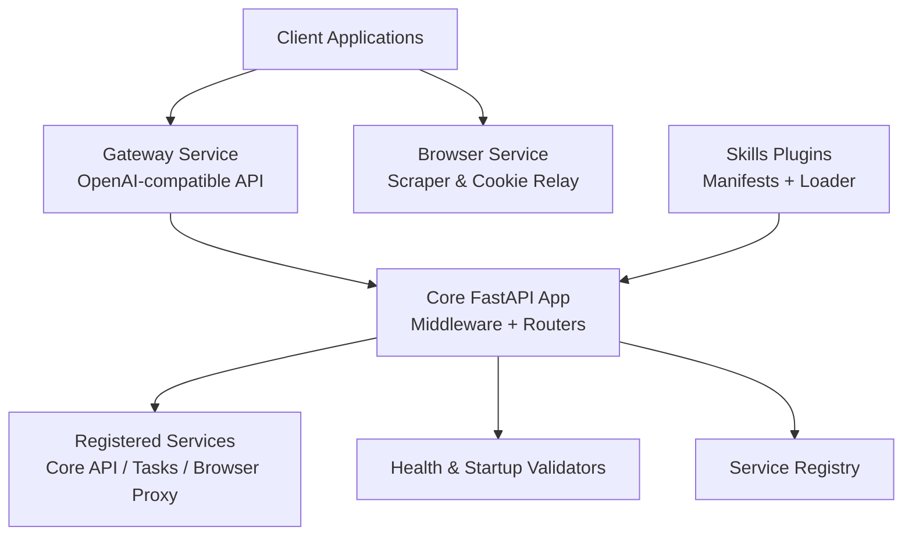
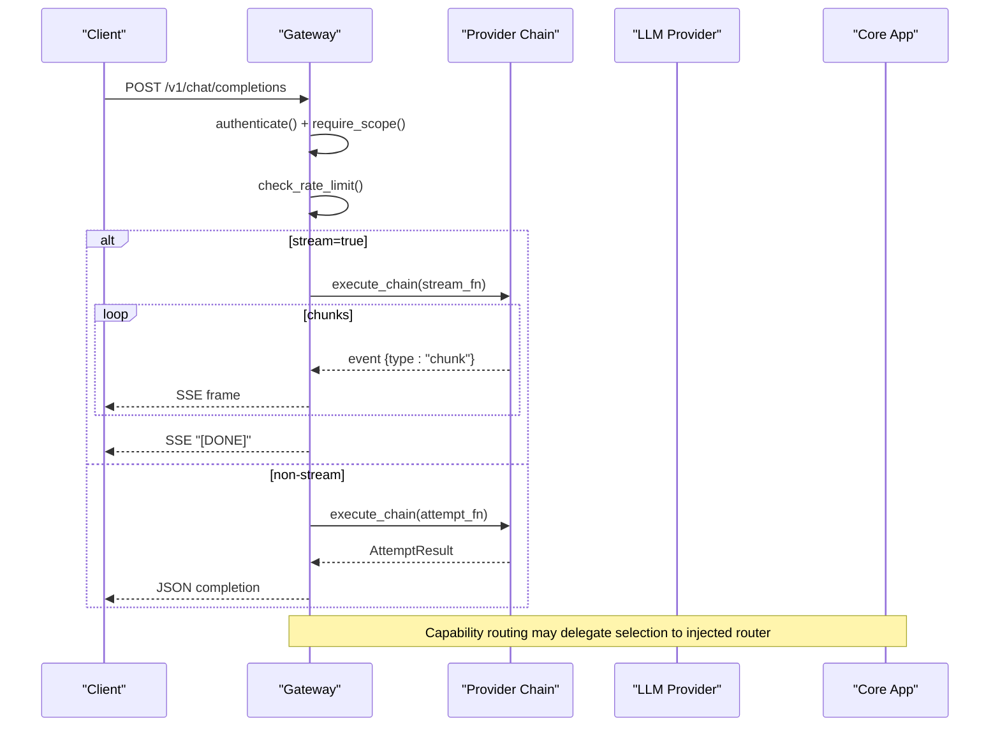
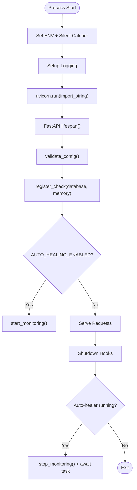
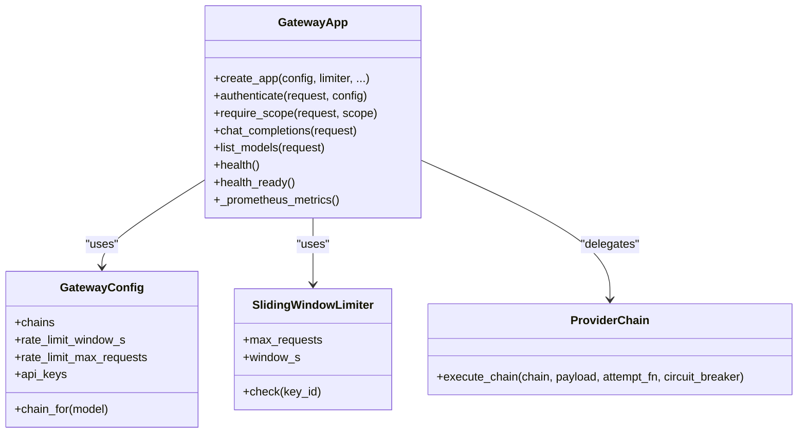
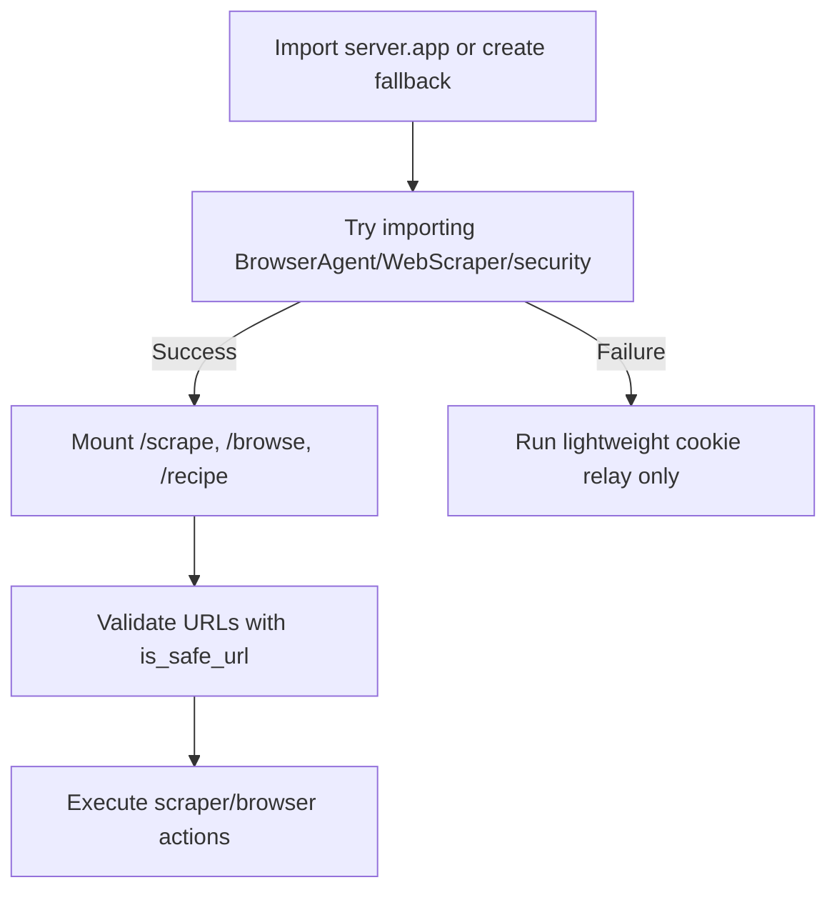
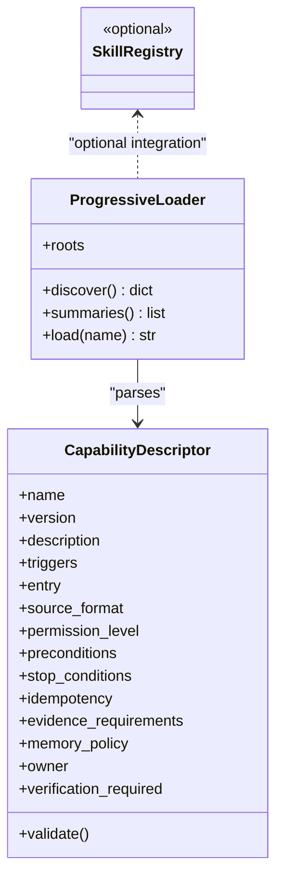
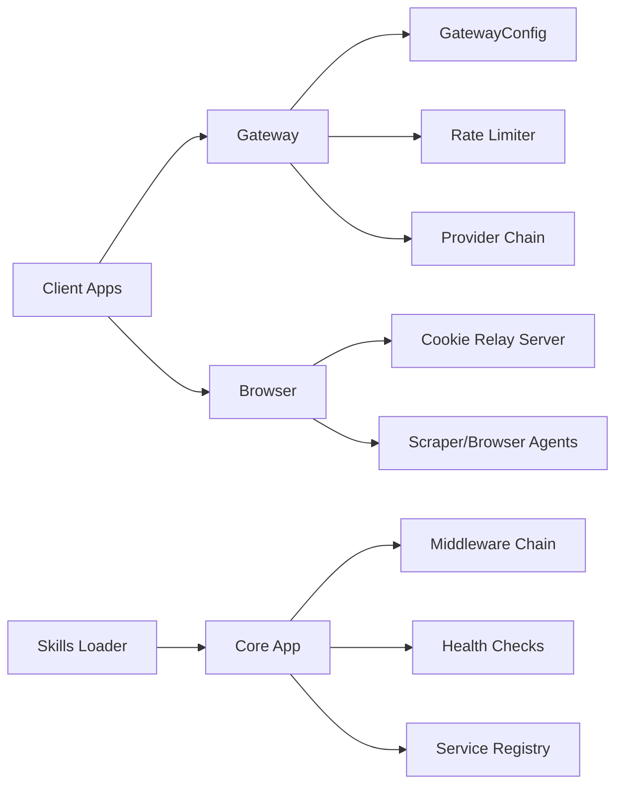

# Component Architecture & Boundaries

<cite>
**Referenced Files in This Document**
- [README.md](../../README.md)
- [core/main.py](../../core/main.py)
- [core/app.py](../../core/app.py)
- [core/app_builder.py](../../core/app_builder.py)
- [core/service_registry.py](../../core/service_registry.py)
- [core/startup_validator.py](../../core/startup_validator.py)
- [core/health_check.py](../../core/health_check.py)
- [gateway/main.py](../../gateway/main.py)
- [browser/main.py](../../browser/main.py)
</cite>

## Table of Contents
1. [Introduction](#introduction)
2. [Project Structure](#project-structure)
3. [Core Components](#core-components)
4. [Architecture Overview](#architecture-overview)
5. [Detailed Component Analysis](#detailed-component-analysis)
6. [Dependency Analysis](#dependency-analysis)
7. [Performance Considerations](#performance-considerations)
8. [Troubleshooting Guide](#troubleshooting-guide)
9. [Conclusion](#conclusion)

## Introduction
This document explains SupremeAI’s component architecture and service boundaries across the Core engine, API Gateway, Browser automation, and Client applications. It documents separation of concerns, contract interfaces, dependency injection patterns, module isolation strategies, plugin architecture for skills/providers/extensions, request flows, event propagation, state synchronization, microservices-in-monorepo organization, shared libraries, cross-cutting concerns (logging, metrics, security), startup sequence, service registration, and health checks.

The repository is a single monorepo SSOT containing Core, Gateway, Browser, Studio, Infrastructure, and MCP Control Plane. The public boundary surface is intentionally minimal: clients interact with a stable Gateway contract while internal engines, providers, and browser automation remain behind well-defined service boundaries.

**Section sources**
- [README.md:22-60](../../README.md#L22-L60)

## Project Structure
SupremeAI follows a microservices-in-monorepo pattern:
- `core/` — Agent intelligence, workflows, FastAPI application builder, middleware chain, service registry, health system, and domain modules.
- `gateway/` — Unified OpenAI-compatible provider gateway with authentication, rate limiting, provider chaining, streaming, and health/metrics endpoints.
- `browser/` — Standalone scraper and cookie relay entrypoint with optional Playwright-based browsing routes.
- `skills/` — Plugin manifest schema, progressive loader, and registry abstractions for skills and extensions.
- `api-schemas/` — Stable external contracts such as the Gateway OpenAPI surface.
- `infrastructure/`, `vscode/`, `studio/`, etc. — Clients, edge workers, and control planes.

**Diagram sources**
- [README.md:22-60](../../README.md#L22-L60)
- [core/app_builder.py:44-607](../../core/app_builder.py#L44-L607)
- [gateway/main.py:334-548](../../gateway/main.py#L334-L548)
- [browser/main.py:21-103](../../browser/main.py#L21-L103)

**Section sources**
- [README.md:22-60](../../README.md#L22-L60)

## Core Components
- Core Engine:
  - Application bootstrap via Uvicorn and lazy app import.
  - Centralized FastAPI app builder with strict middleware ordering, lifecycle hooks, and router registration.
  - Startup validation and comprehensive health checking.
  - Canonical service registry exposing capabilities and health paths.
- API Gateway:
  - Provider-agnostic OpenAI-compatible `/v1/chat/completions` endpoint.
  - Authentication, scope gating, sliding-window rate limiting, and standardized error contracts.
  - Streaming SSE relay with failover before first chunk; honest usage reporting.
  - Health, readiness, Prometheus metrics, and capability routing.
- Browser Automation:
  - Lightweight FastAPI entrypoint that optionally mounts scraping and browsing routes.
  - SSRF-safe URL validation and concurrency/timeouts controlled by environment variables.
- Skills/Plugins:
  - Dual manifest schema (SKILL.md frontmatter and cursor plugin.json).
  - Three-stage progressive disclosure loader (discover → summaries → load).
  - Optional SkillRegistry integration.

**Section sources**
- [core/main.py:1-166](../../core/main.py#L1-L166)
- [core/app.py:1-17](../../core/app.py#L1-L17)
- [core/app_builder.py:44-607](../../core/app_builder.py#L44-L607)
- [core/service_registry.py:1-110](../../core/service_registry.py#L1-L110)
- [core/startup_validator.py:1-184](../../core/startup_validator.py#L1-L184)
- [core/health_check.py:1-536](../../core/health_check.py#L1-L536)
- [gateway/main.py:1-800](../../gateway/main.py#L1-L800)
- [browser/main.py:1-105](../../browser/main.py#L1-L105)
- [skills/registry/manifest_schema.py:1-171](../../skills/registry/manifest_schema.py#L1-L171)
- [skills/registry/progressive_loader.py:1-42](../../skills/registry/progressive_loader.py#L1-L42)

## Architecture Overview
The system enforces clear boundaries:
- Clients talk only to the Gateway or Browser services over HTTP/SSE.
- Core exposes a rich internal API surface behind authentication, rate limiting, and CORS.
- Skills/plugins are loaded progressively and dispatched at runtime without blooting boot-time memory.
- Health and readiness probes are standardized across services.

**Diagram sources**
- [gateway/main.py:627-775](../../gateway/main.py#L627-L775)
- [gateway/main.py:214-314](../../gateway/main.py#L214-L314)

**Section sources**
- [gateway/main.py:107-180](../../gateway/main.py#L107-L180)
- [gateway/main.py:334-548](../../gateway/main.py#L334-L548)
- [gateway/main.py:627-775](../../gateway/main.py#L627-L775)

## Detailed Component Analysis

### Core Engine: Bootstrap, Middleware, Lifecycle, and Health
- Bootstrap:
  - `core/main.py` sets environment, installs signal handlers, configures logging, and launches Uvicorn with import-string based app loading for reload and multi-worker safety.
- App Builder:
  - `core/app_builder.py::create_app()` constructs the FastAPI instance, wires a carefully ordered middleware chain (context, docs auth, gzip, request ID, security headers, request validation, trusted origin, supreme context, tenant extraction, observability, query timing, rate limit, idempotency, auth, API key, AutonoGuard, honeypot, chaos injector, response standardization, CORS, Origin Shield), registers routers, and exposes health/release endpoints.
  - Lifespan validates configuration, registers database/memory checks, starts optional auto-healer monitoring, and shuts down browser sessions gracefully.
- Startup Validation:
  - `core/startup_validator.py` performs comprehensive checks on settings, secrets, LLM keys, DB URL, Redis URL, and production CORS policy, failing fast on critical errors.
- Health System:
  - `core/health_check.py` aggregates application, Redis, database, external services, integrations, memory, and disk checks, returning an overall status and predictions.

**Diagram sources**
- [core/main.py:1-166](../../core/main.py#L1-L166)
- [core/app_builder.py:84-228](../../core/app_builder.py#L84-L228)

**Section sources**
- [core/main.py:1-166](../../core/main.py#L1-L166)
- [core/app.py:1-17](../../core/app.py#L1-L17)
- [core/app_builder.py:44-607](../../core/app_builder.py#L44-L607)
- [core/startup_validator.py:1-184](../../core/startup_validator.py#L1-L184)
- [core/health_check.py:1-536](../../core/health_check.py#L1-L536)

### API Gateway: Contracts, Auth, Rate Limiting, Streaming, and Metrics
- Contract Surface:
  - Implements `api-schemas/gateway.openapi.yaml` with `/health`, `/healthz`, `/v1/models`, and `/v1/chat/completions`.
- Authentication and Scopes:
  - `authenticate()` maps `x-supremeai-key` to a key record with scopes; missing key yields guest chat scope.
  - `require_scope()` enforces per-endpoint scopes.
- Rate Limiting:
  - Sliding window limiter with Redis fallback; standardized 429 responses include `Retry-After` and `X-RateLimit-*` headers.
- Streaming:
  - `relay_stream()` relays provider deltas as SSE frames; failover allowed only before first chunk; terminal `[DONE]` sentinel emitted.
- Metrics and Health:
  - Prometheus metrics exporter wired via middleware; `/metrics` endpoint exposed.
  - Health endpoints report service version, chains, and module statuses; readiness endpoint reports degraded state when memory store is degraded or no chains configured.

**Diagram sources**
- [gateway/main.py:334-548](../../gateway/main.py#L334-L548)
- [gateway/main.py:627-775](../../gateway/main.py#L627-L775)

**Section sources**
- [gateway/main.py:1-800](../../gateway/main.py#L1-L800)

### Browser Automation: Entrypoint, Scraper Routes, and Safety
- Entrypoint:
  - `browser/main.py` imports the primary FastAPI app from `server.py` (cookie relay engine) or creates a lightweight fallback app.
- Optional Scraper/Browse Routes:
  - Registers `/scrape`, `/browse`, and `/recipe` endpoints guarded by SSRF checks (`is_safe_url`) and environment-controlled concurrency/timeout.
- Graceful Degradation:
  - If dependencies are unavailable, the service runs in lightweight cookie relay mode.

**Diagram sources**
- [browser/main.py:21-103](../../browser/main.py#L21-L103)

**Section sources**
- [browser/main.py:1-105](../../browser/main.py#L1-L105)

### Plugin Architecture: Skills, Providers, and Extensions
- Manifest Schema:
  - Normalizes SKILL.md frontmatter and cursor plugin.json into a unified `CapabilityDescriptor`.
  - Supports optional governance fields (permissions, preconditions, stop conditions, idempotency, evidence requirements, memory policy, owner, verification_required).
- Progressive Loader:
  - Stage 1: discover() indexes metadata only.
  - Stage 2: summaries() provides cheap payloads for agent context.
  - Stage 3: load() reads full instructions for exactly one skill.
- Registry Integration:
  - Optional SkillRegistry can be imported if available; otherwise falls back gracefully.

**Diagram sources**
- [skills/registry/manifest_schema.py:22-171](../../skills/registry/manifest_schema.py#L22-L171)
- [skills/registry/progressive_loader.py:24-42](../../skills/registry/progressive_loader.py#L24-L42)
- [skills/registry/__init__.py:1-26](../../skills/registry/__init__.py#L1-L26)

**Section sources**
- [skills/registry/manifest_schema.py:1-171](../../skills/registry/manifest_schema.py#L1-L171)
- [skills/registry/progressive_loader.py:1-42](../../skills/registry/progressive_loader.py#L1-L42)
- [skills/registry/__init__.py:1-26](../../skills/registry/__init__.py#L1-L26)

### Microservices-in-Monorepo Pattern and Shared Libraries
- Monorepo Topology:
  - Single Door Monorepo SSOT contains Core, Gateway, Browser, Studio, Infrastructure, and MCP Control Plane.
  - Public boundary partition separates open surfaces (contracts, CI guards, federation anchors) from transit surfaces (domain mirrors).
- Shared Libraries:
  - `api-schemas/` defines stable contracts (e.g., Gateway OpenAPI).
  - `core/` centralizes cross-cutting concerns: logging, observability, rate limiting, security middleware, health checks, service registry, and lifecycle management.
- Module Isolation:
  - Each service has its own entrypoint and app factory; optional features are lazily imported to reduce cold start cost.
  - Cross-service communication uses HTTP/SSE with standardized error contracts and health endpoints.

**Section sources**
- [README.md:22-60](../../README.md#L22-L60)

### Cross-Cutting Concerns: Logging, Metrics, Security
- Logging:
  - Global silent catcher and structured logging setup during bootstrap.
- Metrics:
  - Gateway exposes Prometheus metrics via middleware recording request latency and status; Core conditionally exposes `/metrics` when detailed monitoring is enabled.
- Security:
  - Core middleware chain includes request validation, trusted origin validation, authentication, API key validation, AutonoGuard, honeypot, and chaos injection.
  - Gateway enforces authentication, scope checks, and standardized error responses; CORS is strictly configured with explicit origins and header allowlists.

**Section sources**
- [core/main.py:1-166](../../core/main.py#L1-L166)
- [core/app_builder.py:323-452](../../core/app_builder.py#L323-L452)
- [gateway/main.py:424-473](../../gateway/main.py#L424-L473)
- [gateway/main.py:529-548](../../gateway/main.py#L529-L548)

## Dependency Analysis
The following diagram shows how services depend on each other and where shared concerns live.

**Diagram sources**
- [gateway/main.py:334-548](../../gateway/main.py#L334-L548)
- [browser/main.py:21-103](../../browser/main.py#L21-L103)
- [core/app_builder.py:323-452](../../core/app_builder.py#L323-L452)
- [core/health_check.py:65-536](../../core/health_check.py#L65-L536)
- [core/service_registry.py:36-70](../../core/service_registry.py#L36-L70)
- [skills/registry/progressive_loader.py:24-42](../../skills/registry/progressive_loader.py#L24-L42)

**Section sources**
- [gateway/main.py:334-548](../../gateway/main.py#L334-L548)
- [browser/main.py:21-103](../../browser/main.py#L21-L103)
- [core/app_builder.py:323-452](../../core/app_builder.py#L323-L452)
- [core/health_check.py:65-536](../../core/health_check.py#L65-L536)
- [core/service_registry.py:36-70](../../core/service_registry.py#L36-L70)
- [skills/registry/progressive_loader.py:24-42](../../skills/registry/progressive_loader.py#L24-L42)

## Performance Considerations
- Cold Start Optimization:
  - Lazy imports for middleware and optional components reduce initialization overhead.
  - Uvicorn import-string usage avoids creating multiple app instances during boot.
- Concurrency and Throughput:
  - Streaming SSE reduces latency for long-running completions.
  - Browser scraper concurrency and timeouts are configurable via environment variables.
- Resource Constraints:
  - Production enforces a single worker to prevent OOM on constrained environments.
  - Database readiness checks use timeouts and REST fallbacks to avoid blocking startup.

[No sources needed since this section provides general guidance]

## Troubleshooting Guide
- Startup Failures:
  - Check `StartupValidator` results for missing JWT secret, encryption key, LLM API keys, database URL, Redis URL, or production CORS misconfiguration.
- Health Probes:
  - Use `/health`, `/healthz`, `/health/live`, and `/health/ready` on Gateway; Core exposes canonical `/health/*` routes.
  - For database connectivity, Core attempts SQLAlchemy ping with a Supabase REST fallback.
- Rate Limiting:
  - Inspect 429 responses for `Retry-After` and `X-RateLimit-*` headers; verify Redis availability for distributed rate limiting.
- Streaming Errors:
  - Pre-first-chunk provider failures trigger failover; post-first-chunk errors emit SSE error frames with sanitized messages.
- Browser SSRF:
  - Ensure URLs pass `is_safe_url`; unauthorized internal access is rejected.

**Section sources**
- [core/startup_validator.py:27-142](../../core/startup_validator.py#L27-L142)
- [core/health_check.py:151-241](../../core/health_check.py#L151-L241)
- [gateway/main.py:147-180](../../gateway/main.py#L147-L180)
- [gateway/main.py:214-314](../../gateway/main.py#L214-L314)
- [browser/main.py:62-95](../../browser/main.py#L62-L95)

## Conclusion
SupremeAI’s architecture cleanly separates client-facing services (Gateway, Browser) from the Core engine, using explicit contracts, dependency injection, and a robust middleware chain. The skills/plugin system supports extensibility through normalized manifests and progressive loading. Health and startup validation ensure reliable operation, while metrics and security middleware provide cross-cutting observability and protection. The microservices-in-monorepo pattern enables cohesive development while maintaining clear service boundaries and shared libraries.

[No sources needed since this section summarizes without analyzing specific files]