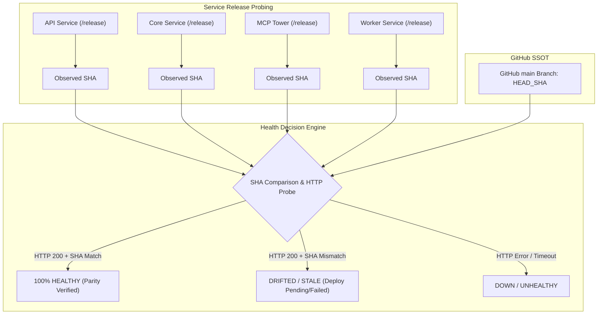
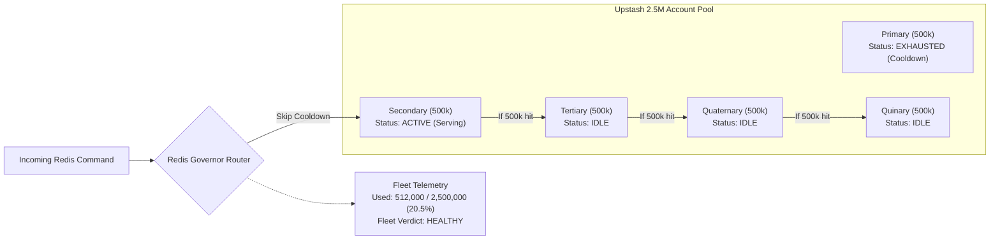

# SupremeAI Free-Tier Safeguards & Real-Data Parity Architecture Specification

> **Status:** PROPOSED & READY FOR IMPLEMENTATION  
> **Target Version:** 2.1.0  
> **Authors:** SupremeAI Engineering & Architecture Core  
> **Scope:** Multi-Cloud Free-Tier Optimization, Failover Integrity, and Honest Telemetry (MCP Control Tower, Gateway, Core)

---

## 1. Executive Summary & Core Motivation

SupremeAI-এর অপারেশনাল দর্শনের একটি প্রধান ভিত্তি হলো **Zero-Cost Sustainability** (সম্পূর্ণ বিনামূল্যে সর্বোচ্চ মানের সার্ভিস নিশ্চিত করা)। আমাদের ইকোসিস্টেমে একাধিক ক্লাউড ও ইনফ্রাস্ট্রাকচার প্রোভাইডারের ফ্রি-টিয়ার ব্যবহার করা হয়:
- **Render:** প্রতি অ্যাকাউন্টে ৭৫০ ঘণ্টা ফ্রি রানটাইম (512 MB RAM)।
- **Upstash Redis:** প্রতি অ্যাকাউন্টে ৫০০,০০০ কমান্ড/মাস।
- **Supabase Postgres:** ৫০০ MB স্টোরেজ ও ফ্রি কানেকশন পুলার।
- **Cloudflare:** ১০০,০০০ রিকোয়েস্ট/দিন এবং ১,০০০ KV রাইট/দিন।
- **GitHub Actions:** ২,০০০ ফ্রি রান মিনিট।
- **LLM Providers (Gemini/Groq):** ফ্রি রেট লিমিট পুল।

### The Two Critical Flaws in Current Architecture:
1. **False Quota Exhaustion Detection (Redis):**  
   ইনফিসিকালে আমাদের ৫টি আলাদা Upstash অ্যাকাউন্ট (মোট ২৫,০০,০০০ কমান্ড/মাস) থাকা সত্ত্বেও কোডের বিভিন্ন এজেন্ট ও চেকার প্রাইমারি অ্যাকাউন্টের ৫০০,০০০ শেষ হলেই পুরো সিস্টেমকে "Quota Dead" বা আনহেলদি ধরে নেয়।
2. **"Process-Live" vs "Commit-Parity" Illusion:**  
   একটি ব্যাকএন্ড সার্ভার শুধুমাত্র HTTP `200 OK` দিলেই তাকে "Healthy" বলা বিভ্রান্তিকর। যদি GitHub `main`-এ নতুন প্যাচ থাকে কিন্তু রেন্ডারে সার্ভিসের ডিপ্লয় ফেইল করে পুরনো কোড চালু থাকে, তবে সার্ভারটি টেকনিক্যালি **Stale / Drifted**, ১০০% Healthy নয়।
3. **Free-Tier Policy Blindness:**  
   রেন্ডারের ৭৫০ ঘণ্টার পলিসি লঙ্ঘন করে একই অ্যাকাউন্টে একাধিক সার্ভিস চলে কি না, তা স্বয়ংক্রিয়ভাবে অডিট করার কোনো মেকানিজম ছিল না।

---

## 2. Comprehensive Multi-Cloud Free-Tier Matrix & Protection Rules

| সার্ভিস | ফ্রি-টিয়ার লিমিট (Limits) | আর্কিটেকচারাল ফেলওভার (Failover Chain) | সুরক্ষা নিয়ম (Enforcement Rules) |
| :--- | :--- | :--- | :--- |
| **Render (Web Services)** | • ৭৫০ ঘণ্টা রানটাইম/মাস/অ্যাকাউন্ট<br>• ৫১২ MB RAM লিমিট<br>• ১৫ মিনিট ইনঅ্যাক্টিভ থাকলে স্লিপ | • **৭টি আলাদা Render অ্যাকাউন্ট ও এপিআই কী** (`RENDER_API_KEY_1` to `6`, `PAYKARI`)<br>• প্রতিটি অ্যাকাউন্টে ঠিক ১টি সার্ভিস বরাদ্দ | • ১টি অ্যাকাউন্টে কখনোই ২য় ওয়েব সার্ভিস যোগ করা যাবে না।<br>• ব্যাকগ্রাউন্ড পিং প্রতি ১৪ মিনিটে সচল রাখবে। |
| **Upstash Redis** | • ৫০০,০০০ কমান্ড/মাস/অ্যাকাউন্ট<br>• এক্সিড করলে `HTTP 400 (max requests limit)` | • **৫টি আলাদা অ্যাকাউন্ট চেইন:**<br>1. Primary (`paykari...`)<br>2. Secondary (`niloyjoy7...`)<br>3. Tertiary (`ziaulhaque...`)<br>4. Quaternary (`njelmedia...`)<br>5. Quinary (`itnjel...`) | • মোট ক্ষমতা: **২৫ লাখ (2,500,000) কমান্ড/মাস**।<br>• কোনো অ্যাকাউন্ট ৫০万 ক্রস করলে স্বয়ংক্রিয় কুলডাউন ও রোটেট।<br>• অ্যালার্ট কেবলমাত্র মোট ৮০% (২০ লাখ) খরচ হলে ট্রিগার হবে। |
| **Supabase Postgres** | • ৫০০ MB ডেটাবেস ডিস্ক<br>• ম্যাক্স ১৫ ডিরেক্ট কানেকশন<br>• ৭ দিন ইনঅ্যাক্টিভ থাকলে পজ | • ডিরেক্ট কানেকশন বাদ দিয়ে Supabase Transaction Pooler (Port 6543) বাধ্যতামূলক<br>• দৈনিক অটো-হার্টবিট কুয়েরি | • কোনো ভারী ফাইল বা ইমেজ বাইনারি Postgres-এ সেভ করা যাবে না (Qdrant বা স্থানীয় ড্রাইভে যাবে)। |
| **Cloudflare Workers / KV** | • ১০০,০০০ রিকোয়েস্ট/দিন<br>• ১,০০০ KV রাইট অপারেশন/দিন | • স্ট্যাটিক অ্যাসেট ও প্রক্সি ক্যাশিং (Edge TTL: 24h)<br>• মেমোরি রাইট ব্যাচিং | • প্রতি হার্টবিটে KV রাইট নিষিদ্ধ; কেবল স্ট্যাটাস পরিবর্তন হলেই KV সিঙ্ক হবে। |
| **LLM Inference Pool** | • Gemini 2.0 Flash: ১৫ RPM<br>• Groq: ৩০ RPM | • ModelRouter (LiteLLM)-এ ৪৭টি ফ্রি এপিআই কী-এর রাউন্ড-রবিন পুল | • জেমিনি রেট লিমিট পেলে ফলসব্যাক গ্রোক/ওপেনএআই-তে সুইচ করবে। |

---

## 3. Real-Data Parity Architecture (True Health Engine)



### New Parity Health Contract:
সার্ভিসের হেলথ কখনোই একটি মাত্র বুলিয়ান (`healthy: true`) হতে পারবে না। হেলথ রেসপন্সে ৩টি স্পষ্ট মাত্রা থাকবে:

```json
{
  "service": "core",
  "process_status": "ALIVE (200 OK)",
  "version_parity": {
    "git_target_sha": "de66a9b6a",
    "running_release_sha": "6b50fb75f",
    "status": "DRIFTED",
    "drift_reason": "Render deployment rolled back or build failed"
  },
  "runtime_guard": {
    "account_id": "render-primary",
    "single_service_isolated": true,
    "max_monthly_runtime_hours": 750,
    "status": "SAFE"
  },
  "overall_verdict": "DEGRADED_STALE_CODE"
}
```

---

## 4. Multi-Account Redis 2.5M Fleet Aggregation Design



### Telemetry Reporting Invariant:
- একক অ্যাকাউন্টের লিমিট শেষ হওয়া কোনো এরর নয়, এটি স্বাভাবিক আর্কিটেকচারাল ফেলওভার ইভেন্ট।
- সিস্টেম কেবল তখনই কোটা সতর্কতা দেবে যখন সমগ্র ফ্লিটের মোট ব্যবহার **২০,০০,০০০ (৮০%)** ছাড়িয়ে যাবে।
- এজেন্টদের কাছে Redis `HEALTHY` রিপোর্ট করবে যতক্ষণ অন্তত একটি অ্যাকাউন্ট সচল থাকবে।

---

## 5. Detailed Implementation Roadmap & Tasks

### Phase 1: Redis Fleet Aggregation Engine (MCP Control Plane & Core)
- [ ] **Task 1.1:** `infrastructure/mcp-control-plane/src/lib/redis_chain.ts` ফাইলে `getFleetQuotaSummary()` ফাংশন তৈরি করা।
  - মোট ক্ষমতা `2,500,000` কমান্ড কনফিগার করা।
  - প্রতিটি অ্যাকাউন্টের রানিং কমান্ড এবং স্ট্যাটাস (`active`, `cooldown`, `idle`) এগ্রিগেট করা।
- [ ] **Task 1.2:** `infrastructure/mcp-control-plane/src/tools/redis.tools.ts`-এ `redis.fleet_status` যোগ করা এবং ফলস অ্যালার্ম বন্ধ করা।
- [ ] **Task 1.3:** `core/cache/redis_manager.py`-এ পাইথন লেভেলে `REDIS_URL` ফেইল করলে অটো-রোটেশন হিসেবে `REDIS_SECONDARY_URL` এবং পরবর্তীগুলোতে অটোমেটিক স্লিপলেস সুইচিং সুসংহত করা।

### Phase 2: Per-Service Commit Parity Engine (Real Data Health)
- [ ] **Task 2.1:** `infrastructure/mcp-control-plane/src/tools/parity.tools.ts` রিফ্যাক্টর করা:
  - শুধুমাত্র একটি সার্ভিস নয়, `config/service_registry.yaml`-এ সংজ্ঞায়িত সমস্ত সার্ভিস (`core`, `api`, `worker`, `scraper`, `mcp`, `brain`) লুপের মাধ্যমে চেক করা।
  - প্রতিটি সার্ভিসের লাইভ `/release` এন্ডপয়েন্ট থেকে রানিং Commit SHA এক্সট্রাক্ট করা।
- [ ] **Task 2.2:** GitHub `main` ব্রাঞ্চের সাথে প্রতিটি সার্ভিসের Commit SHA তুলনা করে আলাদা স্ট্যাটাস দেওয়া (`parity_verified`, `drift_detected`, `offline`)।

### Phase 3: Render 750h Free-Tier Rule Enforcer
- [ ] **Task 3.1:** `infrastructure/mcp-control-plane/src/diagnostics/service_manifest.ts`-এ অ্যাকাউন্ট-ম্যাপিং ভ্যালিডেশন যোগ করা।
  - ভেরিফাই করা যে একই Render API Key একাধিক সার্ভিসে শেয়ার হচ্ছে না।
- [ ] **Task 3.2:** `scripts/ci/render_quota_preflight.py`-এর নিরাপত্তা চেক টাওয়ারের `system_health` এন্ডপয়েন্টে অন্তর্ভুক্ত করা।

---

## 6. Verification & Acceptance Criteria

1. **Redis Resiliency Verification:**
   - প্রাইমারি অ্যাকাউন্টে কোটা শেষ থাকা অবস্থায় `system_health` যেন কোনো ফলস `DOWN` বা `CRITICAL` না দেখায়; বরং সেকেন্ডারি অ্যাকাউন্টে ট্রাফিক হ্যান্ডেল করে `2.5M Fleet Quota: 20.5% Used (HEALTHY)` দেখায়।
2. **Commit Parity Verification:**
   - যদি `api` সার্ভিসে নতুন কোড থাকে এবং `core` সার্ভিসে পুরনো কমিট থাকে, তবে টাওয়ার যেন সুস্পষ্টভাবে দেখায়:
     `api: 100% PARITY_VERIFIED` এবং `core: DRIFT_DETECTED (Running 6b50fb7, Expected de66a9b)`.
3. **Free-Tier Integrity:**
   - কোনো ডুপ্লিকেট অ্যাকাউন্ট কনফিগারেশন বা ওভারল্যাপিং সার্ভিস থাকলে সাথে সাথে ওয়ার্নিং জেনারেট হওয়া।
