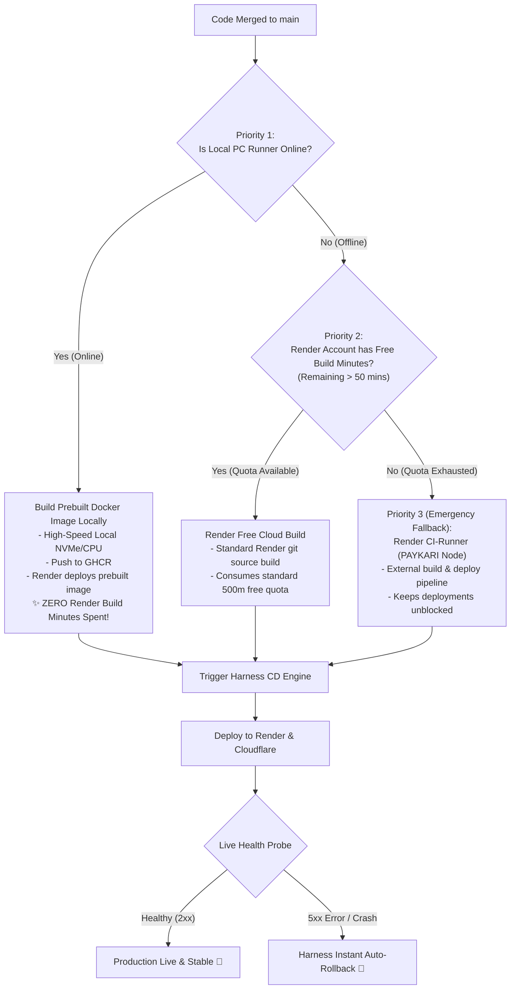
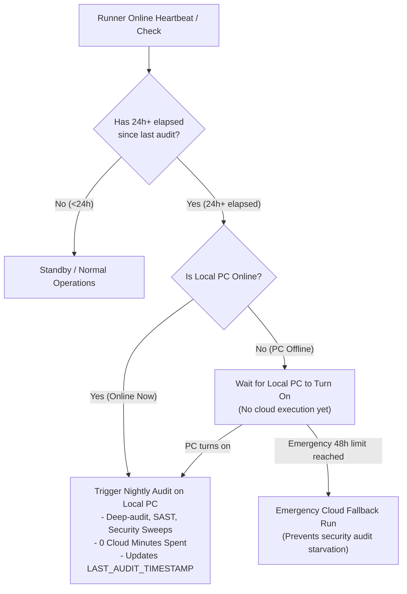

# SupremeAI: GitHub Actions (Fast + Self-Hosted) & Harness Hybrid CI/CD Strategic Blueprint

> **Document Type:** Production Architecture Blueprint & Strategic Execution Plan  
> **Topology:** GitHub Actions (Fast Cloud Gates + Local Self-Hosted Heavy Runner + Cloud Fallback) + Harness CD (Autonomous Verification & Rollback)  
> **Refined Polices:** 
> 1. **Immediate Local-Wake Nightly Audit:** Runs as soon as the local runner comes online once 24h+ have elapsed.  
> 2. **3-Tier Cascade Deployment Engine:** Local PC Docker Build (Priority 1) -> Render Free Cloud Build (Priority 2) -> Render CI-Runner/PAYKARI (Priority 3).  
> **Status:** Approved for Implementation  

---

## 1. Executive Summary & Core Improvements

This architecture maximizes local compute to preserve 100% of external free cloud quotas while retaining bulletproof resilience:

1. **Tier 1 Fast Safety Gates (<30s):** Runs on GitHub Cloud (`ubuntu-latest`) for immediate PR feedback.
2. **Tier 2 Heavy Test Battery:** Runs natively on **Local PC (GitHub Self-Hosted Runner)** when online (0 cloud minutes), falling back to cloud runners if offline.
3. **Event-Driven 24h+ Nightly Audits (Wake-Triggered):**
   - The nightly maintenance sweep has **no fixed wall-clock schedule**.
   - As soon as **24 hours have elapsed** since the last audit AND your **local PC runner comes online**, the audit begins immediately on your machine.
   - Zero cloud minutes are ever consumed during normal operations.
4. **3-Tier Cascade Deployment Priority (Main Merges):**
   - **Priority 1 (Local PC Build):** If local PC is online, build the Docker image locally and push prebuilt artifacts to GHCR. Render deploys instantly (**0 Render build minutes spent**).
   - **Priority 2 (Render Free Cloud Build):** If local PC is offline, fall back to Render's standard 500-minute free cloud build.
   - **Priority 3 (Render CI-Runner / PAYKARI Backup):** If Render's 500-minute free build quota runs out, fall back to the dedicated Render CI-Runner / `PAYKARI` multi-account pipeline.
5. **Harness CD & Verification:** Deploys, probes live endpoints, and performs automated zero-touch rollbacks if any failure or memory leak is detected.

---

## 2. 3-Tier Cascade Deployment Flow (Main Merge)

---

## 3. Immediate Local-Wake Nightly Audit (24h+ Event-Driven)

### Key Rules for the Nightly Audit:
- **No strict midnight run:** Eliminates the risk of running while your PC is asleep.
- **Instant Trigger on Online:** When you start your computer in the morning or evening, the system notices that >24 hours have passed and immediately executes the audit in the background.
- **Zero Cost:** The heavy maintenance scripts run completely on local hardware without touching GitHub's 2,000-minute pool.

---

## 4. Hierarchy of Fallbacks & Quota Defense

| Tier | Deployment Scenario | Compute Source | Quota Impact | Speed |
| :---: | :--- | :--- | :--- | :--- |
| **Tier 1** | Primary (PC Online) | **Local PC Docker Engine** | **0 Render Build Mins** | ⚡ Ultra-Fast (~1-2m) |
| **Tier 2** | Secondary (PC Offline) | **Render Free Cloud Build** | Consumes Render 500m | Normal (~5-8m) |
| **Tier 3** | Emergency (Quota Dead) | **Render CI-Runner (`PAYKARI`)** | Uses backup multi-key budget | Fail-safe backup |

---

## 5. Summary of Benefits

1. **Absolute Quota Protection:** Render's 500-minute free limit will practically never get exhausted because Priority 1 handles 90%+ of all daily merges.
2. **Never Stalled:** Even if your PC is shut down AND the primary Render quota runs out, Priority 3 ensures PRs and main deployments never get blocked.
3. **Smart Audit:** Nightly audits only run when the local machine is awake, ending wasted cloud minutes while keeping audits consistent every ~24 hours.
4. **Harness AI Sentinel:** The entire deployment lifecycle is protected by automated rollbacks and AI failure diagnosis.
