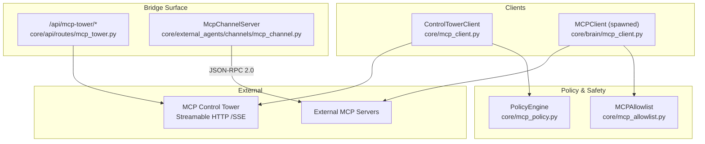
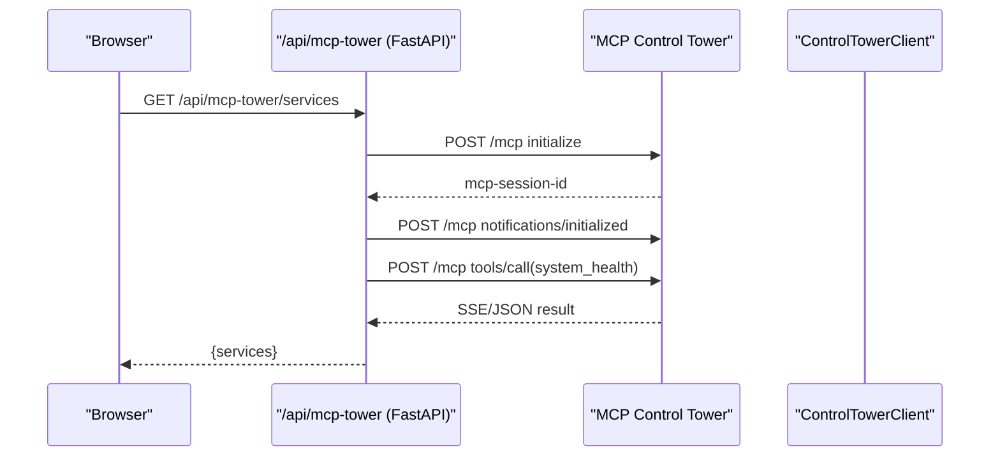
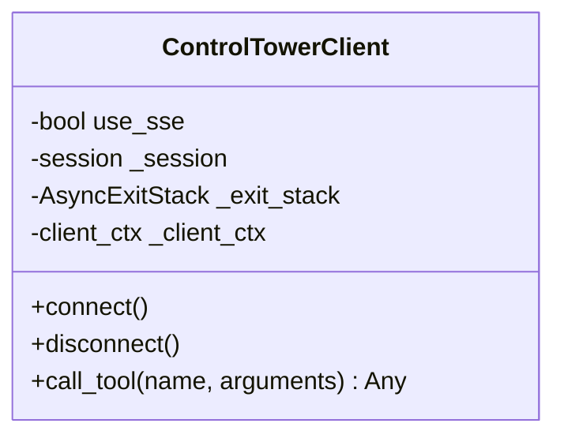
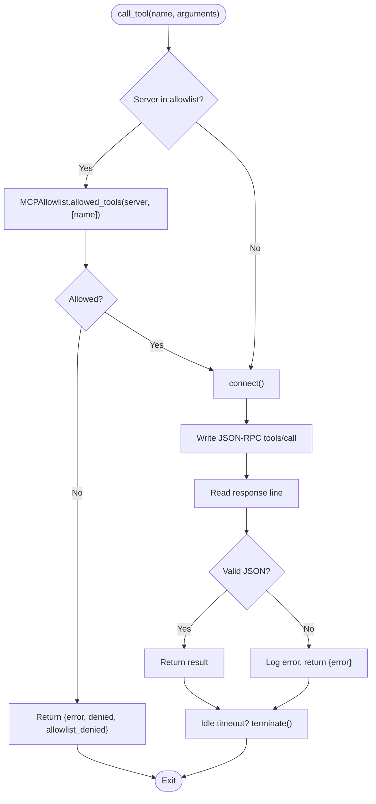
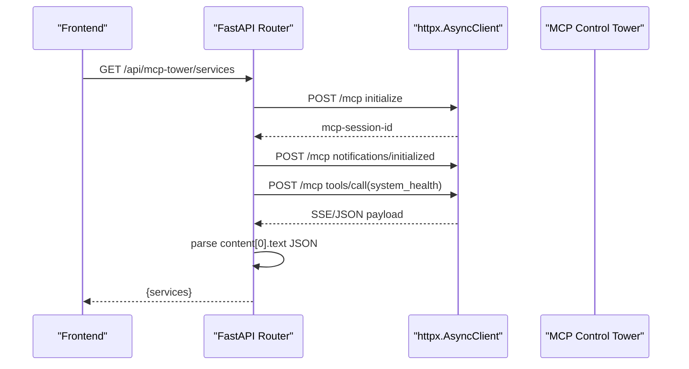
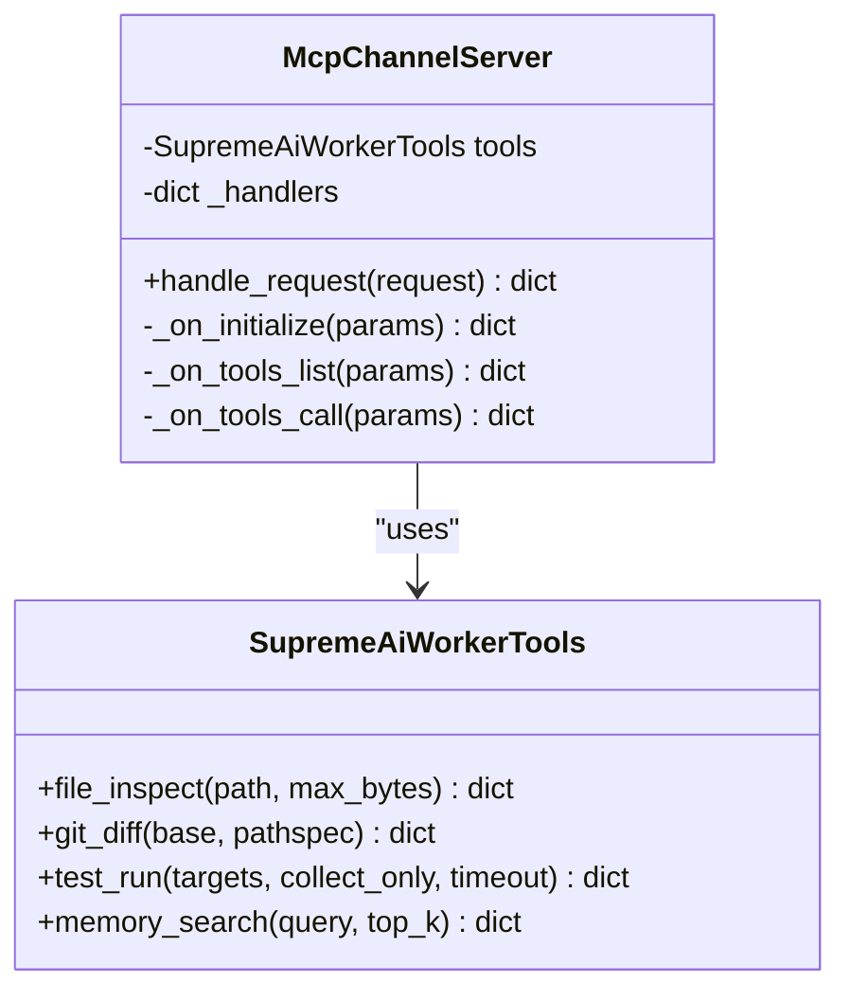
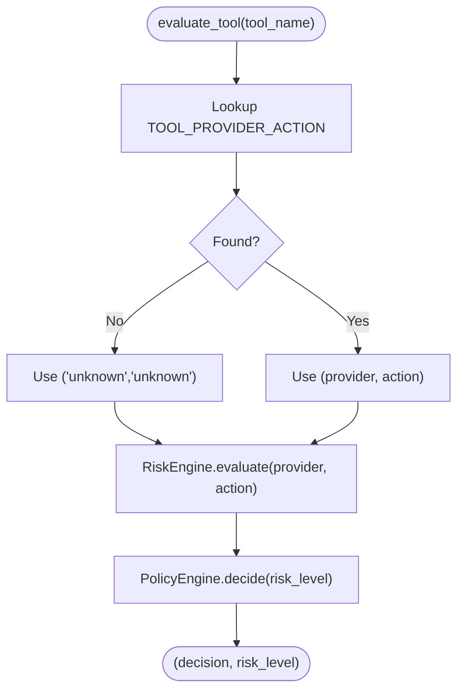
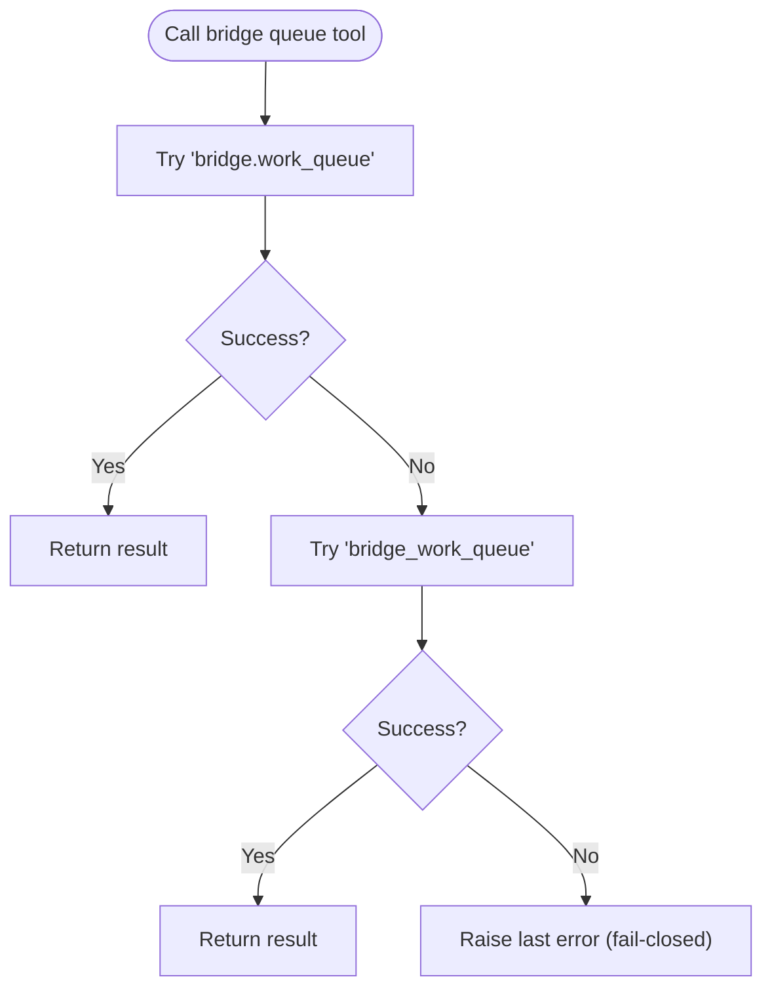
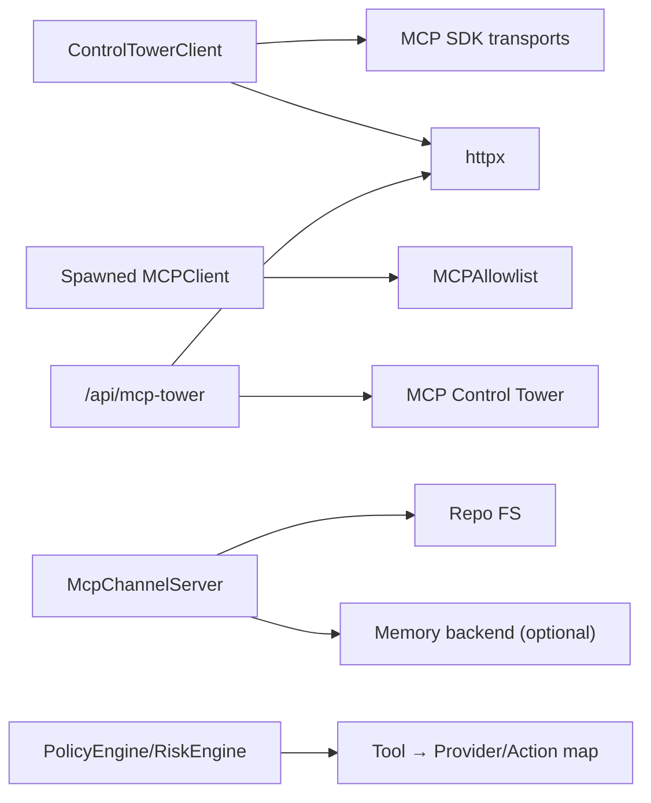

# Bridge System

<cite>
**Referenced Files in This Document**
- [README.md](../../README.md)
- [core/mcp_client.py](../../core/mcp_client.py)
- [core/brain/mcp_client.py](../../core/brain/mcp_client.py)
- [core/api/routes/mcp_tower.py](../../core/api/routes/mcp_tower.py)
- [core/external_agents/channels/mcp_channel.py](../../core/external_agents/channels/mcp_channel.py)
- [core/mcp_policy.py](../../core/mcp_policy.py)
- [core/mcp_allowlist.py](../../core/mcp_allowlist.py)
- [tests/test_dispatch_honesty_floor.py](../../tests/test_dispatch_honesty_floor.py)
- [tests/test_bridge_landing_watchdog.py](../../tests/test_bridge_landing_watchdog.py)
- [tests/test_tower_queue_tool_name_epochs.py](../../tests/test_tower_queue_tool_name_epochs.py)
- [scripts/tower/tool_consolidation_reference.py](../../scripts/tower/tool_consolidation_reference.py)
</cite>

## Introduction (MCP Bridge)
This document explains the MCP bridge system that enables external agent communication with SupremeAI’s internal orchestration and work queue. It covers:
- Bridge architecture and message translation layers
- Protocol adapters for JSON-RPC 2.0, Streamable HTTP, and SSE
- Work queue management, task coordination, and state synchronization
- Client integration patterns, connection pooling, and retry strategies
- Configuration, routing, error handling, performance, throughput, and monitoring

The bridge is a set of clients, servers, policy gates, and tower proxies that translate between external MCP tool calls and internal platform operations such as work queue inspection, work order management, and service telemetry.

**Section sources**
- [README.md:16-20](../../README.md#L16-L20)

## Project Structure
The bridge spans several modules:
- Control Tower client (Streamable HTTP/SSE/stdio)
- External MCP server client (spawned processes)
- API proxy to the Control Tower
- Worker MCP channel exposing core tools
- Policy engine and allowlist for safe execution
- Tests validating rename epochs, honesty floors, and watchdog behavior

**Diagram sources**
- [core/mcp_client.py:128-231](../../core/mcp_client.py#L128-L231)
- [core/brain/mcp_client.py:23-162](../../core/brain/mcp_client.py#L23-L162)
- [core/api/routes/mcp_tower.py:31-117](../../core/api/routes/mcp_tower.py#L31-L117)
- [core/external_agents/channels/mcp_channel.py:188-251](../../core/external_agents/channels/mcp_channel.py#L188-L251)
- [core/mcp_policy.py:121-218](../../core/mcp_policy.py#L121-L218)
- [core/mcp_allowlist.py:216-237](../../core/mcp_allowlist.py#L216-L237)

**Section sources**
- See Diagram sources above.

## Core Components
- ControlTowerClient: Connects to the MCP Control Tower using Streamable HTTP or SSE; wraps session lifecycle and tool calls; logs runs via observe_run.
- MCPClient (spawned): Manages subprocess-based MCP servers, enforces per-server allowlists at call time, and handles idle cleanup.
- MCP Tower Proxy (/api/mcp-tower): Proxies browser requests to the Tower, initializes sessions, parses SSE/JSON, maps service telemetry, and streams health updates.
- McpChannelServer: Implements JSON-RPC 2.0 for worker tools (file inspect, git diff, test run, memory search).
- PolicyEngine and RiskEngine: Map tool names to provider/action risk levels and decide ALLOW vs REQUIRE_APPROVAL vs DENY.
- MCPAllowlist: Whitelists servers and their allowed tools; used by spawned MCPClient at runtime.

Key responsibilities:
- Translation between external MCP tool names and internal platform operations
- Safe execution through policy and allowlist checks
- Robust transport handling (HTTP, SSE, stdio)
- Telemetry exposure and streaming

**Section sources**
- See Diagram sources above.

## Architecture Overview
The bridge composes multiple layers:
- Client layer: ControlTowerClient and spawned MCPClient
- Transport layer: Streamable HTTP, SSE, stdio, and JSON-RPC 2.0 over pipes
- Policy layer: RiskEngine + PolicyEngine and MCPAllowlist
- Server layer: McpChannelServer exposing worker tools
- Tower proxy: /api/mcp-tower routes bridging browser to Tower

**Diagram sources**
- [core/api/routes/mcp_tower.py:46-117](../../core/api/routes/mcp_tower.py#L46-L117)
- [core/mcp_client.py:137-198](../../core/mcp_client.py#L137-L198)

**Section sources**
- [core/api/routes/mcp_tower.py:31-117](../../core/api/routes/mcp_tower.py#L31-L117)
- [core/mcp_client.py:128-231](../../core/mcp_client.py#L128-L231)

## Detailed Component Analysis

### ControlTowerClient (Streamable HTTP/SSE/stdio)
- Establishes a session with the Control Tower using Streamable HTTP when available, falling back to SSE; supports local stdio mode.
- Wraps each tool call with observability via observe_run.
- Handles Authorization headers from environment variables.

**Diagram sources**
- [core/mcp_client.py:128-231](../../core/mcp_client.py#L128-L231)

**Section sources**
- [core/mcp_client.py:128-231](../../core/mcp_client.py#L128-L231)

### Spawned MCPClient (Process Pooling and Allowlist Enforcement)
- Spawns external MCP servers as subprocesses, manages lifecycle, and serializes JSON-RPC messages.
- Enforces per-server allowlist at call time; returns structured denial if tool not permitted.
- Performs idle cleanup after inactivity.

**Diagram sources**
- [core/brain/mcp_client.py:107-158](../../core/brain/mcp_client.py#L107-L158)
- [core/mcp_allowlist.py:216-237](../../core/mcp_allowlist.py#L216-L237)

**Section sources**
- [core/brain/mcp_client.py:23-162](../../core/brain/mcp_client.py#L23-L162)
- [core/mcp_allowlist.py:216-237](../../core/mcp_allowlist.py#L216-L237)

### MCP Tower Proxy (/api/mcp-tower)
- Initializes Tower sessions, forwards tool calls, and parses both SSE and JSON responses.
- Maps Tower service telemetry into a normalized shape for the frontend.
- Streams periodic health updates via SSE.

**Diagram sources**
- [core/api/routes/mcp_tower.py:46-117](../../core/api/routes/mcp_tower.py#L46-L117)

**Section sources**
- [core/api/routes/mcp_tower.py:31-117](../../core/api/routes/mcp_tower.py#L31-L117)

### McpChannelServer (Worker Tools)
- Implements JSON-RPC 2.0 methods: initialize, tools/list, tools/call.
- Exposes worker tools: file_inspect, git_diff, test_run, memory_search.
- Guards file paths against traversal and scopes git/test operations.

**Diagram sources**
- [core/external_agents/channels/mcp_channel.py:51-184](../../core/external_agents/channels/mcp_channel.py#L51-L184)
- [core/external_agents/channels/mcp_channel.py:188-251](../../core/external_agents/channels/mcp_channel.py#L188-L251)

**Section sources**
- [core/external_agents/channels/mcp_channel.py:188-251](../../core/external_agents/channels/mcp_channel.py#L188-L251)

### Policy Engine and Risk Engine
- Maps tool names to provider/action pairs and evaluates risk levels (R0–R6).
- Decides ALLOW vs REQUIRE_APPROVAL vs DENY based on risk level.
- Provides quick allow check utilities.

**Diagram sources**
- [core/mcp_policy.py:121-218](../../core/mcp_policy.py#L121-L218)

**Section sources**
- [core/mcp_policy.py:121-218](../../core/mcp_policy.py#L121-L218)

### Tool Name Epochs and Rename Waves
- The bridge must tolerate oscillating tool names across deploys (e.g., bridge.work_queue vs bridge_work_queue).
- Call sites try documented spellings in order and fail closed on the last error.
- Consolidation reference documents legacy-to-current mappings.

**Diagram sources**
- [tests/test_tower_queue_tool_name_epochs.py:51-81](../../tests/test_tower_queue_tool_name_epochs.py#L51-L81)
- [scripts/tower/tool_consolidation_reference.py:40-62](../../scripts/tower/tool_consolidation_reference.py#L40-L62)

**Section sources**
- [tests/test_tower_queue_tool_name_epochs.py:51-81](../../tests/test_tower_queue_tool_name_epochs.py#L51-L81)
- [scripts/tower/tool_consolidation_reference.py:40-62](../../scripts/tower/tool_consolidation_reference.py#L40-L62)

## Dependency Analysis
- ControlTowerClient depends on the official MCP SDK transports and httpx for Streamable HTTP fallback.
- Spawned MCPClient depends on MCPAllowlist for runtime enforcement.
- /api/mcp-tower routes depend on httpx and environment configuration for Tower URL/token.
- McpChannelServer depends on repository-scoped filesystem access and optional memory backend.
- PolicyEngine/RiskEngine provide centralized governance for tool execution decisions.

**Diagram sources**
- [core/mcp_client.py:128-231](../../core/mcp_client.py#L128-L231)
- [core/brain/mcp_client.py:23-162](../../core/brain/mcp_client.py#L23-L162)
- [core/api/routes/mcp_tower.py:31-117](../../core/api/routes/mcp_tower.py#L31-L117)
- [core/external_agents/channels/mcp_channel.py:188-251](../../core/external_agents/channels/mcp_channel.py#L188-L251)
- [core/mcp_policy.py:121-218](../../core/mcp_policy.py#L121-L218)

**Section sources**
- [core/mcp_client.py:128-231](../../core/mcp_client.py#L128-L231)
- [core/brain/mcp_client.py:23-162](../../core/brain/mcp_client.py#L23-L162)
- [core/api/routes/mcp_tower.py:31-117](../../core/api/routes/mcp_tower.py#L31-L117)
- [core/external_agents/channels/mcp_channel.py:188-251](../../core/external_agents/channels/mcp_channel.py#L188-L251)
- [core/mcp_policy.py:121-218](../../core/mcp_policy.py#L121-L218)

## Performance Considerations
- Connection reuse:
  - ControlTowerClient uses an AsyncExitStack to manage httpx sessions and MCP client contexts; prefer reusing sessions where possible.
  - Spawned MCPClient maintains a single process per server and performs idle cleanup to avoid resource leaks.
- Timeouts:
  - Tower proxy and ControlTowerClient set explicit timeouts for HTTP calls; tune based on expected latency.
- Throughput:
  - Stream SSE updates from /api/mcp-tower/stream to reduce polling overhead.
  - Batch tool discovery and cache results where feasible.
- Observability:
  - Wrap tool calls with observe_run to capture run metadata and traceability.

[No sources needed since this section provides general guidance]

## Troubleshooting Guide
Common issues and resolutions:
- Unreachable Tower:
  - The proxy returns 502 with details when Tower is unreachable; verify MCP_TOWER_URL/MCP_TOWER_TOKEN and network connectivity.
- Tool name epoch mismatch:
  - If a tool name changed during deploy waves, callers should try all documented spellings; tests assert first-live-wins and fail-closed behavior.
- Allowlist denial:
  - Spawned MCPClient returns structured denial when a tool is not whitelisted for the server; update MCPAllowlist or adjust requested tool list.
- Honesty floor for queue probing:
  - When Tower is reachable but returns unexpected shapes, ensure parsing of content[0].text and handle windowTruncated/nextStep fields.

Operational tips:
- Validate environment variables for Tower URL and tokens.
- Inspect SSE payloads and JSON envelope shapes for errors.
- Use tests as contracts for expected behaviors (rename epochs, honesty floor, watchdog behavior).

**Section sources**
- [core/api/routes/mcp_tower.py:46-117](../../core/api/routes/mcp_tower.py#L46-L117)
- [tests/test_tower_queue_tool_name_epochs.py:51-81](../../tests/test_tower_queue_tool_name_epochs.py#L51-L81)
- [core/brain/mcp_client.py:107-158](../../core/brain/mcp_client.py#L107-L158)
- [tests/test_dispatch_honesty_floor.py:20-39](../../tests/test_dispatch_honesty_floor.py#L20-L39)

## Conclusion
The MCP bridge integrates external agents with SupremeAI’s internal systems through robust clients, protocol adapters, policy enforcement, and a Tower proxy. It ensures safe execution via allowlists and risk evaluation, tolerates tool name changes across deploys, and exposes reliable telemetry. For high-throughput operations, leverage SSE streaming, session reuse, and careful timeout tuning while maintaining observability and fail-closed guarantees.

[No sources needed since this section summarizes without analyzing specific files]