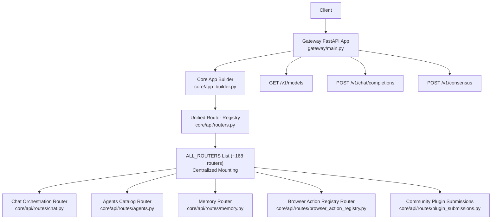
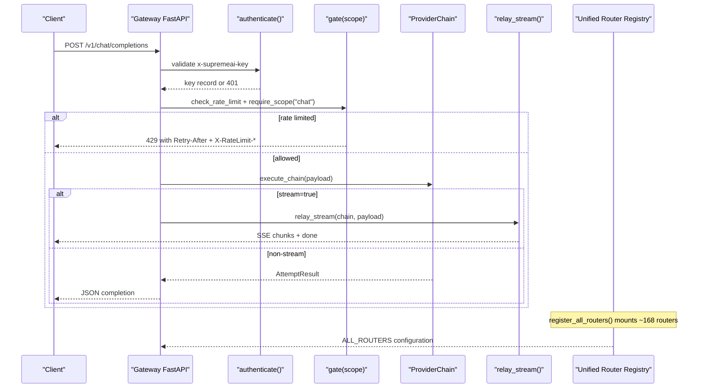
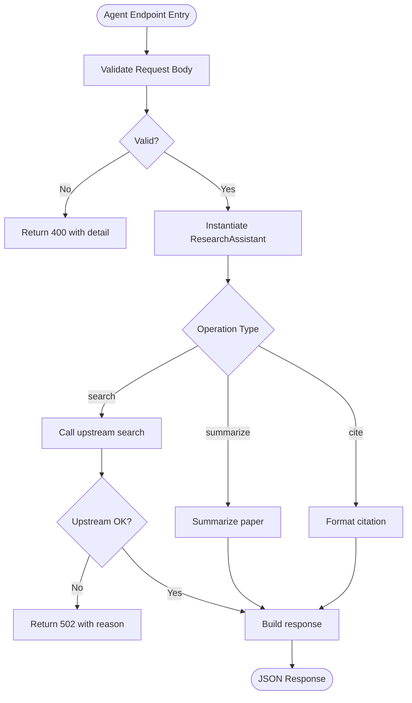
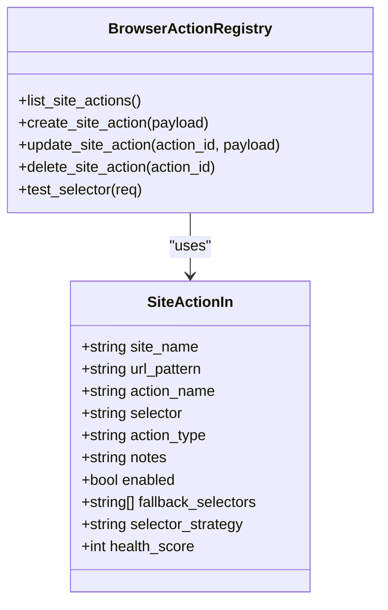
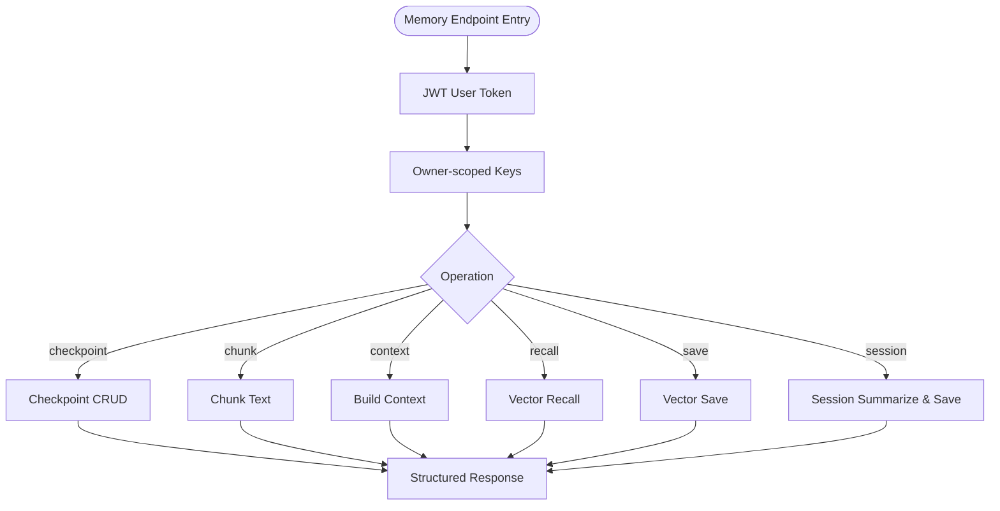

# REST API Endpoints

<cite>
**Referenced Files in This Document**
- [core/app_builder.py](../../core/app_builder.py)
- [core/api/routers.py](../../core/api/routers.py)
- [gateway/main.py](../../gateway/main.py)
- [core/api/routes/chat.py](../../core/api/routes/chat.py)
- [core/api/routes/agents.py](../../core/api/routes/agents.py)
- [core/api/routes/memory.py](../../core/api/routes/memory.py)
- [core/api/routes/browser_action_registry.py](../../core/api/routes/browser_action_registry.py)
- [core/api/routes/plugin_submissions.py](../../core/api/routes/plugin_submissions.py)
- [core/database/supabase_client.py](../../core/database/supabase_client.py)
- [api-schemas/gateway.openapi.yaml](../../api-schemas/gateway.openapi.yaml)
</cite>

## Update Summary
**Changes Made**
- Updated Router Registry section to document unified router mounting through `register_all_routers()` in `core/app_builder.py`
- Added Community Plugin Submissions endpoint documentation with authentication requirements
- Updated Supabase database operations performance considerations with asyncio.to_thread() improvements
- Enhanced troubleshooting guide with router mount failure scenarios
- Updated architecture diagrams to reflect centralized router registry pattern

## Table of Contents
1. [Introduction](#introduction)
2. [Project Structure](#project-structure)
3. [Core Components](#core-components)
4. [Architecture Overview](#architecture-overview)
5. [Detailed Component Analysis](#detailed-component-analysis)
6. [Dependency Analysis](#dependency-analysis)
7. [Performance Considerations](#performance-considerations)
8. [Troubleshooting Guide](#troubleshooting-guide)
9. [Conclusion](#conclusion)

## Introduction
This document provides comprehensive REST API documentation for the gateway endpoints exposed by the SupremeAI system. It covers authentication, rate limiting, HTTP methods, URL patterns, request/response schemas, validation rules, error responses, pagination and content negotiation where applicable, retry strategies, and security/access control per endpoint group: chat completions, agent management, model operations, browser automation, memory access, and community plugin submissions.

The gateway implements an OpenAI-compatible surface for model listing and chat completions, while additional feature routers expose specialized agent capabilities, memory operations, browser action registry administration, and community plugin submission workflows. The central router registry controls which routes are mounted and whether they require admin-level authentication at the router level.

**Updated** The application now uses a unified router registry that mounts approximately 168 routers through `register_all_routers()`, fixing critical issues where previously defined routers were never mounted causing 404 responses.

## Project Structure
The gateway application is built on FastAPI and wires multiple feature routers through a centralized registry. The primary gateway entry point defines health probes, model listing, chat completions (including streaming), consensus routing, rate limiting, authentication, and standardized error contracts. Feature-specific endpoints live under `core/api/routes` and are mounted via the unified router registry in `core/api/routers.py`.



**Diagram sources**
- [core/app_builder.py:512-527](../../core/app_builder.py#L512-L527)
- [core/api/routers.py:15-512](../../core/api/routers.py#L15-L512)
- [core/api/routers.py:515-600](../../core/api/routers.py#L515-L600)
- [gateway/main.py:483-527](../../gateway/main.py#L483-L527)
- [gateway/main.py:584-607](../../gateway/main.py#L584-L607)
- [gateway/main.py:626-775](../../gateway/main.py#L626-L775)

**Section sources**
- [core/app_builder.py:44-624](../../core/app_builder.py#L44-L624)
- [core/api/routers.py:1-630](../../core/api/routers.py#L1-L630)
- [gateway/main.py:1-21](../../gateway/main.py#L1-L21)

## Core Components
- **Unified Application Builder**: `create_app()` in `core/app_builder.py` builds FastAPI app, configures middleware chain, and calls `register_all_routers(app)` to mount all feature routers centrally.
- **Central Router Registry**: Declarative `ALL_ROUTERS` list in `core/api/routers.py` defines ~168 routers with path, prefix, admin gating, and criticality flags.
- **Authentication**: Reads `x-supremeai-key`, supports guest mode with limited scope, validates key records, and enforces required scopes.
- **Rate Limiting**: Sliding window limiter with standardized JSON error contract and `X-RateLimit-*` headers plus `Retry-After`.
- **Streaming**: SSE framing for chat completions with provider failover before first chunk; honest usage echo only when provided by providers.
- **Supabase Performance Layer**: Async-safe database operations using `asyncio.to_thread()` to prevent blocking event loop during sync Supabase client calls.

Key responsibilities:
- `/health`, `/healthz`, `/health/live`, `/health/ready`: credential-free probes and readiness checks.
- `/metrics`: Prometheus metrics export.
- `/v1/models`: lists enabled models from configured chains.
- `/v1/chat/completions`: OpenAI-compatible chat completion with optional streaming.
- `/v1/consensus`: parallel multi-model consensus endpoint.
- `/api/v1/plugins/community/submit`: authenticated community plugin submission endpoint.

**Updated** The unified router registry now ensures all ~168 routers are properly mounted, eliminating the previous issue where routers were defined but never accessible.

**Section sources**
- [core/app_builder.py:44-624](../../core/app_builder.py#L44-L624)
- [core/api/routers.py:15-512](../../core/api/routers.py#L15-L512)
- [core/api/routers.py:515-600](../../core/api/routers.py#L515-L600)
- [gateway/main.py:69-104](../../gateway/main.py#L69-L104)
- [gateway/main.py:110-141](../../gateway/main.py#L110-L141)
- [gateway/main.py:147-179](../../gateway/main.py#L147-L179)
- [gateway/main.py:184-314](../../gateway/main.py#L184-L314)
- [gateway/main.py:334-405](../../gateway/main.py#L334-L405)
- [gateway/main.py:463-473](../../gateway/main.py#L463-L473)
- [gateway/main.py:483-527](../../gateway/main.py#L483-L527)
- [gateway/main.py:584-607](../../gateway/main.py#L584-L607)
- [gateway/main.py:626-775](../../gateway/main.py#L626-L775)

## Architecture Overview
The gateway exposes both OpenAI-compatible endpoints and internal feature APIs. Clients authenticate using either an API key header or JWT-based user tokens depending on the route group. Streaming uses Server-Sent Events with explicit event frames and terminal markers. Provider failures are handled honestly: pre-first-chunk failures trigger failover; post-first-chunk failures emit error events without silent reassembly.



**Diagram sources**
- [gateway/main.py:110-141](../../gateway/main.py#L110-L141)
- [gateway/main.py:147-179](../../gateway/main.py#L147-L179)
- [gateway/main.py:626-775](../../gateway/main.py#L626-L775)
- [gateway/main.py:214-314](../../gateway/main.py#L214-L314)
- [core/app_builder.py:512-527](../../core/app_builder.py#L512-L527)
- [core/api/routers.py:515-600](../../core/api/routers.py#L515-L600)

## Detailed Component Analysis

### Chat Completions
- Base path: `/v1/chat/completions`
- Method: `POST`
- Authentication: requires `x-supremeai-key`; guest mode grants `chat` scope if no key present.
- Scope: `chat` enforced by gate.
- Request body: JSON object containing:
  - `messages`: array of message objects (required).
  - `model`: string; supports capability routing via `capability:<name>` or alias resolution.
  - `stream`: boolean; enables SSE streaming.
- Response:
  - Non-streaming: JSON object with fields `id`, `object`, `created`, `model`, `choices`, and optional `usage`.
  - Streaming: `text/event-stream` with framed events:
    - `event: chat.completion.chunk` carrying OpenAI-style chunk payloads.
    - `event: error` carrying error payloads when provider fails after first chunk.
    - `event: done` followed by `data: [DONE]` terminal marker.
- Validation:
  - Malformed JSON returns 400 with `malformed_json`.
  - Missing or invalid `messages` returns 400 with `missing_messages`.
  - Unknown model returns 400 with `unknown_model`.
- Error handling:
  - Provider malformed response returns 502 with `provider_malformed_response`.
  - Chain exhaustion before streaming begins emits error event then `[DONE]`.
- Rate limiting:
  - Standardized 429 response with `Retry-After` and `X-RateLimit-Limit/Remaining/Reset`.
- Content negotiation:
  - Streaming uses `text/event-stream`; non-streaming uses `application/json`.
- Security:
  - Key validation and scope enforcement; CORS allows specific origins and headers including `X-SupremeAI-Key`.

Example requests and responses:
- Non-streaming curl example:
  - `curl -X POST https://your-gateway/v1/chat/completions -H "Content-Type: application/json" -H "x-supremeai-key: YOUR_KEY" -d '{"messages":[{"role":"user","content":"Hello"}],"model":"auto"}'`
- Streaming curl example:
  - `curl -N -X POST https://your-gateway/v1/chat/completions -H "Content-Type: application/json" -H "x-supremeai-key: YOUR_KEY" -d '{"messages":[{"role":"user","content":"Hello"}],"stream":true}'`

**Section sources**
- [gateway/main.py:110-141](../../gateway/main.py#L110-L141)
- [gateway/main.py:147-179](../../gateway/main.py#L147-L179)
- [gateway/main.py:184-314](../../gateway/main.py#L184-L314)
- [gateway/main.py:626-775](../../gateway/main.py#L626-L775)
- [gateway/main.py:407-461](../../gateway/main.py#L407-L461)

### Agent Management
- Base path: `/api/agents`
- Authentication: JWT user token via dependency.
- Endpoints:
  - `GET /api/agents/`: lists available specialized agent types with id, name, description, and count.
  - `GET /api/agents/{agent_id}/status`: returns availability status for a known agent type; unknown ids return 404.
  - `POST /api/agents/research/search`: performs real research search against upstream source; maps bad input to 400 and upstream failure to 502.
  - `POST /api/agents/research/summarize`: deterministic extractive summarization; errors map to 400/500.
  - `POST /api/agents/research/cite`: deterministic citation formatting; errors map to 400/500.
- Request schemas:
  - ResearchRequest: `query` (string), `source` (string, default arxiv), `max_results` (integer, default 5).
  - SummarizeRequest: `paper` (object), `style` (string, default apa).
- Responses:
  - List agents: `{ agents: [...], count: number }`.
  - Agent status: `{ agent_id, status, last_activity, detail }`.
  - Research search: `{ query, source, papers: [...], count }`.
  - Summarize/cite: structured result objects.
- Validation and errors:
  - Input validation raises 400 with details.
  - Upstream failures raise 502 with verbatim reasons.
  - Internal errors raise 500.



**Diagram sources**
- [core/api/routes/agents.py:80-164](../../core/api/routes/agents.py#L80-L164)

**Section sources**
- [core/api/routes/agents.py:23-27](../../core/api/routes/agents.py#L23-L27)
- [core/api/routes/agents.py:80-164](../../core/api/routes/agents.py#L80-L164)

### Model Operations
- Base path: `/v1/models`
- Method: `GET`
- Authentication: requires `x-supremeai-key`; scope `models` enforced.
- Response: JSON object with `object: "list"` and `data: [...]` where each item includes `id`, `object`, `owned_by`.
- Rate limiting: success responses include `X-RateLimit-*` headers.
- Security: key validation and scope enforcement.

Example curl:
- `curl https://your-gateway/v1/models -H "x-supremeai-key: YOUR_KEY"`

**Section sources**
- [gateway/main.py:584-607](../../gateway/main.py#L584-L607)
- [gateway/main.py:110-141](../../gateway/main.py#L110-L141)
- [gateway/main.py:609-616](../../gateway/main.py#L609-L616)

### Browser Automation
- Base path: `/api/admin/site-actions`
- Authentication: admin token via dependency.
- Endpoints:
  - `GET /api/admin/site-actions/`: lists site actions with metadata and total count.
  - `POST /api/admin/site-actions/`: creates a new site action; returns created row.
  - `PUT /api/admin/site-actions/{action_id}`: updates an existing action; 404 if not found.
  - `DELETE /api/admin/site-actions/{action_id}`: deletes an action; 404 if not found.
  - `POST /api/admin/site-actions/test`: dry-run selector test; blocked in production with 501.
- Request schema (SiteActionIn):
  - `site_name` (string), `url_pattern` (string), `action_name` (string), `selector` (string), `action_type` (string, default click), `notes` (string), `enabled` (boolean), `fallback_selectors` (array of strings), `selector_strategy` (string, default exact), `health_score` (integer).
- Responses:
  - List: `{ items: [...], total: number }`.
  - Create/Update/Delete: structured row or success object.
  - Test: `{ found, screenshot_base64, metrics }` in non-production; 501 in production.
- Validation and errors:
  - Not found returns 404.
  - Production test returns 501 with explanation.



**Diagram sources**
- [core/api/routes/browser_action_registry.py:64-75](../../core/api/routes/browser_action_registry.py#L64-L75)
- [core/api/routes/browser_action_registry.py:98-200](../../core/api/routes/browser_action_registry.py#L98-L200)

**Section sources**
- [core/api/routes/browser_action_registry.py:14-18](../../core/api/routes/browser_action_registry.py#L14-L18)
- [core/api/routes/browser_action_registry.py:98-200](../../core/api/routes/browser_action_registry.py#L98-L200)

### Memory Access
- Base path: `/api/memory`
- Authentication: JWT user token via dependency.
- Endpoints:
  - Checkpoint CRUD:
    - `POST /api/memory/checkpoint`: save checkpoint scoped by owner.
    - `GET /api/memory/checkpoint/{task_id}`: load checkpoint scoped by owner.
    - `GET /api/memory/checkpoints`: list checkpoints scoped by owner.
    - `DELETE /api/memory/checkpoint/{task_id}`: clear checkpoint scoped by owner.
  - Sliding window memory:
    - `POST /api/memory/chunk`: chunk text into windows scoped by session and owner.
    - `POST /api/memory/context`: build context from documents/query scoped by session and owner.
    - `GET /api/memory/recall`: recall memories scoped by session and owner.
    - `DELETE /api/memory/recall`: clear memory scoped by session and owner.
  - Vector memory (Eternal Brain):
    - `POST /api/memory/recall`: semantic recall bound to user id.
    - `POST /api/memory/save`: store vector memory bound to user id.
    - `POST /api/memory/session`: summarize and save session bound to user id.
- Request schemas:
  - CheckpointSaveRequest: `task_id`, `step_index`, `state`.
  - ChunkRequest: `text`, `session_id`, `max_tokens`, `overlap_ratio`.
  - ContextRequest: `documents`, `query`, `session_id`, `budget`.
  - VectorRecallRequest: `task_description`, `limit`, `threshold`.
  - VectorSaveRequest: `session_id`, `summary`, `task_type`, `agent_type`, `metadata`.
  - SessionSaveRequest: `session_id`, `messages`, `task_type`.
- Responses:
  - Checkpoint: `{ task_id, step_index, state, resumed }`.
  - Chunk: `{ session_id, windows }`.
  - Context: `{ session_id, context }`.
  - Recall/save/session: structured results with success flags and counts.
- Validation and errors:
  - Save/load/clear operations may return 404/500 depending on outcome.
  - User scoping ensures tenant isolation.



**Diagram sources**
- [core/api/routes/memory.py:19-16](../../core/api/routes/memory.py#L19-L16)
- [core/api/routes/memory.py:96-187](../../core/api/routes/memory.py#L96-L187)
- [core/api/routes/memory.py:217-258](../../core/api/routes/memory.py#L217-L258)

**Section sources**
- [core/api/routes/memory.py:12-16](../../core/api/routes/memory.py#L12-L16)
- [core/api/routes/memory.py:96-187](../../core/api/routes/memory.py#L96-L187)
- [core/api/routes/memory.py:217-258](../../core/api/routes/memory.py#L217-L258)

### Community Plugin Submissions
- Base path: `/api/v1/plugins/community`
- Authentication: requires valid JWT user token via `get_current_user_token` dependency.
- **Updated** Previously anonymous submissions are now authenticated to prevent abuse.
- Endpoints:
  - `POST /api/v1/plugins/community/submit`: accepts community plugin submissions for security review.
- Request schema (PluginSubmission):
  - `name` (string): plugin name.
  - `description` (string): plugin description.
  - `mcp_url` (HttpUrl): MCP server URL (must be HTTPS and safe).
  - `author` (string): submitter identifier.
- Responses:
  - Success: `{ status: "pending_review", message: "...", tracking_id: "PRJ-{uuid}-V1" }`.
  - Validation error: 400 with unsafe URL rejection.
- Security:
  - URL validation via `MCPSecurityGuard.is_safe_url()` enforces HTTPS and blocks internal/private networks.
  - Submitter identity logged for manual review process.
  - V1 scope limitation: submissions are logged but not persisted to durable queue yet.

Example curl:
- `curl -X POST https://your-gateway/api/v1/plugins/community/submit -H "Authorization: Bearer YOUR_JWT_TOKEN" -H "Content-Type: application/json" -d '{"name":"my-plugin","description":"A useful plugin","mcp_url":"https://example.com/mcp","author":"user123"}'`

**Section sources**
- [core/api/routes/plugin_submissions.py:1-61](../../core/api/routes/plugin_submissions.py#L1-L61)

### Additional Gateway Endpoints
- Health and readiness:
  - `GET /health`, `GET /healthz`, `GET /health/live`: return service status and module health.
  - `GET /health/ready`: returns 200 ready or 503 not_ready based on memory store degradation and chain configuration.
- Metrics:
  - `GET /metrics`: Prometheus metrics export.
- Command and component health:
  - `GET /command/health`, `GET /agents/health`, `GET /skills/health`, `GET /mcp/health`, `GET /mcp/tools`: lightweight health and tool listing.

**Section sources**
- [gateway/main.py:483-527](../../gateway/main.py#L483-L527)
- [gateway/main.py:529-582](../../gateway/main.py#L529-L582)

## Dependency Analysis
The gateway wires feature routers centrally through the unified router registry. Critical routers are loaded with fail-fast semantics; non-critical routers are optional. Admin routers can be globally gated by router registry dependencies, but many routers enforce their own auth internally.

```mermaid
graph LR
Registry["ALL_ROUTERS Registry<br/>core/api/routers.py"] --> ChatRoute["api.routes.chat"]
Registry --> AgentsRoute["api.routes.agents"]
Registry --> MemoryRoute["api.routes.memory"]
Registry --> BrowserRegRoute["api.routes.browser_action_registry"]
Registry --> PluginRoute["api.routes.plugin_submissions"]
Registry --> LLMGW["api.routes.llm_gateway_routes"]
Registry --> HealthRoute["api.routes.health"]
Registry --> PublicConfig["api.routes.public_config"]
Registry --> ~160 More Routes["...and ~160 more feature routers"]
```

**Diagram sources**
- [core/api/routers.py:15-512](../../core/api/routers.py#L15-L512)

**Section sources**
- [core/api/routers.py:515-600](../../core/api/routers.py#L515-L600)

## Performance Considerations
- **Streaming latency**: provider failures before first chunk trigger failover without wire noise; after first chunk, errors are emitted and streaming terminates to avoid duplication.
- **Usage honesty**: usage fields are echoed only when providers report them; model names reflect the actual serving provider/model pair.
- **Rate limiting**: sliding window limiter reduces burst traffic; clients must honor `Retry-After` and never hot-loop.
- **Middleware overhead**: metrics recording and build metadata headers add minimal overhead; CORS configuration is strict to prevent unintended cross-origin exposure.
- **Database performance**: Supabase operations now use `asyncio.to_thread()` to prevent blocking the event loop during synchronous database calls.
- **Router mounting**: unified registry eliminates startup delays from individual router imports while ensuring all routes are properly mounted.

**Updated** Supabase database operations have been optimized to prevent event loop blocking through proper async/threading patterns.

[No sources needed since this section provides general guidance]

## Troubleshooting Guide
Common issues and resolutions:
- **401 authentication_error**:
  - Cause: missing or invalid `x-supremeai-key`.
  - Resolution: provide a valid API key or ensure guest mode is permitted for the requested scope.
- **403 permission_error**:
  - Cause: key lacks required scope (`chat` or `models`).
  - Resolution: use a key with appropriate scopes.
- **400 invalid_request_error**:
  - Causes: malformed JSON, missing messages, unknown model.
  - Resolution: validate request body and model configuration.
- **429 rate_limit_error**:
  - Cause: exceeded rate limit.
  - Resolution: honor `Retry-After` and back off; monitor `X-RateLimit-*` headers.
- **502 api_error**:
  - Cause: provider malformed response or chain exhaustion.
  - Resolution: inspect provider logs; verify chain configuration; implement retry with exponential backoff for transient failures.
- **501 dry-run unavailable**:
  - Cause: browser action test endpoint disabled in production.
  - Resolution: connect a real CDP proxy endpoint or run in non-production environment.
- **404 not_found for feature endpoints**:
  - **Updated** Previously common due to unmounted routers; now resolved through unified router registry.
  - If still occurring, check service role filtering and router import dependencies.
- **Startup failures with router registration**:
  - **New** Critical routers now fail fast if they cannot be imported.
  - Check service role configuration and dependency availability.
- **Database operation timeouts**:
  - **Updated** Supabase operations should use `asyncio.to_thread()` pattern for sync client calls.
  - Monitor event loop blocking indicators in performance metrics.

**Section sources**
- [gateway/main.py:110-141](../../gateway/main.py#L110-L141)
- [gateway/main.py:147-179](../../gateway/main.py#L147-L179)
- [gateway/main.py:626-775](../../gateway/main.py#L626-L775)
- [core/api/routes/browser_action_registry.py:178-200](../../core/api/routes/browser_action_registry.py#L178-L200)
- [core/app_builder.py:512-527](../../core/app_builder.py#L512-L527)
- [core/database/supabase_client.py:94-100](../../core/database/supabase_client.py#L94-L100)

## Conclusion
The SupremeAI gateway provides a secure, rate-limited, and honest interface for chat completions, model listing, and specialized agent/memory/browser automation features. The unified router registry ensures all ~168 feature endpoints are properly mounted and accessible, resolving the previous critical issue of unmounted routers returning 404 responses. Community plugin submissions now require authentication for security, and database operations are optimized for performance.

Clients should implement robust authentication, respect rate limits and retry-after directives, handle streaming events correctly, and apply exponential backoff for transient provider failures. Admin endpoints require elevated privileges and should be restricted to trusted operators. The centralized router management simplifies endpoint discovery and maintenance while maintaining security boundaries.

**Updated** The unified router registry represents a significant architectural improvement that eliminates the previous disconnect between router definitions and actual endpoint availability.

[No sources needed since this section summarizes without analyzing specific files]