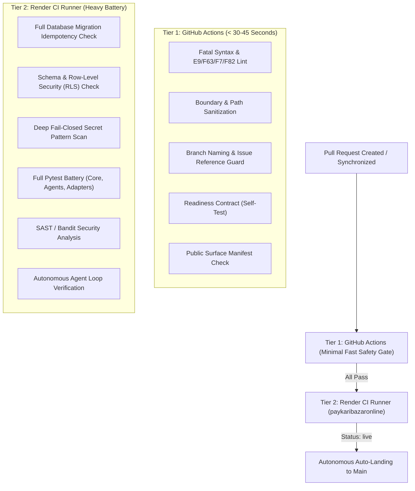

# SupremeAI Universal CI/CD Pipeline & Guard Architecture (SSOT)

> **Document Type:** Architecture & Operational Specification  
> **Target Repositories Audited:**  
> 1. `SaifulHaqueNiloy/supremeai` (Upstream Monorepo SSOT)  
> 2. `Supremeai-bd/supremeai` (Task Board SSOT & Embassy)  
> 3. `Supremeai-bd/supremeai` (Active Unified Monorepo)

---

## 🏗️ 1. Two-Tier Split Architecture (Design Philosophy)

To prevent GitHub Action runner timeouts and eliminate Render build-minute exhaustion (avoiding the 450+ minute threshold), all CI/CD checks are partitioned into two strict tiers:

---

## 📋 2. Comprehensive Inventory from `SaifulHaqueNiloy/supremeai`

### A. PR Gate (`.github/workflows/pr.yml`)
* **Auto-add Label:** `has-pr` tag injection on linked issues.
* **PR Context Resolution:** Author, slot permissions, and bot exemptions.
* **Branch Naming Guard:** Enforces branch regex format (`feat/*`, `fix/*`, `ci/*`).
* **Constitutional System Gates:**
  - `template_gate.py`: PR body reflection evidence & closes issue verification.
  - `freshness_gate.py`: Anti-stale base check.
  - `bengali_check.py`: Bengali architectural comment checker.
  - `arch_preservation_gate.py`: Ensures architectural invariants remain intact.
  - `generate_agents_md.py --check`: AGENTS.md single door constitution guard.
  - `audit_suite.py --pr`: Overall PR compliance audit.
  - `sprawl_guard.py --pr`: Detects unauthorized repository sprawl.
  - `generate_script_index.py --check`: Enforces script index registry.
  - `reconcile_secrets_registry.py --strict`: Ensures no unregistered secrets are referenced.
  - `check_slot_registry_drift.py`: Verifies agent slot assignments.
  - `inventory_lint.py --strict`: Validates system capability inventories.
  - `generate_env_example.py --check`: Syncs `.env.example`.
  - `ledger_check.py --base`: Financial/token expenditure ledger verification.
  - `cross_pr_collision_detector.py`: Blocks conflicting simultaneous agent PRs.
* **Test & Build Verification:**
  - `test_no_silent_exception_swallow.py`: Guarantees exceptions are logged honestly.
  - `detect_changed_tests.py`: Identifies impacted test suites.
  - `knip_ratchet_gate.py`: Dead frontend dependency detection.
  - `verify_frontend_build_contract.py`: Studio bundle contract check.
* **Full Backend Suite Ratchet:** `full_suite_ratchet_gate.py` (prevents regression in test counts).
* **Auto-Close Ghost PRs:** `auto_close_on_failure.py` (closes invalid agent claims).

---

### B. Nightly Ops & Heavy Maintenance (`.github/workflows/nightly-ops.yml` & `supremeai_ci_automation_fix.patch`)
* **Static Analysis, Type Checking & Bytecode Compilation:**
  - `python -m compileall -q core gateway browser scripts`: Python bytecode compilation syntax validation.
  - `mypy core gateway browser scripts`: Full static type check coverage.
  - `semgrep scan --config p/python --config p/secrets`: AST-level semantic security scanner.
  - `pip-audit -r requirements.txt`: Python package vulnerability & CVE scanner.
  - `gitleaks-action`: Automated Git history fail-closed credential leak detection.
* **Heavy Static & Dynamic Analysis:**
  - `duplicate_detector.py`: Code duplication detection across files.
  - `feature_parity_sentinel.py`: Core vs satellite parity verification.
  - `auto_vulnerability_scanner.py`: Full SBOM generation & CVE scan.
  - `mutation_testing.py`: Tests resilience against mutated code.
  - `performance_benchmark.py`: Backend API latency benchmark.
  - `blocking_call_detector.py`: Detects sync/blocking calls inside async loops.
  - `bola_idor_detector.py`: Broken Object Level Authorization vulnerability scan.
  - `webhook_signature_checker.py`: Validates webhook HMAC verification.
  - `rate_limit_endpoint_checker.py`: Audits rate limit coverage across routes.
  - `rls_rbac_auditor.py`: Audits Supabase row-level security policies.
  - `find_dead_code.py`: Backend dead code hunter (`vulture`).
* **AI Safety & Memory Integrity:**
  - `ai_memory_integrity_audit.py`: Checks Qdrant/Redis agent memory sanity.
  - `embedding_drift_detector.py`: Detects drift in vector embeddings.
  - `queue_health_checker.py`: Dead Letter Queue (DLQ) auditor.
  - `metrics_cardinality_auditor.py`: Prevents Prometheus/OpenTelemetry cardinality explosions.
* **Platform Security:**
  - `check_infisical_vault_synth.py`: Live synthetic validation of 200+ vault secrets.
  - `platform_deep_audit.py`: Auto-discovers API drifts and creates issues.
  - `docs_garbage_tree_sweep.py`: Sweeps obsolete markdown and bridge documentation.
  - `OWASP ZAP Full Scan`: Web vulnerability penetration testing.
  - `Locust Load Test`: 100 concurrent virtual users load testing.

---

## 🌐 3. Comprehensive Inventory from `Supremeai-bd/supremeai`

`supremeai` acts as the public task board, embassy, and bridge ingestion hub. Its pipeline (`.github/workflows/pipeline.yml`) runs:

1. **Federation CI Failure Ingress:**
   - `federation_ci_watchdog.py`: Captures cross-repo failures and assigns triage labels.
2. **Instant Bridge Ingestion & PR Dispatch:**
   - `auto_bridge_pr_opener.py --auto-open`: Ingests public work orders into private monorepo branches.
   - `bridge_landing_watchdog.py`: Monitors external pull requests through CAS gates.
3. **Embassy & Satellite Board Audit:**
   - `satellite_board_guard.py --check --via-tower`: Audits issue board consistency.
   - `cleanup_stale_branches.py`: Purges obsolete feature branches.
4. **Agent Protocol & Claim Guards:**
   - `Claim Gate Guard (#392)`: Validates agent issue reservation leases.
   - `Knowledge Sharing Guard (#392)`: Enforces structured learning logs.
   - `Tower Verification Signature Guard`: Enforces 3-Tier reflection evidence (`Closes #N`).
   - `Anti-Duplicate PR Guard`: Blocks duplicate PRs for the same work order.
   - `Boundary Sanitization Guard (#107)`: Prevents satellite code from leaking into monorepo root.
   - `Loop-Contract Parity Guard (#118)`: `check_loop_contract_parity.py`.
   - `Ingress Hook & Stale-Base Guard (#161)`: Fail-closed CAS validation (`baseSha`).
5. **Multi-Platform Verification:**
   - `Tower TS Verification`: Runs MCP Control Tower tests.
   - `SDK TypeScript Verification`: Builds and validates `@supremeai/sdk`.
   - `Studio TypeScript Verification`: Validates React UI frontend types (`tsc`).
6. **Continuous Agent Loop:**
   - Runs `continuous_agent_loop.py` on a 30-minute cadence to dispatch solver, reviewer, and guardian roles.

---

## ⚡ 4. Allocation Matrix: Tier 1 (GitHub) vs Tier 2 (Render)

| Guard / Check Name | Assigned Tier | Execution Environment | Execution Target Time |
| :--- | :---: | :---: | :---: |
| **Fast Syntax & Fatal Error Lint (`E9, F63, F7, F82`)** | **Tier 1** | GitHub Actions Runner | < 15s |
| **Branch Naming & Issue Reference Guard** | **Tier 1** | GitHub Actions Runner | < 5s |
| **Runtime Readiness Contract (`readiness_contract.py`)** | **Tier 1** | GitHub Actions Runner | < 12s |
| **Public Surface Manifest Guard (`public_surface_guard.py`)** | **Tier 1** | GitHub Actions Runner | < 8s |
| **Boundary Sanitization Preflight** | **Tier 1** | GitHub Actions Runner | < 10s |
| **Database Migration Idempotency (`migration_contract.py`)** | **Tier 2** | Render `supremeai-ci-runner` | ~ 5s |
| **Database Schema & RLS Policy (`schema_contract.py`)** | **Tier 2** | Render `supremeai-ci-runner` | ~ 4s |
| **Fail-Closed Secret Pattern Scanner** | **Tier 2** | Render `supremeai-ci-runner` | ~ 2s |
| **Core Pytest Battery (Adapters, Agents, Integrations)** | **Tier 2** | Render `supremeai-ci-runner` | ~ 10s |
| **Python Bytecode Compilation (`compileall`)** | **Tier 2** | Render `supremeai-ci-runner` | ~ 3s |
| **Package Vulnerability Audit (`pip-audit`)** | **Tier 2** | Render `supremeai-ci-runner` | ~ 8s |
| **AST Semantic Security (`semgrep`)** | **Tier 2** | Render `supremeai-ci-runner` | ~ 12s |
| **Full Typecheck Coverage (`mypy`)** | **Tier 2** | Render `supremeai-ci-runner` | ~ 15s |
| **Bandit SAST Security Scan** | **Tier 2** | Render `supremeai-ci-runner` | ~ 5s |
| **Docker Container Build & Health Validation** | **Tier 2** | Render `supremeai-ci-runner` | ~ 15s |
| **Post-Merge 5-Node Live Canary Smoke Probes** | **Post-Merge** | Render Live Cluster | ~ 20s |

---

## 🛡️ 5. Current Production Verification State
- **GitHub Workflow File:** [`.github/workflows/unified-pipeline.yml`](file:///f:/supremeai/.github/workflows/unified-pipeline.yml) (Single SSOT).
- **Render Heavy Battery Script:** [`core/scripts/run_render_heavy_suite.sh`](file:///f:/supremeai/core/scripts/run_render_heavy_suite.sh).
- **Active Render Runner:** `supremeai-ci-runner` (`srv-dbl8tbmtlv9c73bbkvqg`) under `paykaribazaronline` workspace.
- **Verification Result:** Fully operational, fast, and quota-protected.

